# ตำรับยาสามัญประจำบ้านแผนโบราณ 24 ขนาน

> แยกตามกลุ่มอาการ พร้อมรูปสมุนไพร รสยา และสรรพคุณ (ข้อมูลรสยา/สรรพคุณจาก บทที่ 2.MD)

## สารบัญ

- **1. กลุ่มยาขับลม แก้ท้องอืด ท้องเฟ้อ บำรุงธาตุ — รสประธาน: ร้อน**
  - [1) ยาประสะกะเพรา](ตำรับ-01-ยาประสะกะเพรา.html)
  - [2) ยาวิสัมพยาใหญ่](ตำรับ-02-ยาวิสัมพยาใหญ่.html)
  - [3) ยาประสะกานพลู](ตำรับ-03-ยาประสะกานพลู.html)
  - [5) ยามันทธาตุ](ตำรับ-04-ยามันทธาตุ.html)
  - [6) ยาประสะเจตพังคี](ตำรับ-05-ยาประสะเจตพังคี.html)
  - [7) ยามหาจักรใหญ่](ตำรับ-06-ยามหาจักรใหญ่.html)
- **2. กลุ่มยาแก้ท้องเสีย — รสประธาน: ฝาด / สุขุม**
  - [11) ยาเหลืองปิดสมุทร](ตำรับ-07-ยาเหลืองปิดสมุทร.html)
  - [12) ยาธาตุบรรจบ](ตำรับ-08-ยาธาตุบรรจบ.html)
- **3. กลุ่มยาถ่าย ยาระบาย — รสประธาน: ขม / เค็ม / เปรี้ยว / เอียน**
  - [8) ยาตรีหอม](ตำรับ-09-ยาตรีหอม.html)
  - [9) ยาธรณีสันฑะฆาต](ตำรับ-10-ยาธรณีสันฑะฆาต.html)
  - [10) ยาถ่าย](ตำรับ-11-ยาถ่าย.html)
- **4. กลุ่มยาแก้ไข้และร้อนใน — รสประธาน: เย็น (ยาเด็กใช้ ร้อนสุขุม)**
  - [13) ยาจันทน์ลีลา](ตำรับ-12-ยาจันทน์ลีลา.html)
  - [14) ยาประสะจันทน์แดง](ตำรับ-13-ยาประสะจันทน์แดง.html)
  - [15) ยาเขียวหอม](ตำรับ-14-ยาเขียวหอม.html)
  - [16) ยามหานิลแท่งทอง](ตำรับ-15-ยามหานิลแท่งทอง.html)
  - [4) ยาแสงหมึก (ยาสำหรับเด็ก)](ตำรับ-16-ยาแสงหมึก (ยาสำหรับเด็ก).html)
  - [24) ยาประสะเปราะใหญ่](ตำรับ-17-ยาประสะเปราะใหญ่.html)
- **5. กลุ่มยาทางเดินหายใจ (แก้ไอ ขับเสมหะ คัดจมูก) — รสประธาน: สุขุม**
  - [21) ยาอำมฤควาที](ตำรับ-18-ยาอำมฤควาที.html)
  - [22) ยาประสะมะแว้ง](ตำรับ-19-ยาประสะมะแว้ง.html)
- **6. กลุ่มยาหอม แก้ลมวิงเวียน บำรุงหัวใจ — รสประธาน: สุขุม**
  - [17) ยาหอมเทพจิตร](ตำรับ-20-ยาหอมเทพจิตร.html)
  - [18) ยาหอมทิพโอสถ](ตำรับ-21-ยาหอมทิพโอสถ.html)
  - [19) ยาหอมอินทจักร์](ตำรับ-22-ยาหอมอินทจักร์.html)
  - [20) ยาหอมนวโกฐ](ตำรับ-23-ยาหอมนวโกฐ.html)
- **7. กลุ่มยาเฉพาะสตรี — รสประธาน: ร้อน**
  - [23) ยาประสะไพล](ตำรับ-24-ยาประสะไพล.html)

---

## 1) ยาประสะกะเพรา

*กลุ่ม: 1. กลุ่มยาขับลม แก้ท้องอืด ท้องเฟ้อ บำรุงธาตุ — รสประธาน: ร้อน*

### อัตราส่วนประกอบ

**1 ส่วน**  
- **เกลือสินเธาว์**
  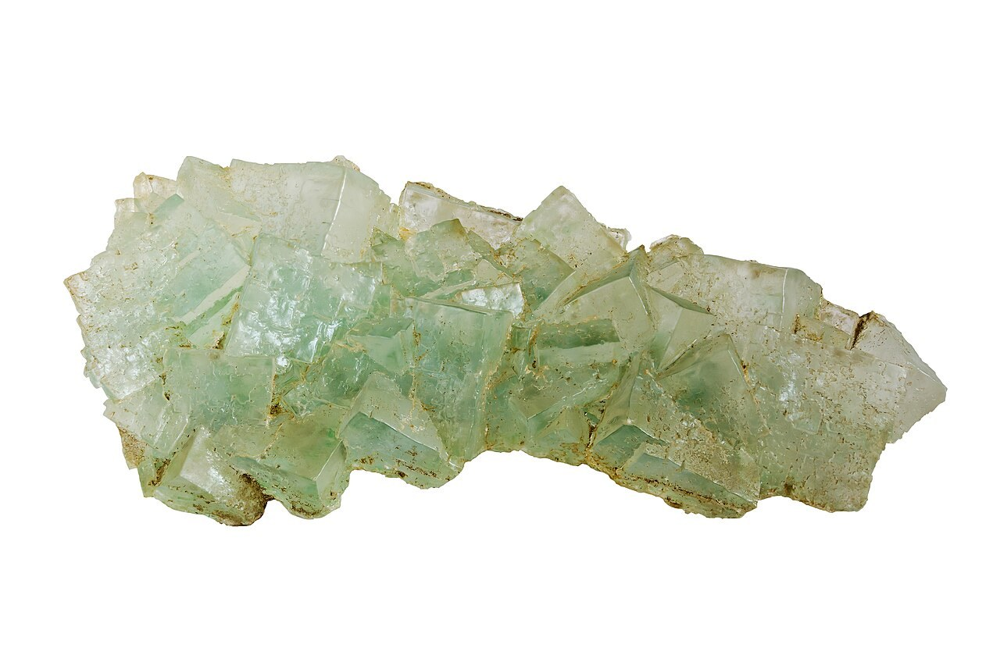

**2 ส่วน**  
- **พริกไทย** — เถา — รสร้อน · เถา — แก้เสมหะในทรวงอก แก้อติสาร (ท้องร่วงอย่างแรง)
  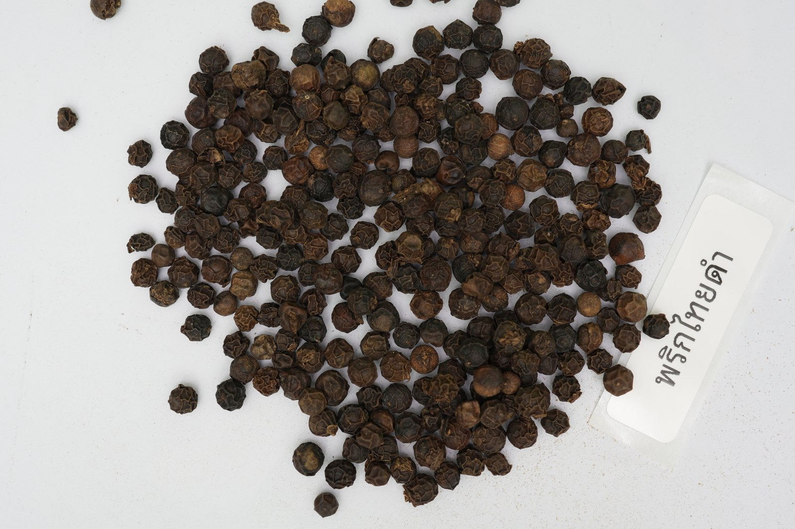
- **ขิง** — รสหวานเผ็ดร้อน · แก้ลมจุกเสียด แก้เสมหะ บำรุงธาตุ แก้คลื่นเหียนอาเจียน
  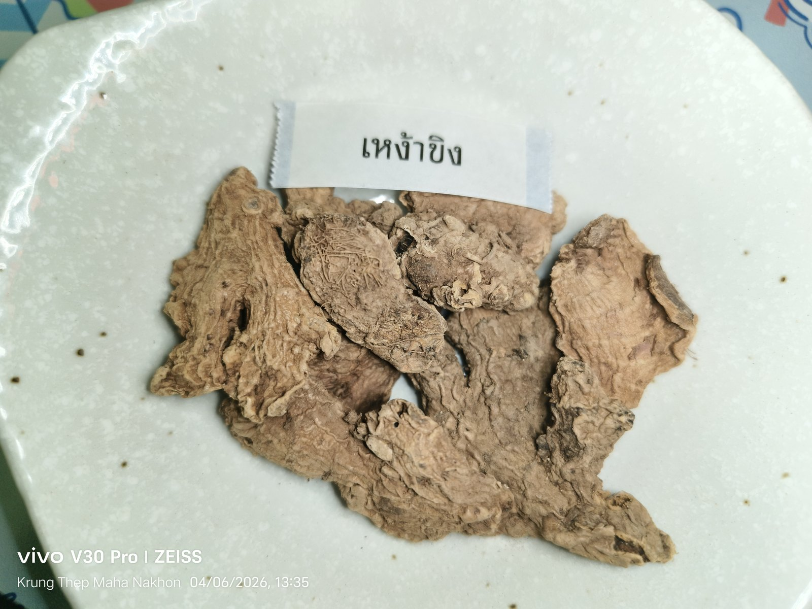
- **ดีปลี** — ดอก — รสร้อน · ดอก — แก้ปถวีธาตุพิการ แก้ท้องร่วง ขับลมในลำไส้
  
- **กระเทียม** — หัว — รสร้อนฉุน · หัว — แก้ไอ แก้โรคผิวหนัง กลาก เกลื้อน แผลเน่า เนื้อร้าย บำรุงธาตุ ขับโลหิตระดู แก้โรคประสาท น้ำคั้นจากหัว หยอดหู แก้ปวดหูและหูอื้อ
  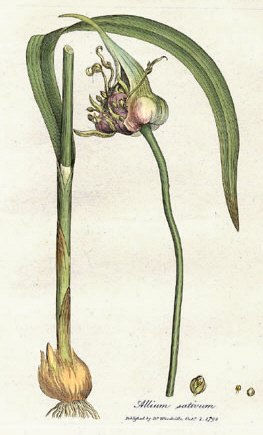

**8 ส่วน**  
- **ชะเอมเทศ** — ใบ — รสเฝื่อนหวาน · ใบ — ทำให้เสมหะแห้ง แก้ดีพิการ
  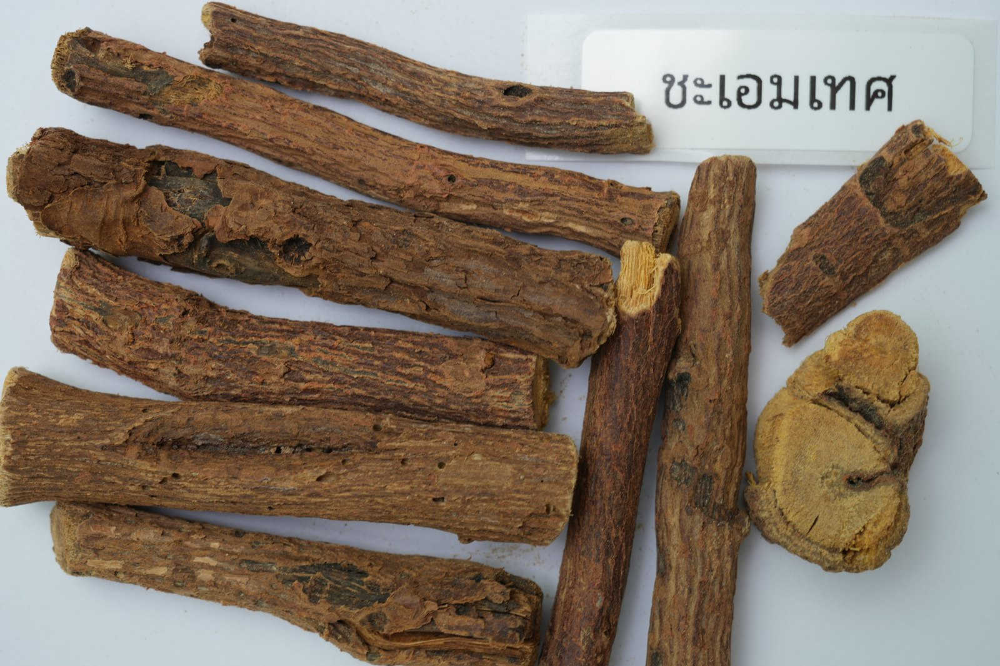
- **มหาหิงค์**
  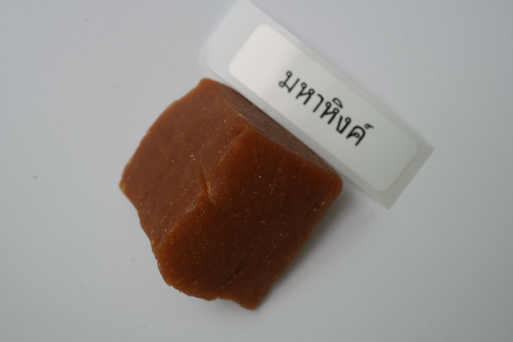

**20 ส่วน**  
- **ผิวมะกรูด** — ผล — รสเปรี้ยว · ผล — ใช้ทำยาดอง ฟอกโลหิตระดู ถอนพิษผิดสำแดง
  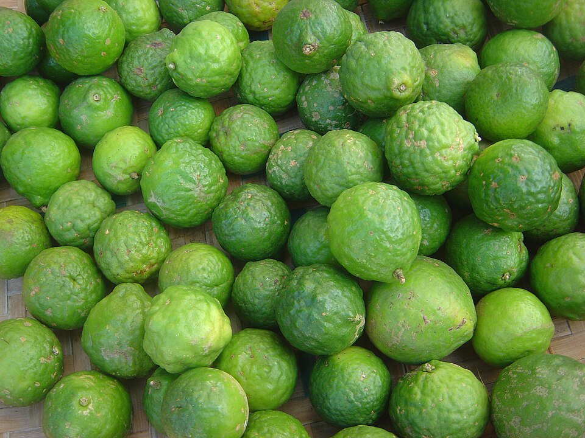

**45 ส่วน**  
- **ใบกะเพรา** — รสเผ็ดร้อน · เป็นยาตั้งธาตุ แก้ปวดท้อง ท้องขึ้น จุกเสียดในท้อง ใช้แต่งกลิ่นแต่งรสได้
  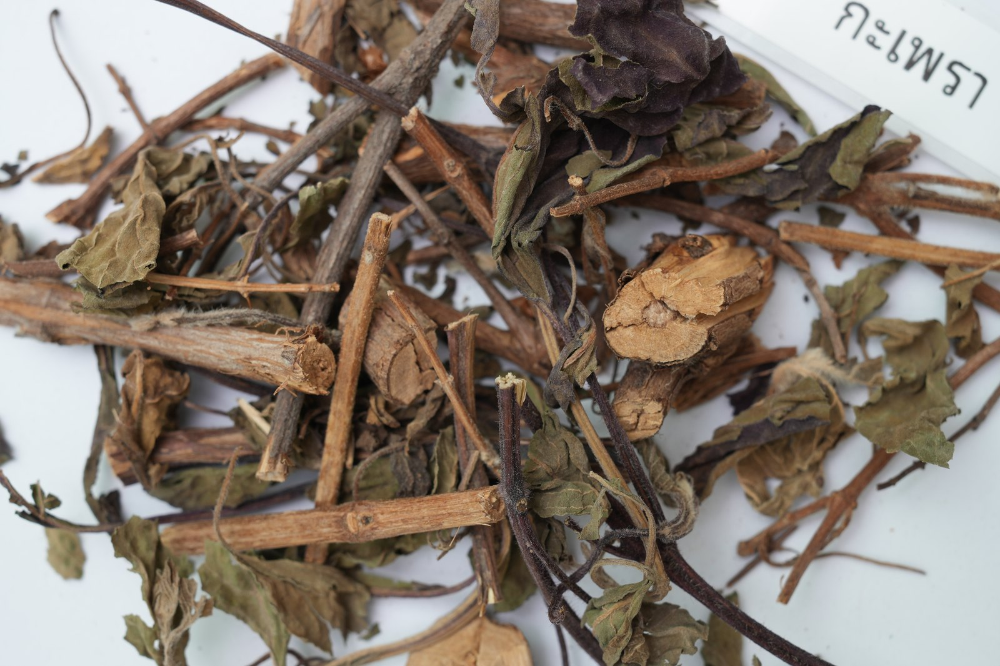

### สรรพคุณ

- แก้ท้องขึ้น ท้องเฟ้อ
- แก้ท้องแน่นจุกเสียด

### การใช้งาน

- วิธีทำ: บดเป็นผง ทำเป็นเม็ด หนักเม็ดละ 0.1 กรัม
- กระสายยา: น้ำสุก หรือน้ำใบกะเพราต้ม / ใช้ไพลเผาไฟพอสุก ฝนแทรก
- รับประทานเช้า–เย็น
- เด็ก 1–3 เดือน ครั้งละ 1–2 เม็ด
- เด็ก 4–6 เดือน ครั้งละ 2–3 เม็ด
- เด็ก 7–12 เดือน ครั้งละ 4–6 เม็ด

### บรรจุภัณฑ์

- ไม่เกิน 30 เม็ด

---

## 2) ยาวิสัมพยาใหญ่

*กลุ่ม: 1. กลุ่มยาขับลม แก้ท้องอืด ท้องเฟ้อ บำรุงธาตุ — รสประธาน: ร้อน*

### อัตราส่วนประกอบ

**2 ส่วน**  
- **กระวาน** — ใบ — รสเผ็ดเล็กน้อยกลิ่นหอม · ใบ — ขับลมให้ผายเรอ ขับเสมหะ แก้ไข้เซื่องซึม
  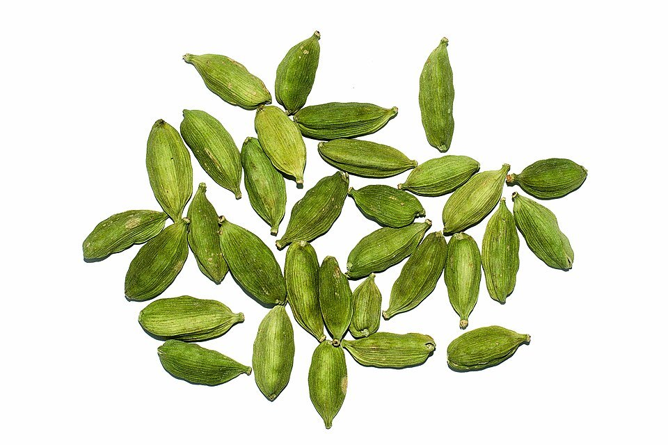
- **กานพลู** — ดอก — รสร้อน · ดอก — บำรุงธาตุ แก้ปวดท้อง แน่น จุกเสียด แก้รำมะนาด แก้ปวดฟัน แก้ปวดท้อง ท้องขึ้น แก้ท้องร่วง ชุบลำสีอุดฟันแก้ปวดฟัน ทุบ1 ดอกใส่ขวดนมให้เด็กรับประทาน
  
- **โกฐสอ** — ราก รสสุขมกลิ่นหอม · แก้ไข้ แก้หืด แก้ไอ บำรุงหัวใจให้ชุ่มชื้น
  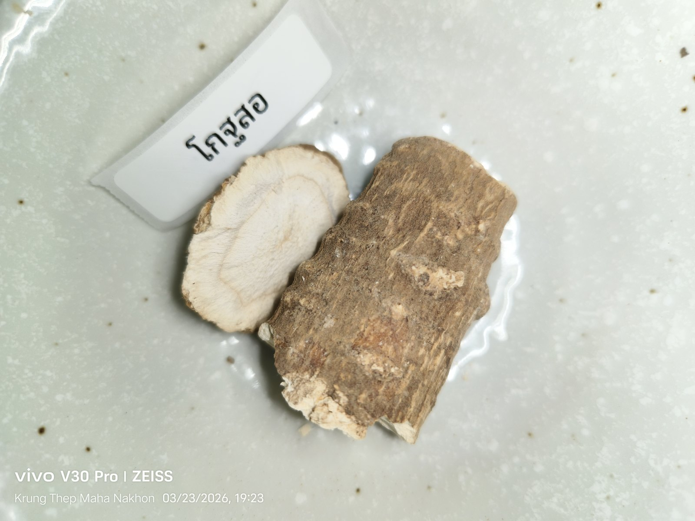
- **โกฐเขมา** — รสหวานอมขมเล็กน้อย เผ็ดร้อน · มีกลิ่นหอมเฉพาะ (เหง้าแห้ง) · ยาบำรุงธาตุ ขับลม บำรุงกำลัง · เจริญอาหาร · ขับปัสสาวะ
  .jpg)
- **โกฐหัวบัว**
  .jpg)
- **โกฐเชียง**
  .jpg)
- **โกฐจุฬาลัมพา** — ใช้ทั้งต้น รสขมกลิ่นหอม (ไม้ล้มลุกเนื้ออ่อน เป็นพุ่มขนาดย่อม) · แก้ไข้เจรียง แก้ไข้ที่มีผื่นขึ้นตามตัว (หัด เหือด สุกใส ดำแดง ฝีดาษ ไข้รากสาด) แก้หืด ไอ แก้ไข้เพื่อเสมหะ
  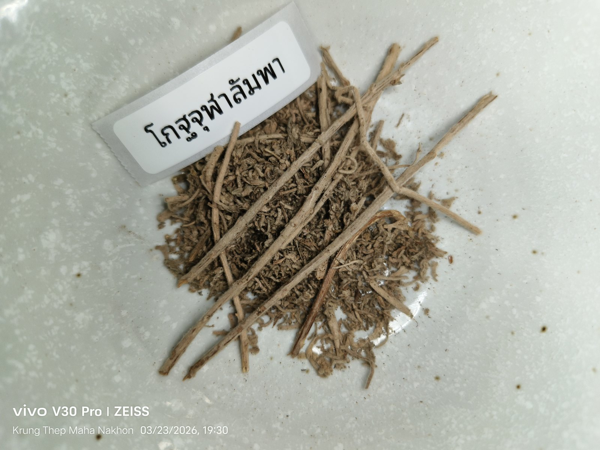
- **อบเชย** — เปลือกต้น — รสหอมติดร้อน · เปลือกต้น — บำรุงดวงจิต แก้อ่อนเพลีย
  
- **สมุลแว้ง** — เปลือกต้น — รสหอมฉุนปร่า · เปลือกต้น — แก้ลมวิงเวียน ใจสั่น แก้พิษหวัด กำเดา ขับลมในลำไส้ แก้ธาตุพิการ
  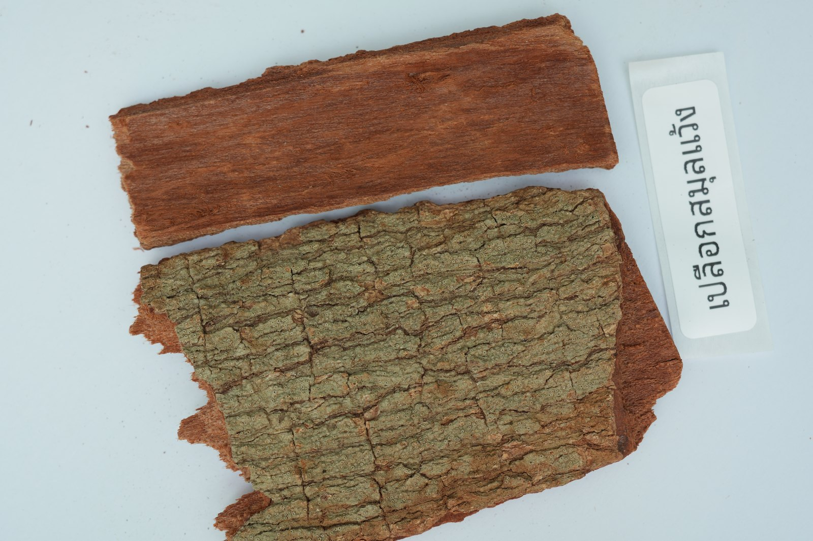
- **สมอเทศ** · ผลรสเปรี้ยวและฝาดจัด — ระบายอ่อนๆ ระบายเสมหะ ระบายลมรู้ถ่าย รู้ปิดเอง แก้เสมหะ ทำให้ลมเดินสะดวก
  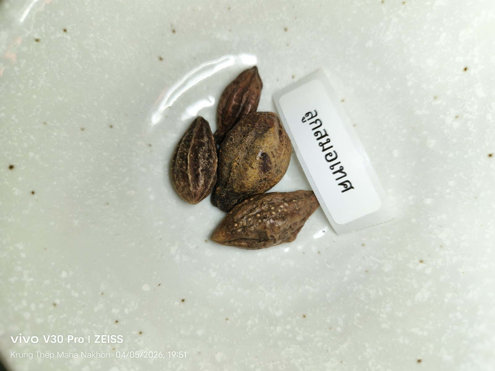
- **สมอไทย** — ผล — รสฝาดติดเปรี้ยว · ผล — ระบายอ่อนๆ แก้ลมป่วง แก้พิษร้อนภายใน คุมธาตุแก้ลมจุกเสียด รู้ผายธาตุ รู้ระบายรู้ถ่ายอุจจาระ ถ่ายพิษไข้ คุมธาตุในตัวเสร็จ แก้ไข้เพื่อเสมหะ
  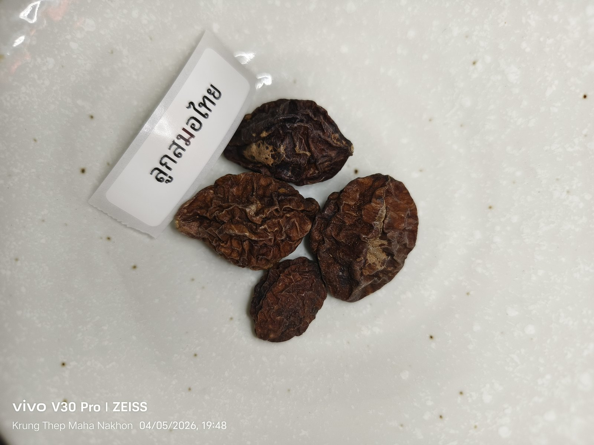
- **ว่านน้ำ** — เหง้า หรือ ราก — รสร้อนกลิ่นหอมแรง · เหง้า หรือ ราก — แก้บิด แก้ปวดท้อง แน่นจุกเสียด แก้ท้องขึ้นอืดเฟ้อ ฝนกับสุราทาหน้าอกเด็ก แก้ปวดและหลอดลมอักเสบ
  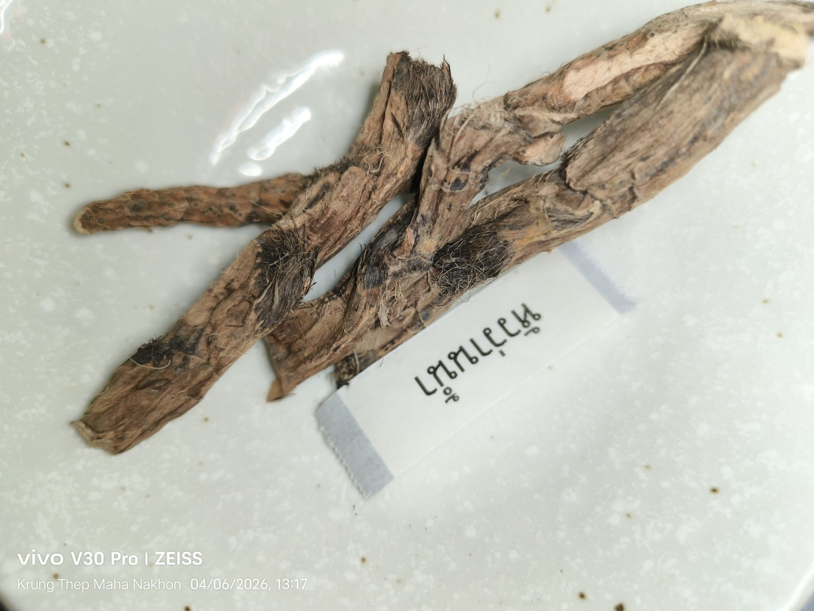
- **บอระเพ็ด** — เถา — รสขมเย็น · เถา — แก้พิษฝีดาษ ไข้เหนือ ไข้พิษ แก้ร้อนใน กระหายน้ำ ทำให้เนื้อเย็น สะอึก บำรุงกำลัง บำรุงน้ำดี บำรุงไฟธาตุ
  
- **ขิงแห้ง** — รสหวานเผ็ดร้อน · แก้ลมจุกเสียด แก้เสมหะ บำรุงธาตุ แก้คลื่นเหียนอาเจียน
  
- **พญารากขาว** — ราก — รสขม บำรุงธาตุ เจริญอาหาร แก้อ่อนเพลีย กินเป็นยาชูกำลังหลังฟื้นไข้
  

**8 ส่วน**  
- **ลูกผักชีลา** — ลูก — รสขมฝาดร้อนหอม · ลูก — แก้ไข้เนื่องจากซาง แก้กระหายน้ำ บำรุงธาตุ แก้คลื่นเหียน อาเจียน ขับลมในลำไส้ แก้สะอึก แก้ตาเจ็บ
  
- **ลูกจันทน์** — แก่น — รสร้อนหอม · แก่น — แก้ไข้สันนิบาต แก้ไข้เพื่อเลือดและลม
  
- **ดอกจันทน์** — แก่น — รสร้อนหอม · แก่น — แก้ไข้สันนิบาต แก้ไข้เพื่อเลือดและลม
  

**54 ส่วน**  
- **ดีปลี** — ดอก — รสร้อน · ดอก — แก้ปถวีธาตุพิการ แก้ท้องร่วง ขับลมในลำไส้
  

### สรรพคุณ

- แก้ท้องขึ้น อืดเฟ้อ จุกเสียด

### การใช้งาน

- วิธีทำ: ผง = บดเป็นผง / เม็ด = เม็ดละ 0.25 กรัม / แคปซูล = แคปซูลละ 0.25 กรัม
- รับประทานทุก 4 ชั่วโมง
- ชนิดผง: ผู้ใหญ่ ครั้งละ 1 ช้อนชา ใช้น้ำสุกเป็นกระสาย หรือผสมน้ำผึ้งปั้นเป็นลูกกลอน
- ชนิดเม็ด: ผู้ใหญ่ ครั้งละ 4 เม็ด
- ชนิดแคปซูล: ผู้ใหญ่ ครั้งละ 4 แคปซูล

### บรรจุภัณฑ์

- ผง ไม่เกิน 30 กรัม
- เม็ด ไม่เกิน 120 เม็ด
- แคปซูล ไม่เกิน 120 แคปซูล

---

## 3) ยาประสะกานพลู

*กลุ่ม: 1. กลุ่มยาขับลม แก้ท้องอืด ท้องเฟ้อ บำรุงธาตุ — รสประธาน: ร้อน*

### อัตราส่วนประกอบ

**1 ส่วน**  
- **เกลือสินเธาว์**
  

**2 ส่วน**  
- **พริกไทย** — เถา — รสร้อน · เถา — แก้เสมหะในทรวงอก แก้อติสาร (ท้องร่วงอย่างแรง)
  
- **ขิง** — รสหวานเผ็ดร้อน · แก้ลมจุกเสียด แก้เสมหะ บำรุงธาตุ แก้คลื่นเหียนอาเจียน
  
- **ดีปลี** — ดอก — รสร้อน · ดอก — แก้ปถวีธาตุพิการ แก้ท้องร่วง ขับลมในลำไส้
  
- **กระเทียม** — หัว — รสร้อนฉุน · หัว — แก้ไอ แก้โรคผิวหนัง กลาก เกลื้อน แผลเน่า เนื้อร้าย บำรุงธาตุ ขับโลหิตระดู แก้โรคประสาท น้ำคั้นจากหัว หยอดหู แก้ปวดหูและหูอื้อ
  

**4 ส่วน**  
- **เทียนดำ** — เมล็ด รสเผ็ดขม · ใบและต้น/เปลือกต้น รสจืดเฝื่อน · เมล็ด: ขับเสมหะให้ลงสู่คูถทวาร ขับลมในลำไส้ แก้อาเจียน บำรุงโลหิต
  
- **เทียนขาว** — เมล็ด รสเผ็ดร้อนขม (ไม้ต้นเล็ก ๆ — ยี่หร่า) · บำรุงกำลัง ขับผายลม แก้เส้นศูนย์กลางท้องพิการ แก้ชีพจรอ่อนหรือพิการ นอนสะดุ้งผวา (โทษน้ำดี) แก้คลั่งเพ้อ
  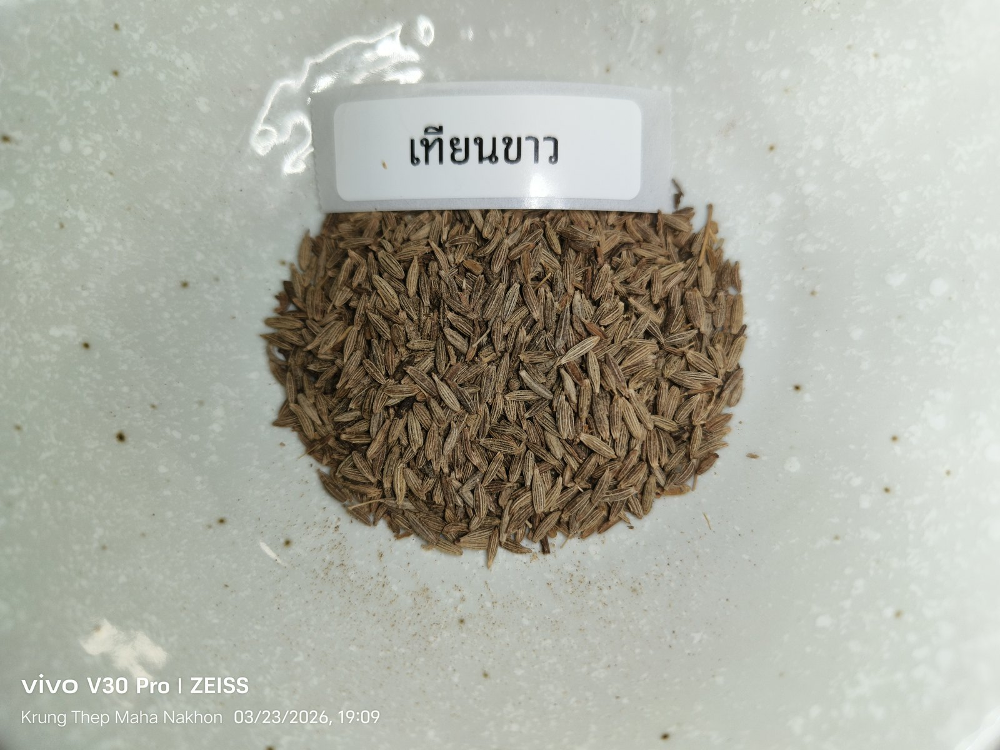
- **โกฐสอ** — ราก รสสุขมกลิ่นหอม · แก้ไข้ แก้หืด แก้ไอ บำรุงหัวใจให้ชุ่มชื้น
  
- **โกฐกระดูก** — เปลือกราก รสร้อน กลิ่นหอม (ไม้ต้นขนาดเล็กถึงกลาง จากประเทศจีน) · แก้ลมวิงเวียน หน้ามืด ตาลาย ขับลมในลำไส้ แก้โลหิตจาง
  
- **กำมะถันเหลือง**
  
- **การบูร** — รสร้อน (การบูรเกล็ด) — ตาม บทที่ 2.MD · แก้ปวดท้อง จุกเสียด
  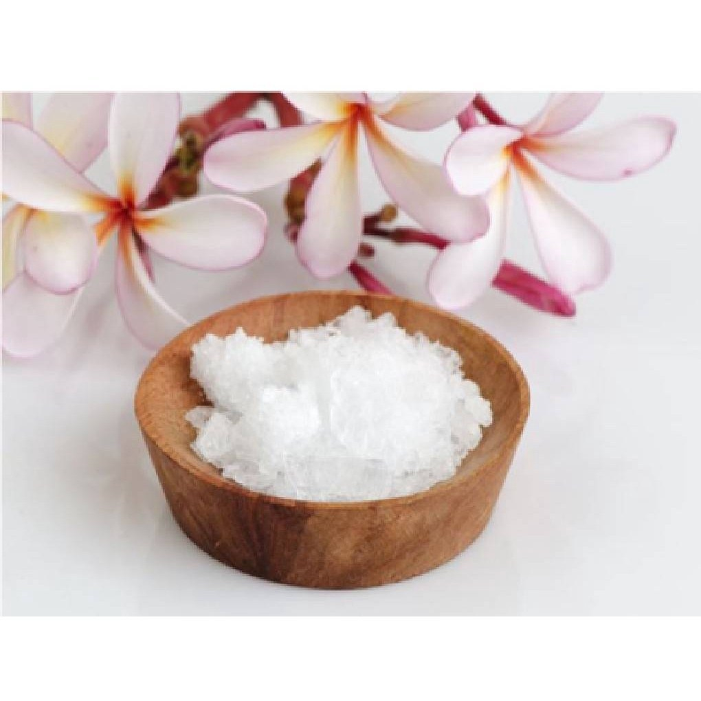
- **เปลือกเพกา** — เปลือกต้น — รสฝาดเย็นขมเล็กน้อย · เปลือกต้น — ตำกับสุรา ทา พ่นตามตัวสตรีที่ทนการอยู่ไฟไม่ได้ ทำให้หนังชา สมานแผล ทำให้น้ำเหลืองปกติ ดับพิษโลหิต
  
- **เปลือกขี้อ้าย** · เปลือกต้นรสฝาด — แก้บิด แก้อุจจาระเป็นฟอง แก้ปวดเบ่ง สมานแผล
  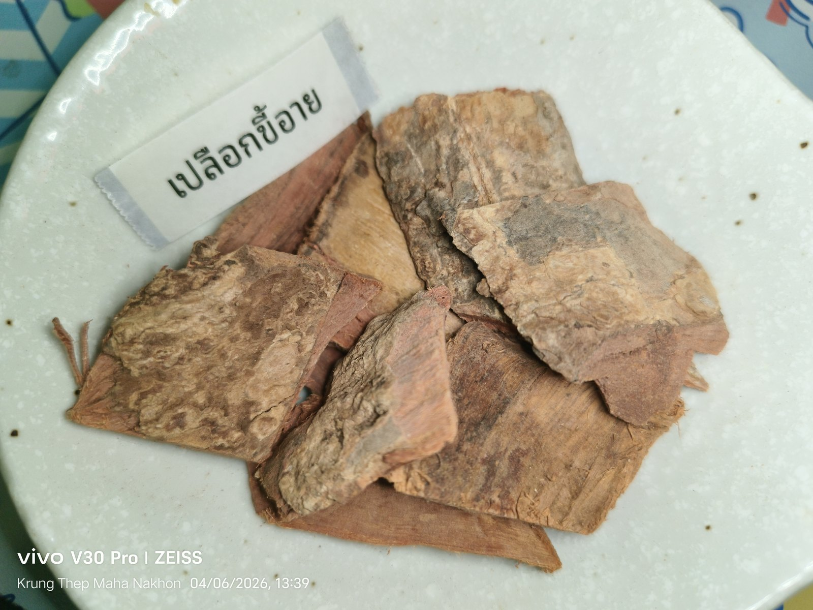
- **ใบกระวาน** — ใบ — รสเผ็ดเล็กน้อยกลิ่นหอม · ใบ — ขับลมให้ผายเรอ ขับเสมหะ แก้ไข้เซื่องซึม
  
- **ลูกกระวาน** — ใบ — รสเผ็ดเล็กน้อยกลิ่นหอม · ใบ — ขับลมให้ผายเรอ ขับเสมหะ แก้ไข้เซื่องซึม
  
- **ลูกผักชีลา** — ลูก — รสขมฝาดร้อนหอม · ลูก — แก้ไข้เนื่องจากซาง แก้กระหายน้ำ บำรุงธาตุ แก้คลื่นเหียน อาเจียน ขับลมในลำไส้ แก้สะอึก แก้ตาเจ็บ
  
- **แฝกหอม**
  
- **ว่านน้ำ** — เหง้า หรือ ราก — รสร้อนกลิ่นหอมแรง · เหง้า หรือ ราก — แก้บิด แก้ปวดท้อง แน่นจุกเสียด แก้ท้องขึ้นอืดเฟ้อ ฝนกับสุราทาหน้าอกเด็ก แก้ปวดและหลอดลมอักเสบ
  
- **หัวกระชาย** — หัว — รสเผ็ดร้อนขมหอม · หัว — แก้ปากเปื่อย ปากแตกเป็นแผล ขับระดูขาว แก้ใจสั่น แก้ปวดมวนในท้อง แก้บิดมูกเลือด บำรุงกำลัง
  
- **เปราะหอม** — หัว ใบ — รสร้อนหอม · หัว ใบ — ขับลมในลำไส้ให้ผายเรอ แก้ท้องขึ้นอืดเฟ้อ ทำยาสุมขม่อมเด็ก แก้หวัด กำเดา ซางชัก และลมซาง
  
- **รากแจง**
  
- **กรุงเขมา** — ราก — รสเย็นหอมสุขุม · ราก — แก้ไข้ที่มีพิษร้อน แก้ดีซ่าน บำรุงร่างกายให้แข็งแรง
  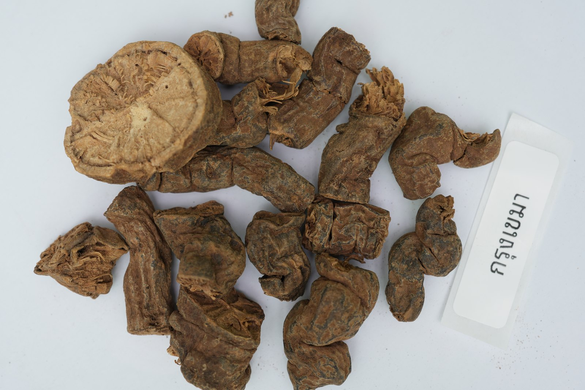

**8 ส่วน**  
- **รากข้าวสาร** — ราก — รสเย็นเบื่อ · ราก — แก้ตาแดง ตาแฉะ ตามัว
  
- **เนื้อไม้** — รสขมหวาน · บำรุงโลหิต หัวใจ ตับ ปอด แก้ลมหน้ามืดวิงเวียน
  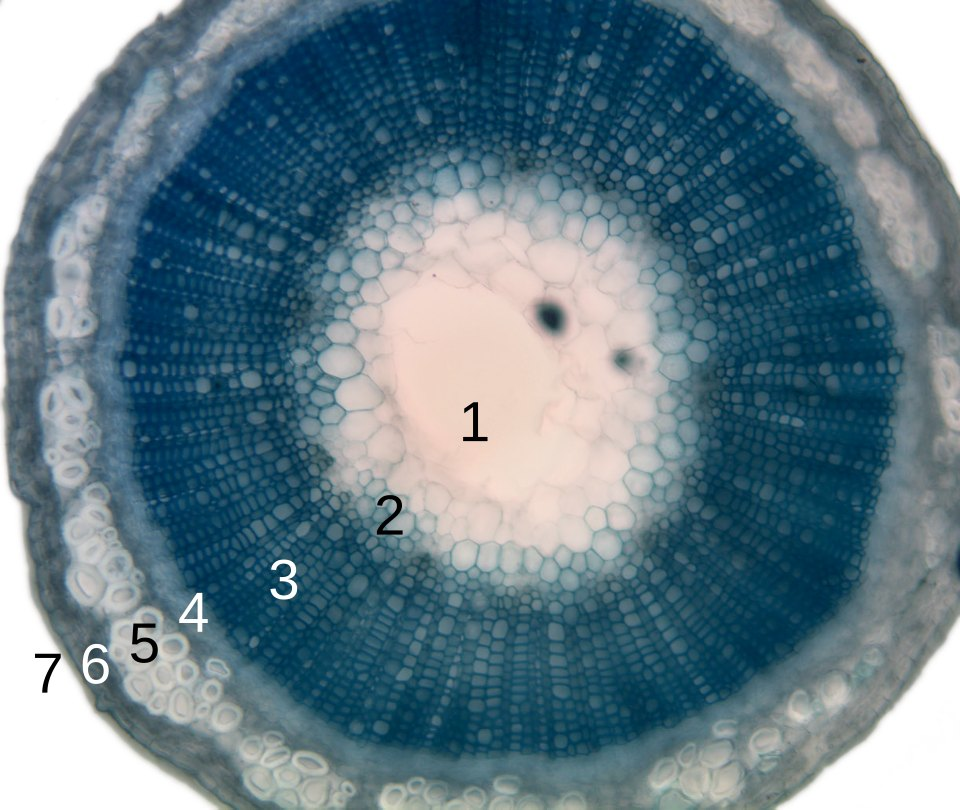
- **ลูกจันทน์** — แก่น — รสร้อนหอม · แก่น — แก้ไข้สันนิบาต แก้ไข้เพื่อเลือดและลม
  
- **ขมิ้นชัน** — หัว — รสฝาดเอียน · หัว — แก้ไข้เพื่อดี คลั่งเพ้อ แก้ไข้เรื้อรังผอมเหลือง แก้โรคผิวหนัง แก้เสมหะและโลหิต แก้ท้องร่วง สมานแผล
  

**10 ส่วน**  
- **เปลือกซิก**

**125 ส่วน**  
- **กานพลู** — ดอก — รสร้อน · ดอก — บำรุงธาตุ แก้ปวดท้อง แน่น จุกเสียด แก้รำมะนาด แก้ปวดฟัน แก้ปวดท้อง ท้องขึ้น แก้ท้องร่วง ชุบลำสีอุดฟันแก้ปวดฟัน ทุบ1 ดอกใส่ขวดนมให้เด็กรับประทาน
  

### สรรพคุณ

- แก้ปวดท้องเนื่องจากธาตุไม่ปกติ

### การใช้งาน

- วิธีทำ: ผง = บดเป็นผง / เม็ด = เม็ดละ 0.25 กรัม / แคปซูล = แคปซูลละ 0.25 กรัม
- กระสายยา: ใช้ไพลเผาไฟฝนกับน้ำปูนใส ถ้าหาน้ำกระสายไม่ได้ให้ใช้น้ำสุกแทน
- รับประทานทุก 3 ชั่วโมง
- ชนิดผง: ผู้ใหญ่ ครั้งละ 1 ช้อนชา
- ชนิดเม็ด: ผู้ใหญ่ ครั้งละ 2–4 เม็ด
- ชนิดแคปซูล: ผู้ใหญ่ ครั้งละ 2–4 แคปซูล

### บรรจุภัณฑ์

- ผง ไม่เกิน 15 กรัม
- เม็ด ไม่เกิน 60 เม็ด
- แคปซูล ไม่เกิน 60 แคปซูล

---

## 5) ยามันทธาตุ

*กลุ่ม: 1. กลุ่มยาขับลม แก้ท้องอืด ท้องเฟ้อ บำรุงธาตุ — รสประธาน: ร้อน*

### อัตราส่วนประกอบ

**1 ส่วน**  
- **โกฐสอ** — ราก รสสุขมกลิ่นหอม · แก้ไข้ แก้หืด แก้ไอ บำรุงหัวใจให้ชุ่มชื้น
  
- **โกฐเขมา** — รสหวานอมขมเล็กน้อย เผ็ดร้อน · มีกลิ่นหอมเฉพาะ (เหง้าแห้ง) · ยาบำรุงธาตุ ขับลม บำรุงกำลัง · เจริญอาหาร · ขับปัสสาวะ
  .jpg)
- **โกฐหัวบัว**
  .jpg)
- **โกฐเชียง**
  .jpg)
- **โกฐจุฬาลัมพา** — ใช้ทั้งต้น รสขมกลิ่นหอม (ไม้ล้มลุกเนื้ออ่อน เป็นพุ่มขนาดย่อม) · แก้ไข้เจรียง แก้ไข้ที่มีผื่นขึ้นตามตัว (หัด เหือด สุกใส ดำแดง ฝีดาษ ไข้รากสาด) แก้หืด ไอ แก้ไข้เพื่อเสมหะ
  
- **เทียนดำ** — เมล็ด รสเผ็ดขม · ใบและต้น/เปลือกต้น รสจืดเฝื่อน · เมล็ด: ขับเสมหะให้ลงสู่คูถทวาร ขับลมในลำไส้ แก้อาเจียน บำรุงโลหิต
  
- **เทียนแดง** — เมล็ด รสเผ็ดร้อนขมเล็กน้อย (ไม้ต้นเล็ก ๆ คล้ายผักชี) · ขับเสมหะ แก้ลม แก้น้ำดีพิการ แก้ลมเสียดแทง แก้คลื่นเหียนอาเจียน
  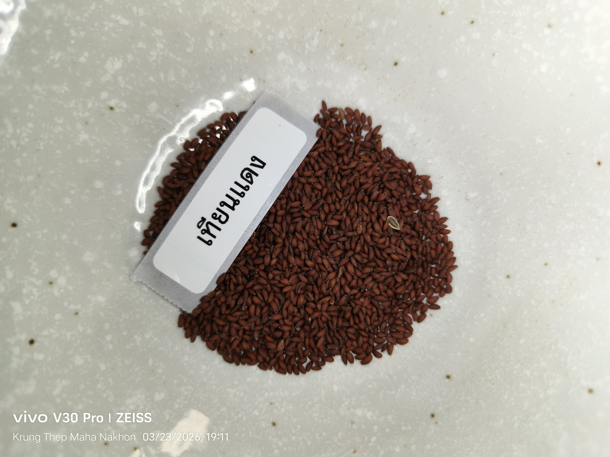
- **เทียนขาว** — เมล็ด รสเผ็ดร้อนขม (ไม้ต้นเล็ก ๆ — ยี่หร่า) · บำรุงกำลัง ขับผายลม แก้เส้นศูนย์กลางท้องพิการ แก้ชีพจรอ่อนหรือพิการ นอนสะดุ้งผวา (โทษน้ำดี) แก้คลั่งเพ้อ
  
- **เทียนข้าวเปลือก**
  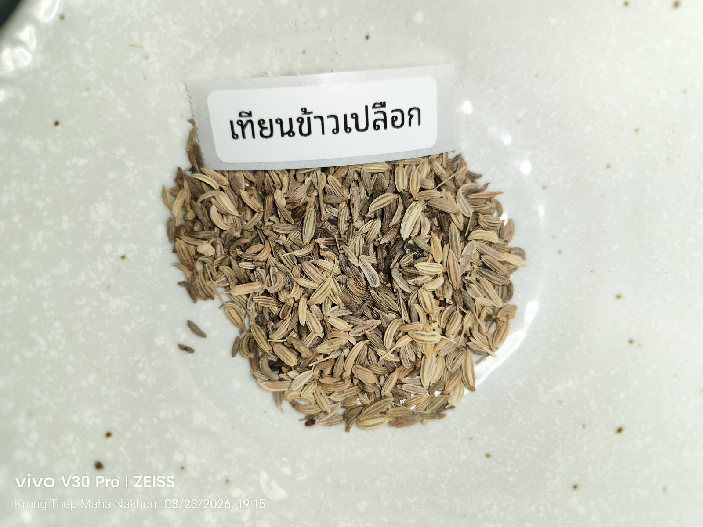
- **เทียนตาตั๊กแตน** — เมล็ด รสขมเผ็ดร้อนเล็กน้อย · บำรุงธาตุ แก้เสมหะพิการ แก้กำเดา
  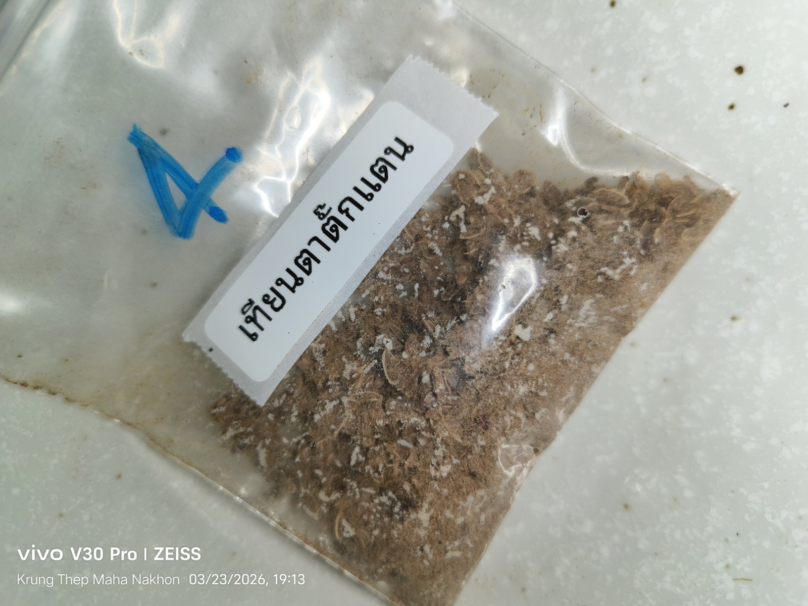
- **ลูกผักชีล้อม** — เมล็ด — รสผอมร้อนเล็กน้อย · เมล็ด — ขับลมในลำไส้ แก้ธาตุพิการ แก้ไอ แก้หอบ บำรุงปอด
  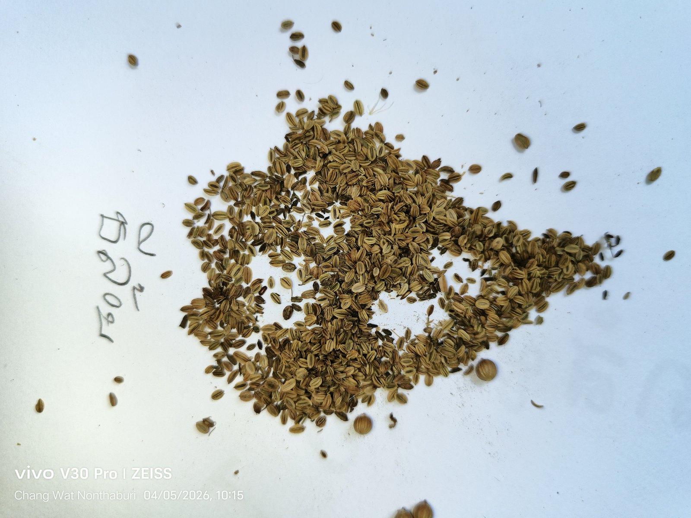
- **ลูกผักชีลา** — ลูก — รสขมฝาดร้อนหอม · ลูก — แก้ไข้เนื่องจากซาง แก้กระหายน้ำ บำรุงธาตุ แก้คลื่นเหียน อาเจียน ขับลมในลำไส้ แก้สะอึก แก้ตาเจ็บ
  
- **การบูร** — รสร้อน (การบูรเกล็ด) — ตาม บทที่ 2.MD · แก้ปวดท้อง จุกเสียด
  
- **กระเทียม** — หัว — รสร้อนฉุน · หัว — แก้ไอ แก้โรคผิวหนัง กลาก เกลื้อน แผลเน่า เนื้อร้าย บำรุงธาตุ ขับโลหิตระดู แก้โรคประสาท น้ำคั้นจากหัว หยอดหู แก้ปวดหูและหูอื้อ
  
- **เปลือกสมุลแว้ง** — เปลือกต้น — รสหอมฉุนปร่า · เปลือกต้น — แก้ลมวิงเวียน ใจสั่น แก้พิษหวัด กำเดา ขับลมในลำไส้ แก้ธาตุพิการ
  
- **เปลือกโมกมัน** — เปลือกตัน — รสฝาดเมา · เปลือกตัน — บำรุงธาตุให้เป็นปกติ แก้คุดทะราด
  
- **จันทน์แดง** — เนื้อไม้ และแก่น — รสขมเย็น · เนื้อไม้ และแก่น — แก้ไอ แก้ซางอันบังเกิดแต่ดี แก้เลือดออกตามไรฟัน แก้บาดแผล แก้ไข้เพื่อดีพิการทำให้ชื่นใจ แก้ร้อนดับพิษไข้ทุกชนิด ฝนทาแก้ฟกบวม
  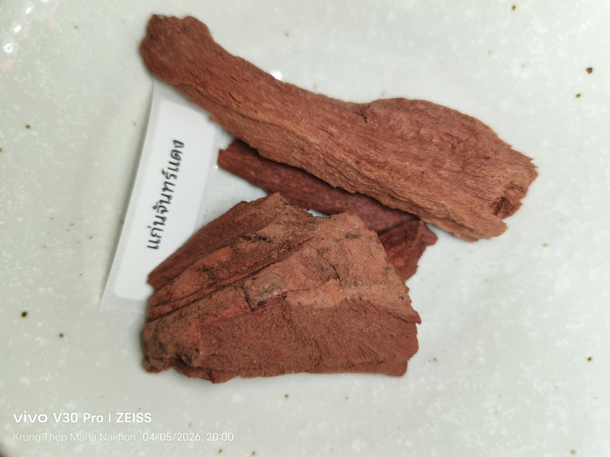
- **จันทน์เทศ** — เนื้อไม้และแก่น — รสขมหอมร้อน · เนื้อไม้และแก่น — แก้ไข้ดีเดือด ดีพลุ่ง แก้กระสับกระส่าย ตาลอยเผลอสติ บำรุงตับ ปอด น้ำดี
  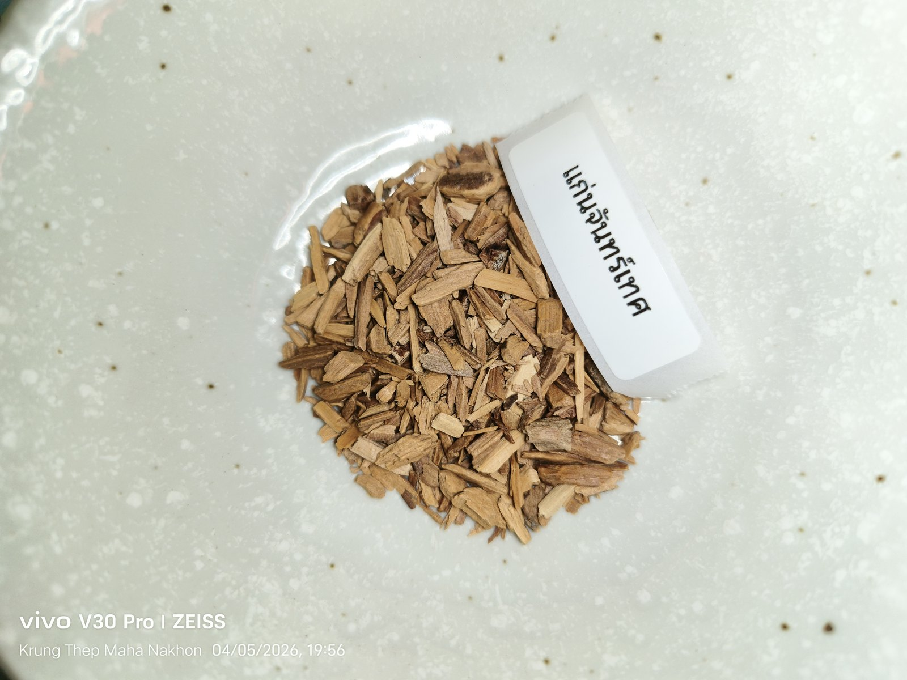
- **กานพลู** — ดอก — รสร้อน · ดอก — บำรุงธาตุ แก้ปวดท้อง แน่น จุกเสียด แก้รำมะนาด แก้ปวดฟัน แก้ปวดท้อง ท้องขึ้น แก้ท้องร่วง ชุบลำสีอุดฟันแก้ปวดฟัน ทุบ1 ดอกใส่ขวดนมให้เด็กรับประทาน
  
- **ดีปลี** — ดอก — รสร้อน · ดอก — แก้ปถวีธาตุพิการ แก้ท้องร่วง ขับลมในลำไส้
  
- **รากช้าพลู** — ราก — รสเผ็ดร้อนเล็กน้อย · ราก — แก้คูถเสมหะ ขับเสมหะให้ตกทางทวารหนัก
  
- **เถาสะค้าน**
  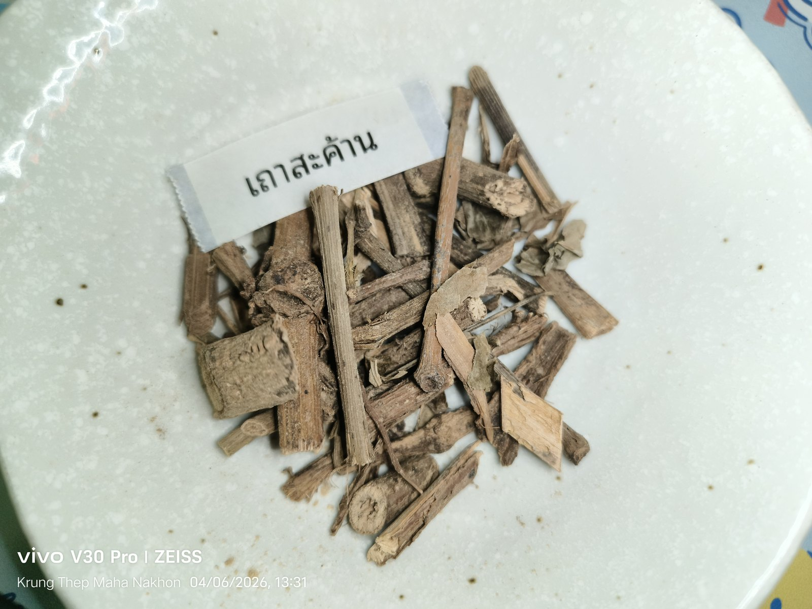
- **รากเจตมูลเพลิงแดง** — ราก — รสร้อน · ราก — บำรุงธาตุ บำรุงโลหิต ขับลมในลำไส้และกระเพาะอาหารให้เรอ แก้ท้องอืด เฟ้อ เสียด แน่นหน้าอก ทำให้ร่างกายเกิดความอบอุ่น ถ้ารับประทานมาก ทำให้แท้งลูก บดเป็นผงปิดพอกฝี ทำให้เกิดความร้อน เกลื่อนฝีได้ แก้ริดสีดวงทวาร
  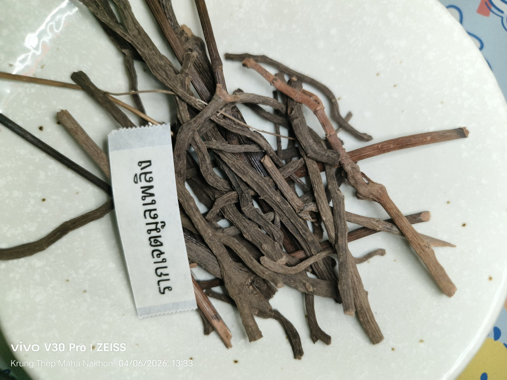
- **พริกไทยล่อน** — เถา — รสร้อน · เถา — แก้เสมหะในทรวงอก แก้อติสาร (ท้องร่วงอย่างแรง)
  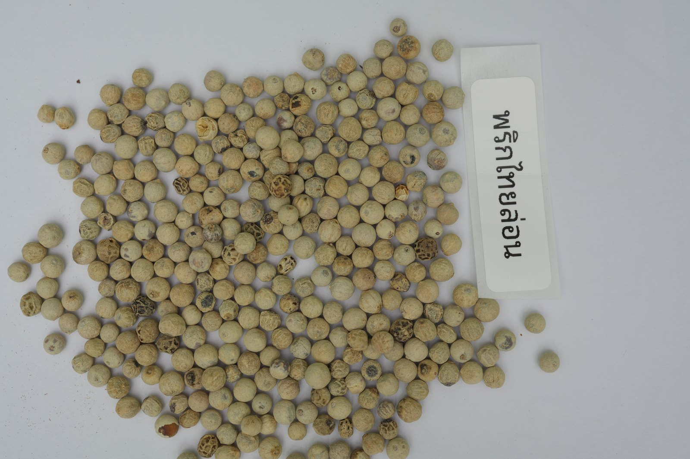
- **ลูกจันทน์** — แก่น — รสร้อนหอม · แก่น — แก้ไข้สันนิบาต แก้ไข้เพื่อเลือดและลม
  

**3 ส่วน**  
- **ขิง** — รสหวานเผ็ดร้อน · แก้ลมจุกเสียด แก้เสมหะ บำรุงธาตุ แก้คลื่นเหียนอาเจียน
  
- **ลูกเบญกานี** · รสฝาดจัด — แก้ท้องร่วง บิด ปวดเบ่ง แก้อาเจียน สมานแผล
  

### สรรพคุณ

- แก้ธาตุไม่ปกติ
- แก้ท้องขึ้น ท้องเฟ้อ

### การใช้งาน

- วิธีทำ: ผง = บดเป็นผง / เม็ด = เม็ดละ 0.25 กรัม / แคปซูล = แคปซูลละ 0.25 กรัม
- รับประทานวันละ 3 ครั้ง ก่อนอาหาร
- ชนิดผง: เด็ก 6–12 ปี ครั้งละ ½ ช้อนชา, ผู้ใหญ่ ครั้งละ 1 ช้อนชา (ละลายน้ำสุก)
- ชนิดเม็ด: เด็ก 6–12 ปี ครั้งละ 1–2 เม็ด, ผู้ใหญ่ ครั้งละ 2–4 เม็ด
- ชนิดแคปซูล: เด็ก 6–12 ปี ครั้งละ 1–2 แคปซูล, ผู้ใหญ่ ครั้งละ 2–4 แคปซูล

### บรรจุภัณฑ์

- ผง ไม่เกิน 30 กรัม
- เม็ด ไม่เกิน 120 เม็ด
- แคปซูล ไม่เกิน 120 แคปซูล

---

## 6) ยาประสะเจตพังคี

*กลุ่ม: 1. กลุ่มยาขับลม แก้ท้องอืด ท้องเฟ้อ บำรุงธาตุ — รสประธาน: ร้อน*

### อัตราส่วนประกอบ

**1 ส่วน**  
- **ดอกจันทน์** — แก่น — รสร้อนหอม · แก่น — แก้ไข้สันนิบาต แก้ไข้เพื่อเลือดและลม
  
- **ลูกจันทน์** — แก่น — รสร้อนหอม · แก่น — แก้ไข้สันนิบาต แก้ไข้เพื่อเลือดและลม
  
- **ลูกกระวาน** — ใบ — รสเผ็ดเล็กน้อยกลิ่นหอม · ใบ — ขับลมให้ผายเรอ ขับเสมหะ แก้ไข้เซื่องซึม
  
- **ใบกระวาน** — ใบ — รสเผ็ดเล็กน้อยกลิ่นหอม · ใบ — ขับลมให้ผายเรอ ขับเสมหะ แก้ไข้เซื่องซึม
  
- **กานพลู** — ดอก — รสร้อน · ดอก — บำรุงธาตุ แก้ปวดท้อง แน่น จุกเสียด แก้รำมะนาด แก้ปวดฟัน แก้ปวดท้อง ท้องขึ้น แก้ท้องร่วง ชุบลำสีอุดฟันแก้ปวดฟัน ทุบ1 ดอกใส่ขวดนมให้เด็กรับประทาน
  
- **กรุงเขมา** — ราก — รสเย็นหอมสุขุม · ราก — แก้ไข้ที่มีพิษร้อน แก้ดีซ่าน บำรุงร่างกายให้แข็งแรง
  
- **การบูร** — รสร้อน (การบูรเกล็ด) — ตาม บทที่ 2.MD · แก้ปวดท้อง จุกเสียด
  
- **ลูกสมอทะเล** — ใบและผล — รสร้อน · ใบและผล — ถ่ายอุจจาระ ถ่ายลม ถ่ายโลหิตเป็นพิษ (ห้ามใช้ถ่ายในผู้ป่วยเป็นไข้) ใบนึ่งให้สุกเสียก่อนตากแห้งจึงใช้ทำยา
  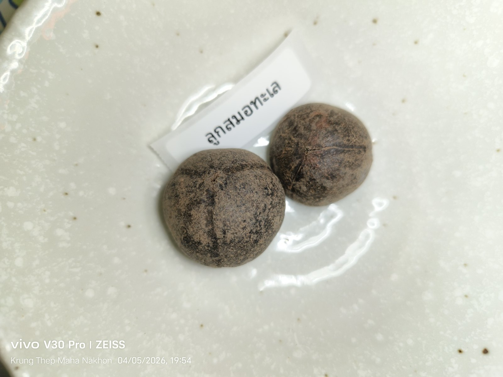
- **พญารากขาว** — ราก — รสขม บำรุงธาตุ เจริญอาหาร แก้อ่อนเพลีย กินเป็นยาชูกำลังหลังฟื้นไข้
  
- **เปลือกหว้า** — เปลือกต้น — รสฝาด · เปลือกต้น — แก้บิด แก้ปากเปื่อย คอเปื่อยเป็นเม็ดเนื่องจากร้อนในแก้น้ำลายเหนียว
  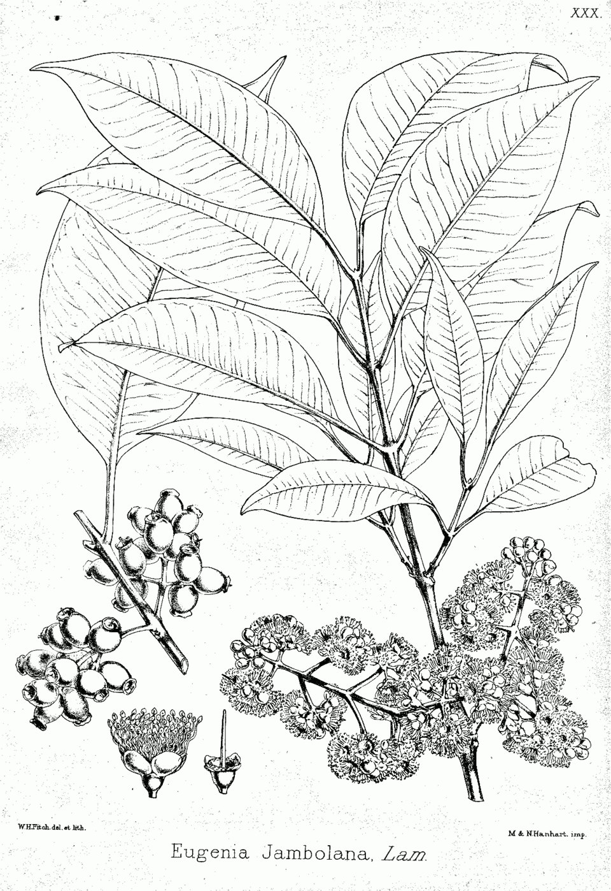
- **เกลือสินเธาว์**
  

**2 ส่วน**  
- **พริกไทยล่อน** — เถา — รสร้อน · เถา — แก้เสมหะในทรวงอก แก้อติสาร (ท้องร่วงอย่างแรง)
  
- **บอระเพ็ด** — เถา — รสขมเย็น · เถา — แก้พิษฝีดาษ ไข้เหนือ ไข้พิษ แก้ร้อนใน กระหายน้ำ ทำให้เนื้อเย็น สะอึก บำรุงกำลัง บำรุงน้ำดี บำรุงไฟธาตุ
  
- **ระย่อม** — ราก — รสขมเมานิดหน่อย · ราก — แก้ปวดศีรษะเนื่องจากความดันโลหิตสูง แก้คลุ้มคลั่ง เนื่องจากดีและโลหิต ช่วยย่อยอาหารและระงับประสาท ถ้ากินจะมีอาการข้างเคียง คือ หน้าแดง ตัวแดง แน่นจมูก และง่วงนอน (ก่อนใช้ต้องคั่วให้เหลืองเสียก่อน อาการแทรกซ้อนจะน้อยลง
  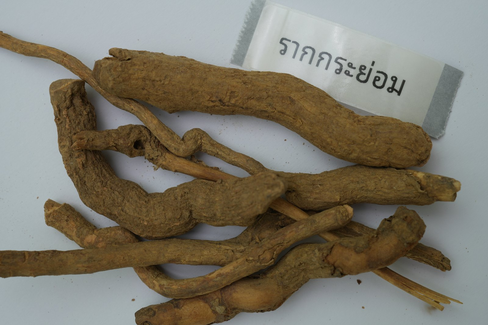

**16 ส่วน**  
- **ข่า** · เหง้าข่า รสเผ็ดปร่า ขับลมแก้บวมฟกซ้ำ
  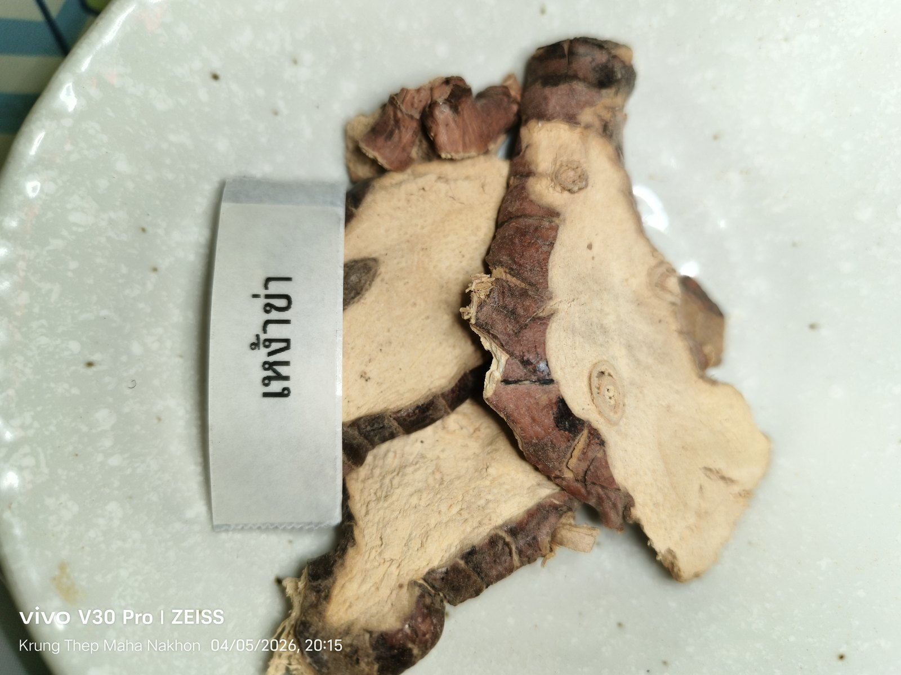

**33 ส่วน**  
- **เจตพังคี** — ราก — รสเผ็ดขื่นปร่า · ราก — แก้ท้องขึ้นปวดแน่นในท้อง ขับลมทำให้เรอ ฝนกับน้ำปูนใส ผสมกับมหาหิงคุ์และการบูรทาท้องเด็กอ่อน แก้ท้องขึ้นอืดเฟ้อ แก้ปวดท้อง ขับผายลม
  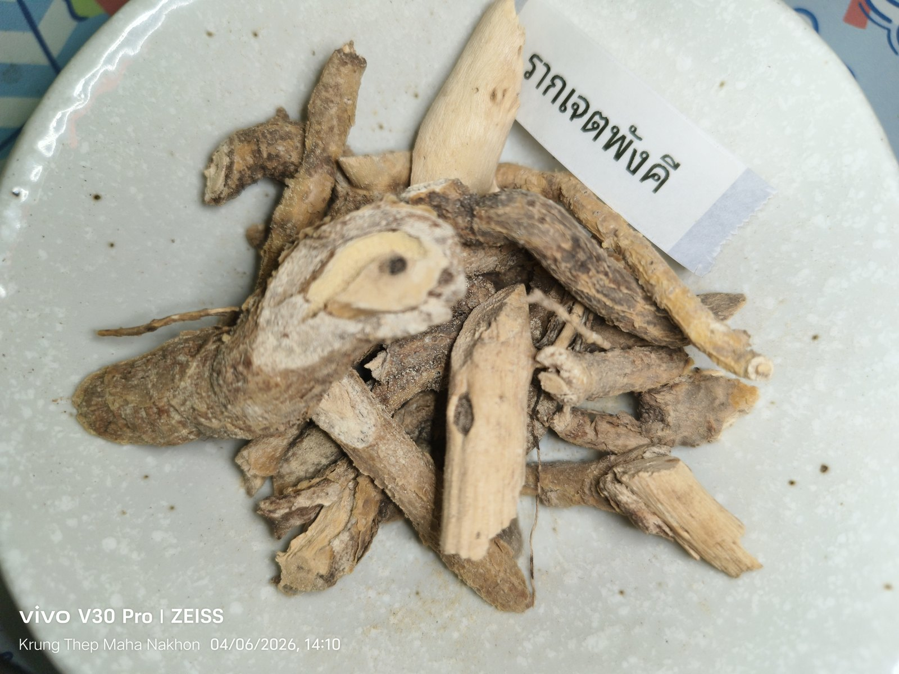

### สรรพคุณ

- แก้กษัยจุกเสียด

### การใช้งาน

- วิธีทำ: ผง = บดเป็นผง / เม็ด = เม็ดละ 0.25 กรัม / แคปซูล = แคปซูลละ 0.25 กรัม
- รับประทานเช้าและเย็น ก่อนอาหาร
- ชนิดผง: ครั้งละ 1 ช้อนชา ละลายน้ำสุก
- ชนิดเม็ด: ครั้งละ 2–4 เม็ด
- ชนิดแคปซูล: ครั้งละ 2–4 แคปซูล

### บรรจุภัณฑ์

- ผง ไม่เกิน 15 กรัม
- เม็ด ไม่เกิน 60 เม็ด
- แคปซูล ไม่เกิน 60 แคปซูล

---

## 7) ยามหาจักรใหญ่

*กลุ่ม: 1. กลุ่มยาขับลม แก้ท้องอืด ท้องเฟ้อ บำรุงธาตุ — รสประธาน: ร้อน*

### อัตราส่วนประกอบ

**1 ส่วน**  
- **โกฐสอ** — ราก รสสุขมกลิ่นหอม · แก้ไข้ แก้หืด แก้ไอ บำรุงหัวใจให้ชุ่มชื้น
  
- **โกฐเขมา** — รสหวานอมขมเล็กน้อย เผ็ดร้อน · มีกลิ่นหอมเฉพาะ (เหง้าแห้ง) · ยาบำรุงธาตุ ขับลม บำรุงกำลัง · เจริญอาหาร · ขับปัสสาวะ
  .jpg)
- **โกฐพุงปลา** — ลูก รสฝาด (ไม้อาศัยเกาะต้นไม้อื่น คล้ายกล้วยไม้ เป็นไม้ล้มลุกเนื้ออ่อน) · แก้ท้องร่วง แก้อาเจียน แก้บิด แก้ปวดเบ่ง แก้เสมหะพิการ สมานแผล
  
- **โกฐก้านพร้าว** — รสขมจัด · มีกลิ่นหอมเฉพาะตัว (เหง้าแห้ง มีข้อคล้ายหางหนูมะพร้าว) · ตำราโบราณไทย: แก้ไข้เรื้อรัง แก้ไข้ซึ่งมีอาการสะอึก แก้หอบ แก้เสมหะเป็นพิษ
  
- **โกฐกระดูก** — เปลือกราก รสร้อน กลิ่นหอม (ไม้ต้นขนาดเล็กถึงกลาง จากประเทศจีน) · แก้ลมวิงเวียน หน้ามืด ตาลาย ขับลมในลำไส้ แก้โลหิตจาง
  
- **เทียนดำ** — เมล็ด รสเผ็ดขม · ใบและต้น/เปลือกต้น รสจืดเฝื่อน · เมล็ด: ขับเสมหะให้ลงสู่คูถทวาร ขับลมในลำไส้ แก้อาเจียน บำรุงโลหิต
  
- **เทียนแดง** — เมล็ด รสเผ็ดร้อนขมเล็กน้อย (ไม้ต้นเล็ก ๆ คล้ายผักชี) · ขับเสมหะ แก้ลม แก้น้ำดีพิการ แก้ลมเสียดแทง แก้คลื่นเหียนอาเจียน
  
- **เทียนขาว** — เมล็ด รสเผ็ดร้อนขม (ไม้ต้นเล็ก ๆ — ยี่หร่า) · บำรุงกำลัง ขับผายลม แก้เส้นศูนย์กลางท้องพิการ แก้ชีพจรอ่อนหรือพิการ นอนสะดุ้งผวา (โทษน้ำดี) แก้คลั่งเพ้อ
  
- **เทียนข้าวเปลือก**
  
- **เทียนเยาวพาณี** — เมล็ด รสหวานกลิ่นหอม (คล้ายผักชีแต่โตกว่า) · กระจายเสมหะ กระจายลมที่ลั่นโครกครากในท้อง แก้จุกเสียด แก้ลมปั่นป่วนรอบขอบสะดือ แก้คลื่นเหียนอาเจียน
  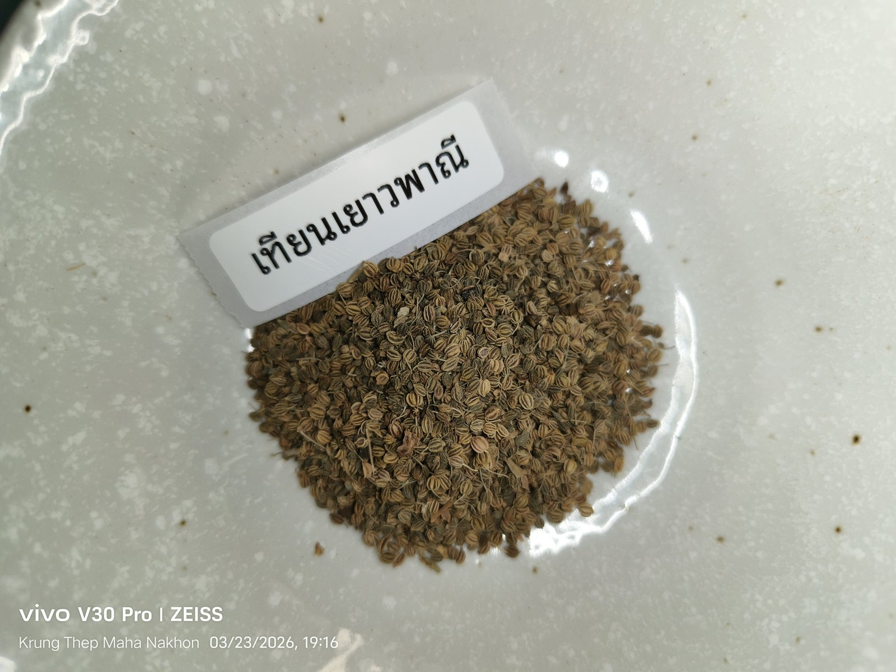
- **สมอไทย** — ผล — รสฝาดติดเปรี้ยว · ผล — ระบายอ่อนๆ แก้ลมป่วง แก้พิษร้อนภายใน คุมธาตุแก้ลมจุกเสียด รู้ผายธาตุ รู้ระบายรู้ถ่ายอุจจาระ ถ่ายพิษไข้ คุมธาตุในตัวเสร็จ แก้ไข้เพื่อเสมหะ
  
- **สมอพิเภก** — เปลือกต้น — รสเย็นฝาด · เปลือกต้น — ขับปัสสาวะ
  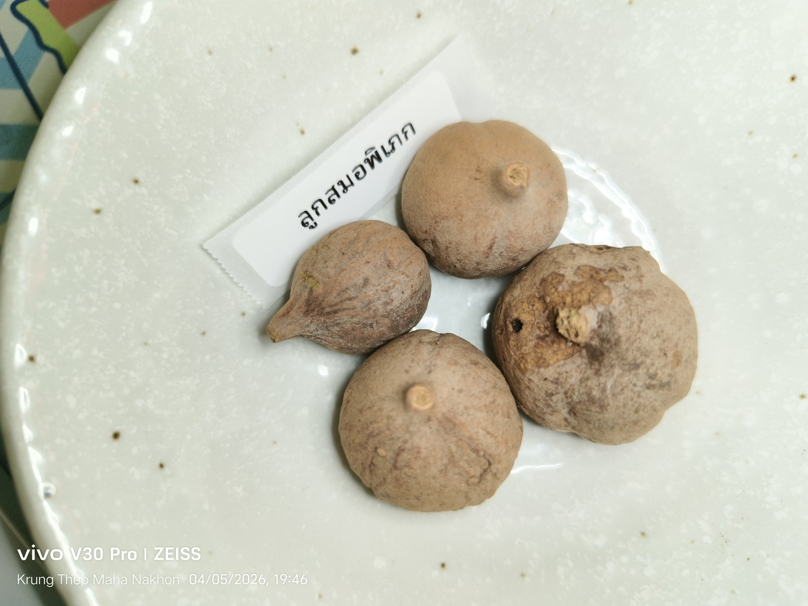
- **มะขามป้อม** — ผลอ่อน — รสฝาดขม · ผลอ่อน — บำรุงเนื้อหนังให้สมบูรณ์
  
- **ลูกจันทน์** — แก่น — รสร้อนหอม · แก่น — แก้ไข้สันนิบาต แก้ไข้เพื่อเลือดและลม
  
- **ดอกจันทน์** — แก่น — รสร้อนหอม · แก่น — แก้ไข้สันนิบาต แก้ไข้เพื่อเลือดและลม
  
- **ลูกกระวาน** — ใบ — รสเผ็ดเล็กน้อยกลิ่นหอม · ใบ — ขับลมให้ผายเรอ ขับเสมหะ แก้ไข้เซื่องซึม
  
- **กานพลู** — ดอก — รสร้อน · ดอก — บำรุงธาตุ แก้ปวดท้อง แน่น จุกเสียด แก้รำมะนาด แก้ปวดฟัน แก้ปวดท้อง ท้องขึ้น แก้ท้องร่วง ชุบลำสีอุดฟันแก้ปวดฟัน ทุบ1 ดอกใส่ขวดนมให้เด็กรับประทาน
  
- **ชะเอมเทศ** — ใบ — รสเฝื่อนหวาน · ใบ — ทำให้เสมหะแห้ง แก้ดีพิการ
  
- **เมล็ดโหระพา**
  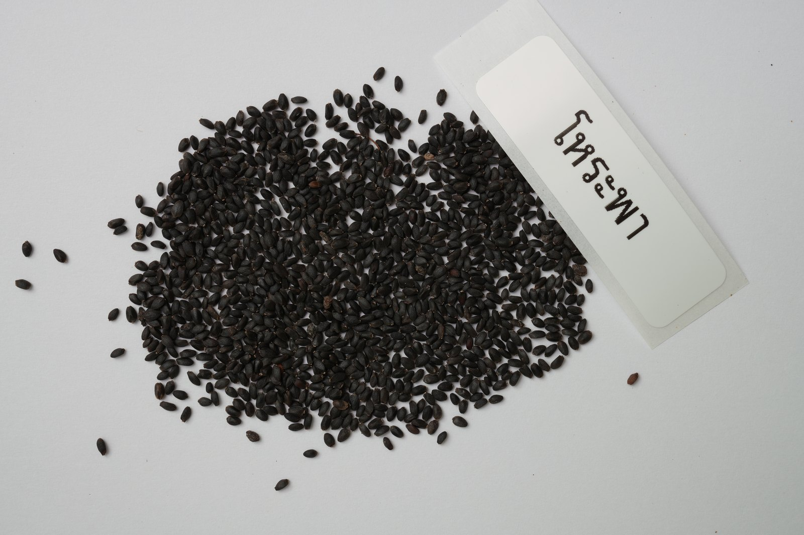
- **ลูกผักชีลา** — ลูก — รสขมฝาดร้อนหอม · ลูก — แก้ไข้เนื่องจากซาง แก้กระหายน้ำ บำรุงธาตุ แก้คลื่นเหียน อาเจียน ขับลมในลำไส้ แก้สะอึก แก้ตาเจ็บ
  
- **สารส้ม** · สารส้ม ก้อนสีขาว — สมานได้ทั้งภายนอกและภายใน ชะล้างระดูขาว แก้บาดแผล ทำให้หนองแห้ง แก้แผลในปากในคอ ขับปัสสาวะ แก้นิ่ว
  
- **ขมิ้นอ้อย** — หัว — รสฝาดเฝื่อน · หัว — แก้ครั่นเนื้อครั่นตัว สมานลำไส้ แก้ระดูขาว ขับปัสสาวะ ตำพอกแก้ฟกบวม อักเสบ
  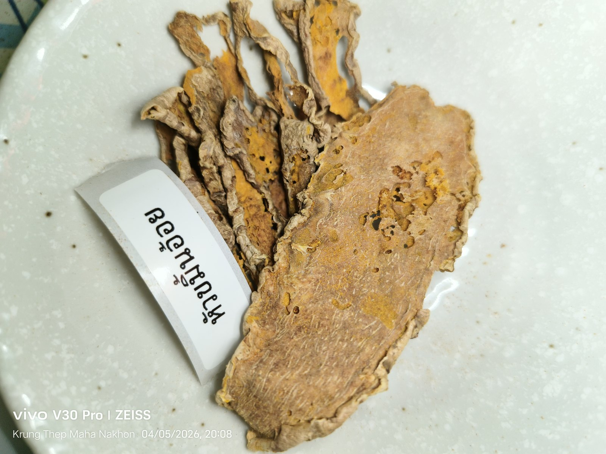
- **หัวกระเทียม** — หัว — รสร้อนฉุน · หัว — แก้ไอ แก้โรคผิวหนัง กลาก เกลื้อน แผลเน่า เนื้อร้าย บำรุงธาตุ ขับโลหิตระดู แก้โรคประสาท น้ำคั้นจากหัว หยอดหู แก้ปวดหูและหูอื้อ
  

**4 ส่วน**  
- **ยาดำสะตุ** — ยาดำ — รสเหม็นขมจัด · ยาดำ — ถ่ายท้อง ถ่ายพิษไข้ ถ่ายพยาธิไส้เดือน ตัวตืด ขับน้ำดี แต่ไซ้ท้อง ฝนกับสุราทาหัวฝี แก้อาการฟกบวม
  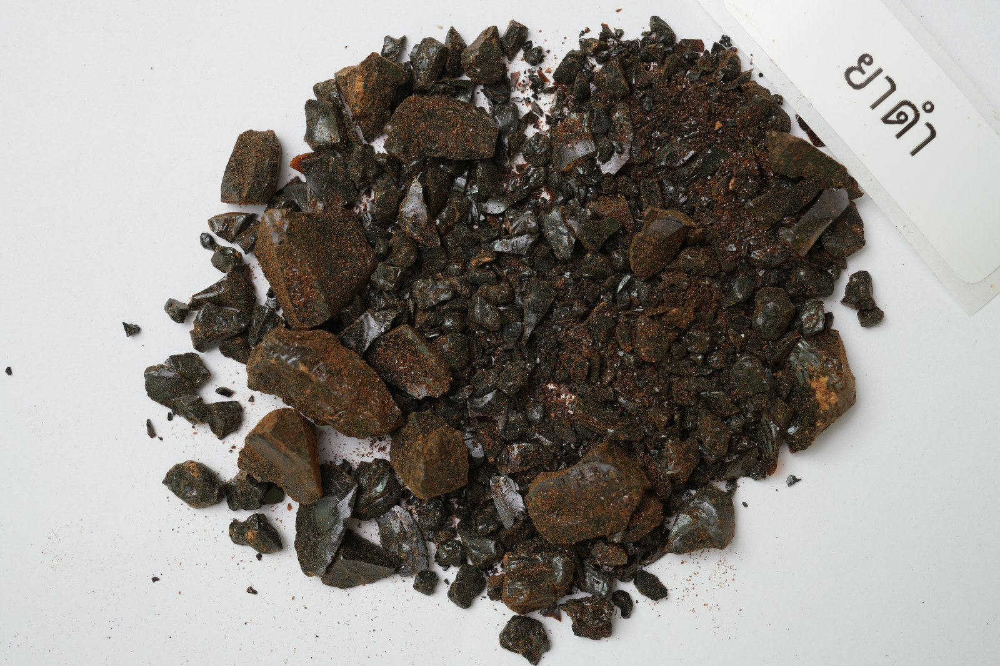

**30 ส่วน**  
- **ใบกระพังโหม** — ใบ เถา — รสกลิ่นเหม็น · ใบ เถา — แก้ตานซาง แก้ตัวร้อน ขับลม แก้ธาตุพิการ ท้องเสีย เจริญอาหาร ขับพยาธิไส้เดือน
  

### สรรพคุณ

- แก้ลมทราง
- แก้อาการท้องอืด ท้องเฟ้อ

### การใช้งาน

- วิธีทำ: บดเป็นผง ทำเป็นเม็ด หนักเม็ดละ 0.5 กรัม
- รับประทานกับน้ำสุกก่อนอาหาร เช้า–เย็น
- เด็กอายุต่ำกว่า 5 ปี ครั้งละ 1–3 เม็ด เพิ่มและลดได้ตามส่วน

### บรรจุภัณฑ์

- ไม่เกิน 20 เม็ด

---

## 11) ยาเหลืองปิดสมุทร

*กลุ่ม: 2. กลุ่มยาแก้ท้องเสีย — รสประธาน: ฝาด / สุขุม*

### อัตราส่วนประกอบ

**1 ส่วน**  
- **แห้วหมู** — รสเผ็ดขมเล็กน้อย · ขับลม
  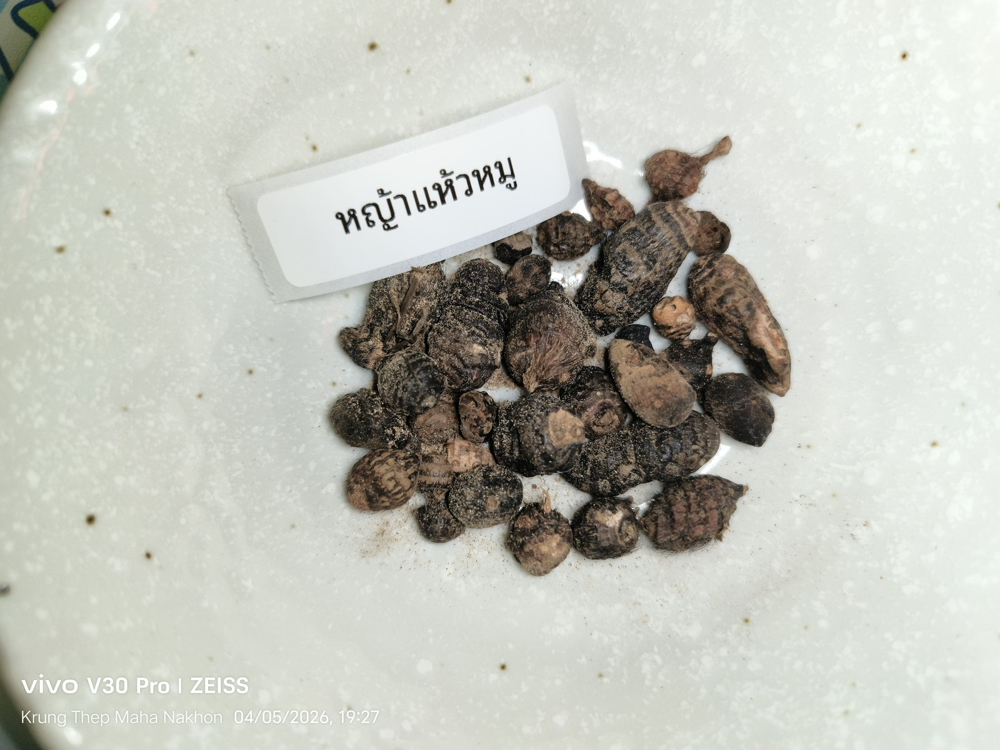
- **ขมิ้นอ้อย** — หัว — รสฝาดเฝื่อน · หัว — แก้ครั่นเนื้อครั่นตัว สมานลำไส้ แก้ระดูขาว ขับปัสสาวะ ตำพอกแก้ฟกบวม อักเสบ
  
- **เปลือกเพกา** — เปลือกต้น — รสฝาดเย็นขมเล็กน้อย · เปลือกต้น — ตำกับสุรา ทา พ่นตามตัวสตรีที่ทนการอยู่ไฟไม่ได้ ทำให้หนังชา สมานแผล ทำให้น้ำเหลืองปกติ ดับพิษโลหิต
  
- **รากกล้วยตีบ** — ราก — รสฝาดเย็น · ราก — แก้ ไข้ท้องเสีย ( ใข้รากสาด ) ร้อนในกระหายน้ำ
  
- **กระเทียมคั่ว** — หัว — รสร้อนฉุน · หัว — แก้ไอ แก้โรคผิวหนัง กลาก เกลื้อน แผลเน่า เนื้อร้าย บำรุงธาตุ ขับโลหิตระดู แก้โรคประสาท น้ำคั้นจากหัว หยอดหู แก้ปวดหูและหูอื้อ
  
- **ดีปลี** — ดอก — รสร้อน · ดอก — แก้ปถวีธาตุพิการ แก้ท้องร่วง ขับลมในลำไส้
  
- **ชันย้อย**
- **ครั่ง**
  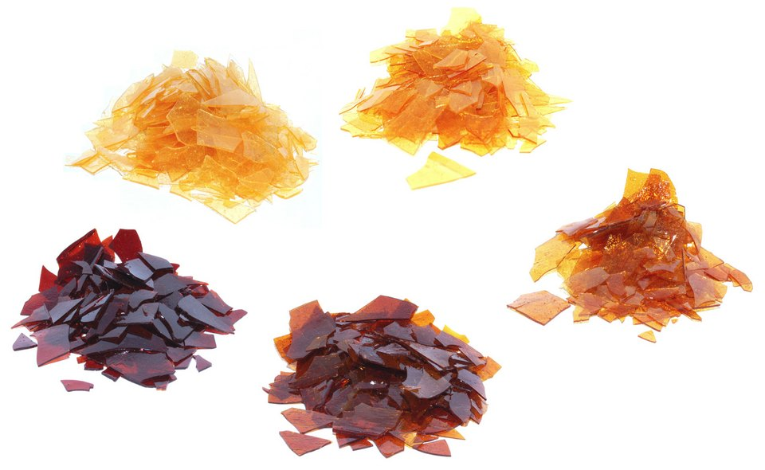
- **สีเสียดเทศ**
  .jpg)
- **สีเสียดไทย**
  
- **ใบเทียน** — เมล็ด — รสเผ็ดร้อนขมหอม · เมล็ด — แก้ลมวิงเวียน หน้ามืด ตามัว แก้โลหิตจาง แก้เย็นชาปลายมือปลายเท้า
  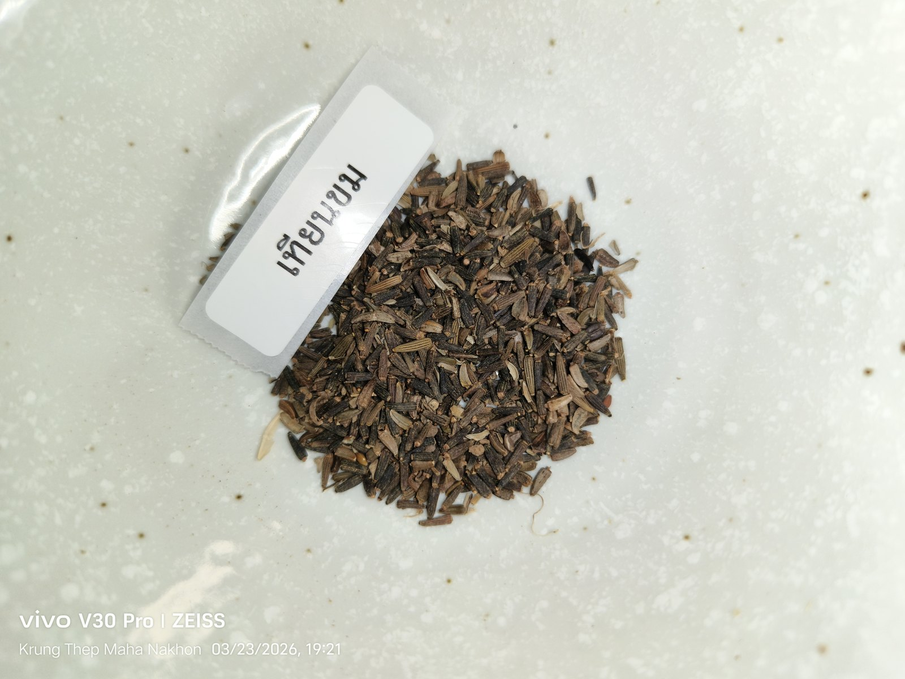
- **ใบทับทิม** — ต้น ราก — รสเบื่อเมา · ต้น ราก — ขับพยาธิตัวตืด และพยาธิไส้เดือน
  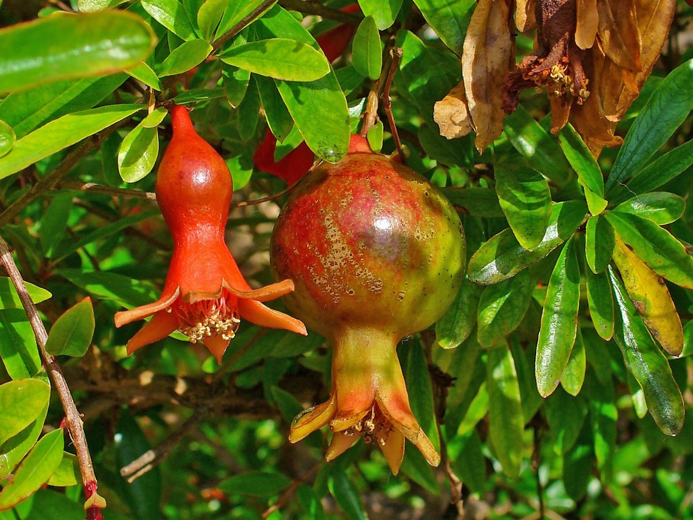

**6 ส่วน**  
- **ขมิ้นชัน** — หัว — รสฝาดเอียน · หัว — แก้ไข้เพื่อดี คลั่งเพ้อ แก้ไข้เรื้อรังผอมเหลือง แก้โรคผิวหนัง แก้เสมหะและโลหิต แก้ท้องร่วง สมานแผล
  

### สรรพคุณ

- แก้ท้องเสีย

### การใช้งาน

- วิธีทำ: บดเป็นผง ทำเป็นเม็ด หนักเม็ดละ 0.1 กรัม
- กระสายยา: น้ำเปลือกลูกทับทิม หรือเปลือกแคต้มกับน้ำปูนใส ถ้าหาไม่ได้ให้ใช้น้ำสุกแทน
- รับประทานร่วมกับน้ำละลายเกลือแกงด้วย
- รับประทานวันละ 3 ครั้ง ก่อนอาหาร
- เด็ก 3–5 เดือน ครั้งละ 2 เม็ด
- เด็ก 6–12 เดือน ครั้งละ 3–4 เม็ด
- เด็ก 1–5 ปี ครั้งละ 4–7 เม็ด
- เด็ก 6–12 ปี ครั้งละ 8–10 เม็ด

### บรรจุภัณฑ์

- ไม่เกิน 30 เม็ด

---

## 12) ยาธาตุบรรจบ

*กลุ่ม: 2. กลุ่มยาแก้ท้องเสีย — รสประธาน: ฝาด / สุขุม*

### อัตราส่วนประกอบ

**4 ส่วน**  
- **ขิง** — รสหวานเผ็ดร้อน · แก้ลมจุกเสียด แก้เสมหะ บำรุงธาตุ แก้คลื่นเหียนอาเจียน
  
- **โกฐเขมา** — รสหวานอมขมเล็กน้อย เผ็ดร้อน · มีกลิ่นหอมเฉพาะ (เหง้าแห้ง) · ยาบำรุงธาตุ ขับลม บำรุงกำลัง · เจริญอาหาร · ขับปัสสาวะ
  .jpg)
- **โกฐพุงปลา** — ลูก รสฝาด (ไม้อาศัยเกาะต้นไม้อื่น คล้ายกล้วยไม้ เป็นไม้ล้มลุกเนื้ออ่อน) · แก้ท้องร่วง แก้อาเจียน แก้บิด แก้ปวดเบ่ง แก้เสมหะพิการ สมานแผล
  
- **โกฐเชียง**
  .jpg)
- **โกฐสอ** — ราก รสสุขมกลิ่นหอม · แก้ไข้ แก้หืด แก้ไอ บำรุงหัวใจให้ชุ่มชื้น
  
- **เทียนดำ** — เมล็ด รสเผ็ดขม · ใบและต้น/เปลือกต้น รสจืดเฝื่อน · เมล็ด: ขับเสมหะให้ลงสู่คูถทวาร ขับลมในลำไส้ แก้อาเจียน บำรุงโลหิต
  
- **เทียนขาว** — เมล็ด รสเผ็ดร้อนขม (ไม้ต้นเล็ก ๆ — ยี่หร่า) · บำรุงกำลัง ขับผายลม แก้เส้นศูนย์กลางท้องพิการ แก้ชีพจรอ่อนหรือพิการ นอนสะดุ้งผวา (โทษน้ำดี) แก้คลั่งเพ้อ
  
- **เทียนสัตตบุษย์**
  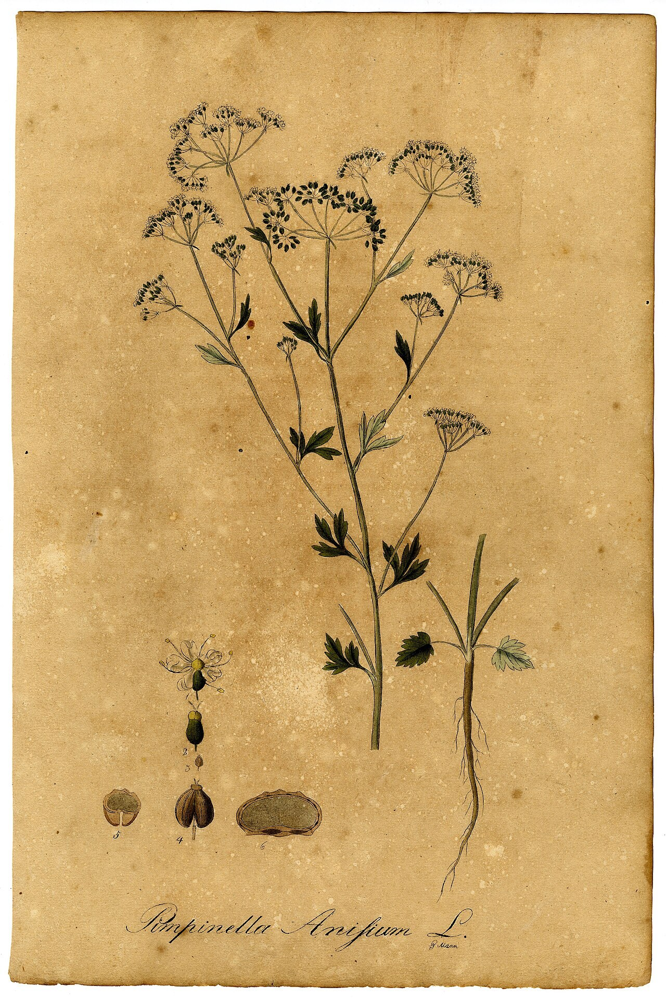
- **เทียนเยาวพาณี** — เมล็ด รสหวานกลิ่นหอม (คล้ายผักชีแต่โตกว่า) · กระจายเสมหะ กระจายลมที่ลั่นโครกครากในท้อง แก้จุกเสียด แก้ลมปั่นป่วนรอบขอบสะดือ แก้คลื่นเหียนอาเจียน
  
- **เทียนแดง** — เมล็ด รสเผ็ดร้อนขมเล็กน้อย (ไม้ต้นเล็ก ๆ คล้ายผักชี) · ขับเสมหะ แก้ลม แก้น้ำดีพิการ แก้ลมเสียดแทง แก้คลื่นเหียนอาเจียน
  
- **ลูกจันทน์** — แก่น — รสร้อนหอม · แก่น — แก้ไข้สันนิบาต แก้ไข้เพื่อเลือดและลม
  
- **ดอกจันทน์** — แก่น — รสร้อนหอม · แก่น — แก้ไข้สันนิบาต แก้ไข้เพื่อเลือดและลม
  
- **กานพลู** — ดอก — รสร้อน · ดอก — บำรุงธาตุ แก้ปวดท้อง แน่น จุกเสียด แก้รำมะนาด แก้ปวดฟัน แก้ปวดท้อง ท้องขึ้น แก้ท้องร่วง ชุบลำสีอุดฟันแก้ปวดฟัน ทุบ1 ดอกใส่ขวดนมให้เด็กรับประทาน
  
- **การบูร** — รสร้อน (การบูรเกล็ด) — ตาม บทที่ 2.MD · แก้ปวดท้อง จุกเสียด
  
- **เปลือกสมุลแว้ง** — เปลือกต้น — รสหอมฉุนปร่า · เปลือกต้น — แก้ลมวิงเวียน ใจสั่น แก้พิษหวัด กำเดา ขับลมในลำไส้ แก้ธาตุพิการ
  
- **ลูกกระวาน** — ใบ — รสเผ็ดเล็กน้อยกลิ่นหอม · ใบ — ขับลมให้ผายเรอ ขับเสมหะ แก้ไข้เซื่องซึม
  
- **ลูกผักชีลา** — ลูก — รสขมฝาดร้อนหอม · ลูก — แก้ไข้เนื่องจากซาง แก้กระหายน้ำ บำรุงธาตุ แก้คลื่นเหียน อาเจียน ขับลมในลำไส้ แก้สะอึก แก้ตาเจ็บ
  
- **ใบพิมเสน** — ใบ — รสเย็นหอม · ใบ — แก้ลม บำรุงหัวใจ แก้ไข้ตัวร้อน ถอนพิษไข้
  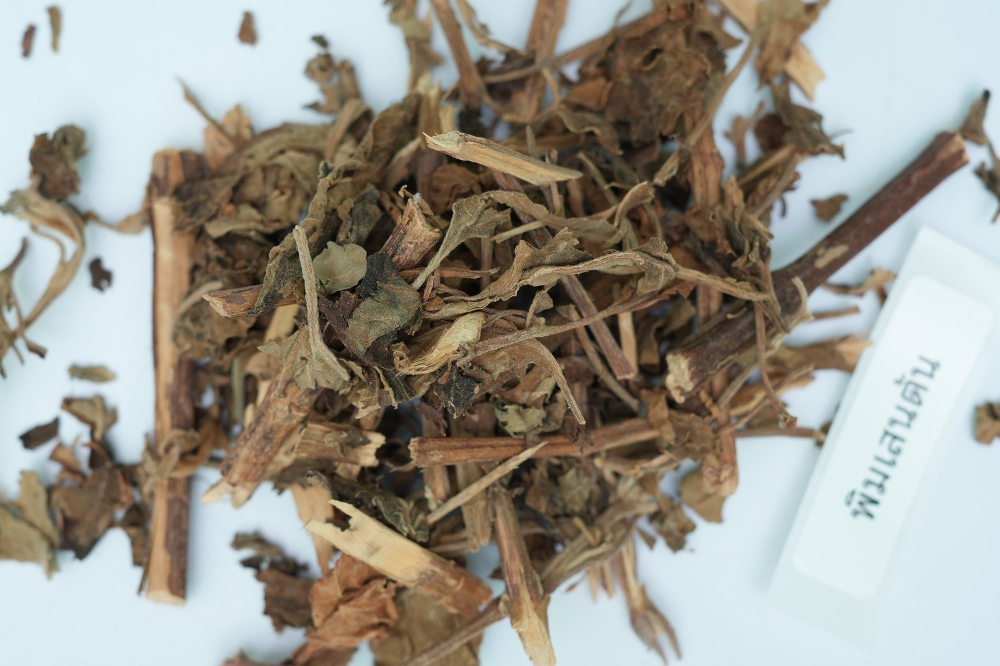
- **ดีปลี** — ดอก — รสร้อน · ดอก — แก้ปถวีธาตุพิการ แก้ท้องร่วง ขับลมในลำไส้
  
- **เปราะหอม** — หัว ใบ — รสร้อนหอม · หัว ใบ — ขับลมในลำไส้ให้ผายเรอ แก้ท้องขึ้นอืดเฟ้อ ทำยาสุมขม่อมเด็ก แก้หวัด กำเดา ซางชัก และลมซาง
  

**8 ส่วน**  
- **โกฐก้านพร้าว** — รสขมจัด · มีกลิ่นหอมเฉพาะตัว (เหง้าแห้ง มีข้อคล้ายหางหนูมะพร้าว) · ตำราโบราณไทย: แก้ไข้เรื้อรัง แก้ไข้ซึ่งมีอาการสะอึก แก้หอบ แก้เสมหะเป็นพิษ
  

**16 ส่วน**  
- **เนื้อลูกสมอไทย** — ผล — รสฝาดติดเปรี้ยว · ผล — ระบายอ่อนๆ แก้ลมป่วง แก้พิษร้อนภายใน คุมธาตุแก้ลมจุกเสียด รู้ผายธาตุ รู้ระบายรู้ถ่ายอุจจาระ ถ่ายพิษไข้ คุมธาตุในตัวเสร็จ แก้ไข้เพื่อเสมหะ
  

### สรรพคุณ

- แก้ธาตุไม่ปกติ ท้องเสีย
- แก้ท้องขึ้น ท้องเฟ้อ

### การใช้งาน

- วิธีทำ: บดเป็นผง
- กระสายยา (แก้ธาตุไม่ปกติ/ท้องเสีย): เปลือกแค หรือเปลือกสะเดา หรือเปลือกลูกทับทิม ต้มกับน้ำปูนใส
- กระสายยา (แก้ท้องขึ้น ท้องเฟ้อ): กระเทียม 3 กลีบทุบชงน้ำร้อน หรือใบกะเพราต้ม ถ้าหาไม่ได้ให้ใช้น้ำสุกแทน
- รับประทานวันละ 3 ครั้ง ก่อนอาหาร
- ผู้ใหญ่ ครั้งละ 1 ช้อนชา
- เด็ก 6–12 ปี ครั้งละ ½ ช้อนชา

### บรรจุภัณฑ์

- ไม่เกิน 20 กรัม

---

## 8) ยาตรีหอม

*กลุ่ม: 3. กลุ่มยาถ่าย ยาระบาย — รสประธาน: ขม / เค็ม / เปรี้ยว / เอียน*

### อัตราส่วนประกอบ

**1 ส่วน**  
- **โกฐสอ** — ราก รสสุขมกลิ่นหอม · แก้ไข้ แก้หืด แก้ไอ บำรุงหัวใจให้ชุ่มชื้น
  
- **ชะเอมเทศ** — ใบ — รสเฝื่อนหวาน · ใบ — ทำให้เสมหะแห้ง แก้ดีพิการ
  
- **ลูกซัดคั่ว**

**4 ส่วน**  
- **เนื้อลูกสมอเทศ** · ผลรสเปรี้ยวและฝาดจัด — ระบายอ่อนๆ ระบายเสมหะ ระบายลมรู้ถ่าย รู้ปิดเอง แก้เสมหะ ทำให้ลมเดินสะดวก
  
- **เนื้อลูกสมอพิเภก** — เปลือกต้น — รสเย็นฝาด · เปลือกต้น — ขับปัสสาวะ
  
- **เนื้อลูกมะขามป้อม** — ผลอ่อน — รสฝาดขม · ผลอ่อน — บำรุงเนื้อหนังให้สมบูรณ์
  
- **ลูกผักชีลา** — ลูก — รสขมฝาดร้อนหอม · ลูก — แก้ไข้เนื่องจากซาง แก้กระหายน้ำ บำรุงธาตุ แก้คลื่นเหียน อาเจียน ขับลมในลำไส้ แก้สะอึก แก้ตาเจ็บ
  

**22 ส่วน**  
- **เนื้อลูกสมอไทย** — ผล — รสฝาดติดเปรี้ยว · ผล — ระบายอ่อนๆ แก้ลมป่วง แก้พิษร้อนภายใน คุมธาตุแก้ลมจุกเสียด รู้ผายธาตุ รู้ระบายรู้ถ่ายอุจจาระ ถ่ายพิษไข้ คุมธาตุในตัวเสร็จ แก้ไข้เพื่อเสมหะ
  
- **โกฐน้ำเต้าใหญ่นึ่งสุก**
  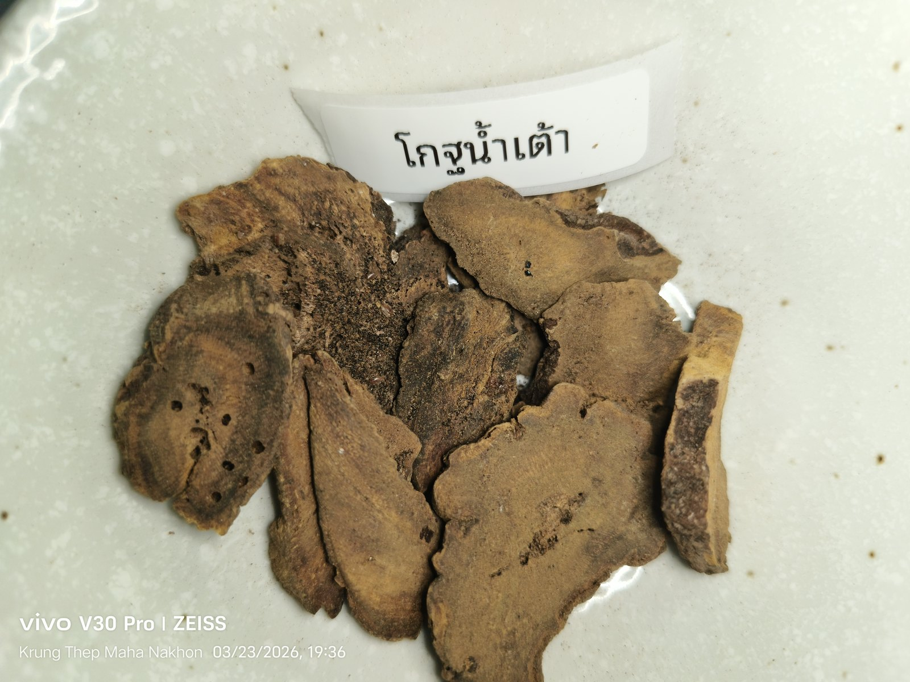

### สรรพคุณ

- แก้เด็กท้องผูก
- ระบายพิษไข้

### การใช้งาน

- วิธีทำ: บดเป็นผง ทำเป็นเม็ด หนักเม็ดละ 0.2 กรัม
- รับประทานก่อนอาหารเช้า
- เด็ก 1–2 เดือน ครั้งละ 2–3 เม็ด
- เด็ก 3–5 เดือน ครั้งละ 4–5 เม็ด
- เด็ก 6–12 เดือน ครั้งละ 6–8 เม็ด

### บรรจุภัณฑ์

- ไม่เกิน 30 เม็ด

---

## 9) ยาธรณีสันฑะฆาต

*กลุ่ม: 3. กลุ่มยาถ่าย ยาระบาย — รสประธาน: ขม / เค็ม / เปรี้ยว / เอียน*

### อัตราส่วนประกอบ

**1 ส่วน**  
- **ลูกจันทน์** — แก่น — รสร้อนหอม · แก่น — แก้ไข้สันนิบาต แก้ไข้เพื่อเลือดและลม
  
- **ดอกจันทน์** — แก่น — รสร้อนหอม · แก่น — แก้ไข้สันนิบาต แก้ไข้เพื่อเลือดและลม
  
- **ลูกกระวาน** — ใบ — รสเผ็ดเล็กน้อยกลิ่นหอม · ใบ — ขับลมให้ผายเรอ ขับเสมหะ แก้ไข้เซื่องซึม
  
- **กานพลู** — ดอก — รสร้อน · ดอก — บำรุงธาตุ แก้ปวดท้อง แน่น จุกเสียด แก้รำมะนาด แก้ปวดฟัน แก้ปวดท้อง ท้องขึ้น แก้ท้องร่วง ชุบลำสีอุดฟันแก้ปวดฟัน ทุบ1 ดอกใส่ขวดนมให้เด็กรับประทาน
  
- **เทียนดำ** — เมล็ด รสเผ็ดขม · ใบและต้น/เปลือกต้น รสจืดเฝื่อน · เมล็ด: ขับเสมหะให้ลงสู่คูถทวาร ขับลมในลำไส้ แก้อาเจียน บำรุงโลหิต
  
- **เทียนขาว** — เมล็ด รสเผ็ดร้อนขม (ไม้ต้นเล็ก ๆ — ยี่หร่า) · บำรุงกำลัง ขับผายลม แก้เส้นศูนย์กลางท้องพิการ แก้ชีพจรอ่อนหรือพิการ นอนสะดุ้งผวา (โทษน้ำดี) แก้คลั่งเพ้อ
  
- **หัวดองดึง** — หัว — รสร้อนเมา · หัว — แก้โรคเรื้อน คุดทะราด แก้ปวดข้อ (รูมาติซั่ม) แก้กามโรค แก้พิษสัตว์กัดต่อย
  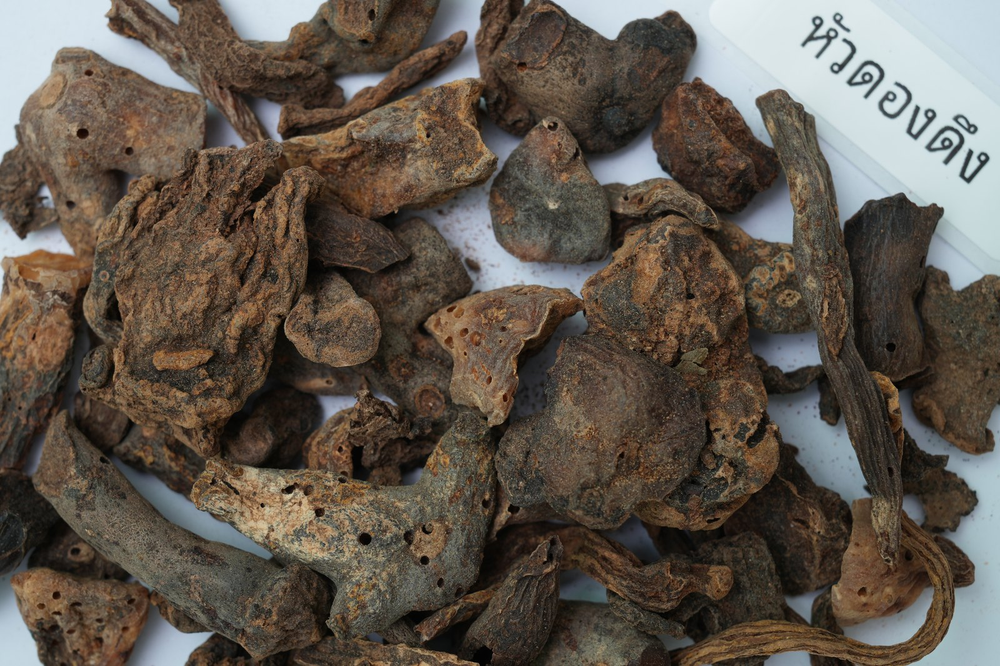
- **หัวบุก** — หัว — รสเบื่อเมาคัน · หัว — กัดเถาคาน กัดเสมหะ หุงกับน้ำมันทาแผลกัดฝ้า กัดหนอง
  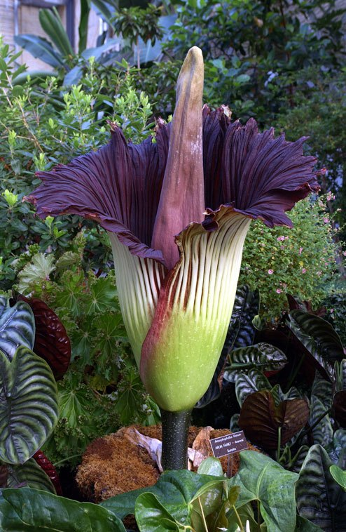
- **หัวกลอย** — หัว — รสขื่นคัน · หัว — กัดเถาดานเป็นก้อนแข็งอยู่ในท้อง หุงกับน้ำมัน ทาแผล กัดหนองและฝ้า
  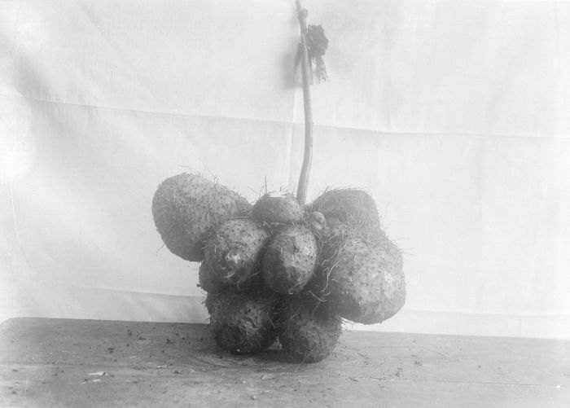
- **หัวกระดาดขาว**
  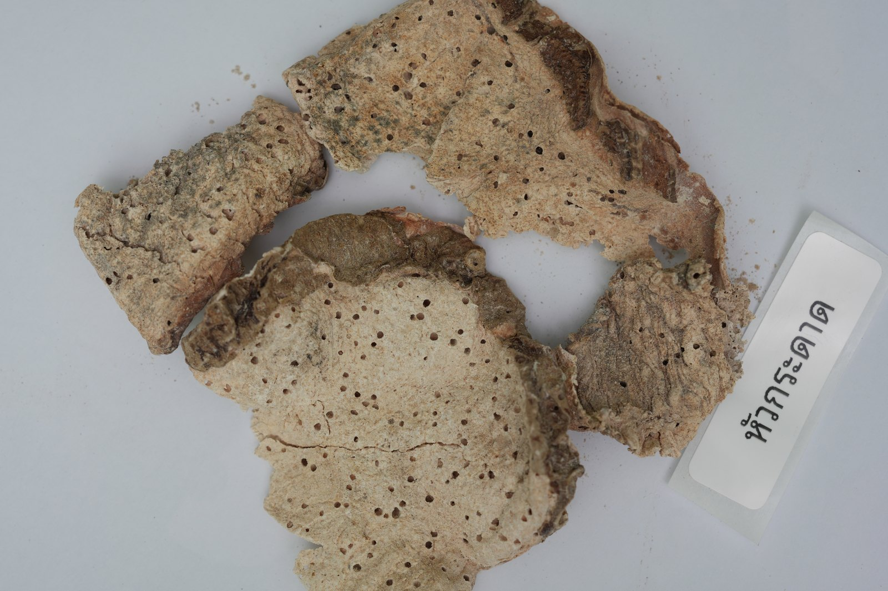
- **หัวกระดาดแดง**
  
- **ลูกเร่ว**
  
- **ขิง** — รสหวานเผ็ดร้อน · แก้ลมจุกเสียด แก้เสมหะ บำรุงธาตุ แก้คลื่นเหียนอาเจียน
  
- **ชะเอมเทศ** — ใบ — รสเฝื่อนหวาน · ใบ — ทำให้เสมหะแห้ง แก้ดีพิการ
  
- **รากเจตมูลเพลิงแดง** — ราก — รสร้อน · ราก — บำรุงธาตุ บำรุงโลหิต ขับลมในลำไส้และกระเพาะอาหารให้เรอ แก้ท้องอืด เฟ้อ เสียด แน่นหน้าอก ทำให้ร่างกายเกิดความอบอุ่น ถ้ารับประทานมาก ทำให้แท้งลูก บดเป็นผงปิดพอกฝี ทำให้เกิดความร้อน เกลื่อนฝีได้ แก้ริดสีดวงทวาร
  
- **โกฐกระดูก** — เปลือกราก รสร้อน กลิ่นหอม (ไม้ต้นขนาดเล็กถึงกลาง จากประเทศจีน) · แก้ลมวิงเวียน หน้ามืด ตาลาย ขับลมในลำไส้ แก้โลหิตจาง
  
- **โกฐเขมา** — รสหวานอมขมเล็กน้อย เผ็ดร้อน · มีกลิ่นหอมเฉพาะ (เหง้าแห้ง) · ยาบำรุงธาตุ ขับลม บำรุงกำลัง · เจริญอาหาร · ขับปัสสาวะ
  .jpg)
- **โกฐน้ำเต้า** — ราก (ปอกเปลือก นึ่งแล้วตากแห้ง) รสฝาดหอม (ไม้พุ่มขนาดใหญ่) · แก้ธาตุพิการ อาหารไม่ย่อย บำรุงธาตุ แก้ท้องอืด ขับลมในลำไส้ ขับปัสสาวะและอุจจาระให้เดินสะดวก ระบายท้อง
  

**2 ส่วน**  
- **ผักแพวแดง** — ราก — รสร้อน · ราก — แก้ลม แก้กระเพาะอาหารพิการ อุจจาระหยาบ แก้ท้องมาน แก้ริดสีดวง แก้หืด ไอ แก้เส้นประสาทพิการ แก้ปวดเมื่อยตามข้อกระดูก
  
- **เนื้อลูกมะขามป้อม** — ผลอ่อน — รสฝาดขม · ผลอ่อน — บำรุงเนื้อหนังให้สมบูรณ์
  

**4 ส่วน**  
- **รงทอง** — ยาง (ฆ่าฤทธิ์แล้ว) — รสเอียนเบื่อ · ยาง (ฆ่าฤทธิ์แล้ว) — ถ่ายอย่างแรง ถ่ายลม ถ่ายน้ำเหลืองเสีย ถ่ายเสมหะ ถ่ายโลหิต ฝนกับหัวกะทิสดทาแผลพุพอง แก้ปวด และให้ล่อนออกดี
  

**6 ส่วน**  
- **เนื้อลูกสมอไทย** — ผล — รสฝาดติดเปรี้ยว · ผล — ระบายอ่อนๆ แก้ลมป่วง แก้พิษร้อนภายใน คุมธาตุแก้ลมจุกเสียด รู้ผายธาตุ รู้ระบายรู้ถ่ายอุจจาระ ถ่ายพิษไข้ คุมธาตุในตัวเสร็จ แก้ไข้เพื่อเสมหะ
  
- **มหาหิงค์**
  
- **การบูร** — รสร้อน (การบูรเกล็ด) — ตาม บทที่ 2.MD · แก้ปวดท้อง จุกเสียด
  

**20 ส่วน**  
- **ยาดำ** — รสเหม็นขมจัด · ถ่ายท้อง ถ่ายพิษไข้ ถ่ายพยาธิไส้เดือน ตัวตืด ขับน้ำดี แต่ไซ้ท้อง ฝนกับสุราทาหัวฝี แก้อาการฟกบวม
  

**96 ส่วน**  
- **พริกไทยล่อน** — เถา — รสร้อน · เถา — แก้เสมหะในทรวงอก แก้อติสาร (ท้องร่วงอย่างแรง)
  

### สรรพคุณ

- แก้กษัยเส้น
- แก้เถาดาน
- แก้ท้องผูก

### การใช้งาน

- วิธีทำ: ผง = บดเป็นผง / เม็ด = เม็ดละ 0.25 กรัม / แคปซูล = แคปซูลละ 0.25 กรัม
- รับประทานวันละ 1 ครั้ง ก่อนอาหารเช้า หรือก่อนนอน
- ชนิดผง: ผู้ใหญ่ ครั้งละ 0.5–1 ช้อนชา ละลายน้ำสุก หรือผสมน้ำผึ้งปั้นเป็นลูกกลอน
- ชนิดเม็ด: ผู้ใหญ่ ครั้งละ 2–4 เม็ด
- ชนิดแคปซูล: ผู้ใหญ่ ครั้งละ 2–4 แคปซูล
- คำเตือน: คนเป็นไข้ เด็ก และสตรีมีครรภ์ ห้ามรับประทาน
- คำเตือน: ผู้สูงอายุควรใช้ด้วยความระมัดระวัง

### บรรจุภัณฑ์

- ผง ไม่เกิน 15 กรัม
- เม็ด ไม่เกิน 60 เม็ด
- แคปซูล ไม่เกิน 60 แคปซูล

---

## 10) ยาถ่าย

*กลุ่ม: 3. กลุ่มยาถ่าย ยาระบาย — รสประธาน: ขม / เค็ม / เปรี้ยว / เอียน*

### อัตราส่วนประกอบ

**1 ส่วน**  
- **ใบมะกา** — ใบ — รสขมขื่น · ใบ — ถ่ายเสมหะและโลหิต ถ่ายพิษตานซางเด็ก ชัดลมขึ้นเบื้องสูงให้ลงต่ำ
  
- **ใบมะขาม** · เนื้อฝักแก่ รสเปรี้ยว เป็นยาระบาย ขับเสมหะ , เนื้อเมล็ดมะขามรสมัน ใช้ขับพยาธิ
  .jpg)
- **ใบส้มป่อย** — ใบ — รสเปรี้ยวฝาดเล็กน้อย · ใบ — ถ่ายเสมหะ ล้างเมือกมันในลำไส้ แก้บิด ฟอกล้างโลหิตระดู ประคบให้เส้นเอ็นอ่อน
  
- **หญ้าไทร**
  
- **ใบไผ่ป่า**
  
- **ฝักคูน** — เนื้อในฝัก — รสหวานเอียน · เนื้อในฝัก — ระบายท้อง ช่วยบรรเทาการแน่นหน้าอก ฟกช้ำ แก้ลมเข้าข้อและขัดข้อ
  .jpg)
- **รากขี้กาแดง** — ลูก — รสขมจัด · ลูก — บำรุงน้ำดี แก้พิษเสมหะและโลหิต ถ่ายและล้างโทษเสมหะ และอุจจาระให้ตก
  
- **รากขี้กาขาว** — เถา — รสขม · เถา — บำรุงน้ำดี ดับพิษ เสมหะและโลหิต
  
- **รากตองแตก** — ราก — รสจืดเฝื่อนขมน้อย · ราก — ระบายอ่อนๆ ถ่ายลมถ่ายเสมหะ ไม่ไซ้ท้อง
  
- **เถาวัลย์เปรียง** — เถา — รสเบื่อเอียน · เถา — ถ่ายเส้น ถ่ายกระษัย แก้เส้นเอ็นขอด เส้นตึง แก้ปวดเมื่อย ทำให้เส้นเอ็นหย่อน ขับปัสสาวะ ถ่ายเสหะลงสู่คูทวาร
  
- **หัวหอม**
  
- **ฝักส้มป่อย** — ใบ — รสเปรี้ยวฝาดเล็กน้อย · ใบ — ถ่ายเสมหะ ล้างเมือกมันในลำไส้ แก้บิด ฟอกล้างโลหิตระดู ประคบให้เส้นเอ็นอ่อน
  
- **สมอไทย** — ผล — รสฝาดติดเปรี้ยว · ผล — ระบายอ่อนๆ แก้ลมป่วง แก้พิษร้อนภายใน คุมธาตุแก้ลมจุกเสียด รู้ผายธาตุ รู้ระบายรู้ถ่ายอุจจาระ ถ่ายพิษไข้ คุมธาตุในตัวเสร็จ แก้ไข้เพื่อเสมหะ
  
- **สมอดีง** — ผล — รสขมฝาด · ผล — แก้พิษดี พิษโลหิต แก้ไอ ขับถ่ายโลหิตระดูสตรี ถ่ายระบายอุจจาระแรงกว่าสมอชนิดอื่นมาก
  
- **ขี้เหล็ก**
  

**4 ส่วน**  
- **ยาดำ** — รสเหม็นขมจัด · ถ่ายท้อง ถ่ายพิษไข้ ถ่ายพยาธิไส้เดือน ตัวตืด ขับน้ำดี แต่ไซ้ท้อง ฝนกับสุราทาหัวฝี แก้อาการฟกบวม
  

**20 ส่วน**  
- **ดีเกลือฝรั่ง**
  

### สรรพคุณ

- แก้ท้องผูก

### การใช้งาน

- วิธีทำ: เม็ด = เม็ดละ 0.5 กรัม / แคปซูล = แคปซูลละ 0.5 กรัม
- รับประทานวันละ 1 ครั้ง ก่อนนอน
- ชนิดเม็ด: ผู้ใหญ่ ครั้งละ 2–5 เม็ด ตามธาตุหนักเบา
- ชนิดแคปซูล: ผู้ใหญ่ ครั้งละ 2–5 แคปซูล ตามธาตุหนักเบา

### บรรจุภัณฑ์

- เม็ด ไม่เกิน 10 เม็ด
- แคปซูล ไม่เกิน 10 แคปซูล

---

## 13) ยาจันทน์ลีลา

*กลุ่ม: 4. กลุ่มยาแก้ไข้และร้อนใน — รสประธาน: เย็น (ยาเด็กใช้ ร้อนสุขุม)*

### อัตราส่วนประกอบ

**1 ส่วน**  
- **พิมเสน** — ใบ — รสเย็นหอม · ใบ — แก้ลม บำรุงหัวใจ แก้ไข้ตัวร้อน ถอนพิษไข้
  

**4 ส่วน**  
- **โกฐสอ** — ราก รสสุขมกลิ่นหอม · แก้ไข้ แก้หืด แก้ไอ บำรุงหัวใจให้ชุ่มชื้น
  
- **โกฐเขมา** — รสหวานอมขมเล็กน้อย เผ็ดร้อน · มีกลิ่นหอมเฉพาะ (เหง้าแห้ง) · ยาบำรุงธาตุ ขับลม บำรุงกำลัง · เจริญอาหาร · ขับปัสสาวะ
  .jpg)
- **โกฐจุฬาลัมพา** — ใช้ทั้งต้น รสขมกลิ่นหอม (ไม้ล้มลุกเนื้ออ่อน เป็นพุ่มขนาดย่อม) · แก้ไข้เจรียง แก้ไข้ที่มีผื่นขึ้นตามตัว (หัด เหือด สุกใส ดำแดง ฝีดาษ ไข้รากสาด) แก้หืด ไอ แก้ไข้เพื่อเสมหะ
  
- **จันทน์ขาว**
  
- **จันทน์แดง** — เนื้อไม้ และแก่น — รสขมเย็น · เนื้อไม้ และแก่น — แก้ไอ แก้ซางอันบังเกิดแต่ดี แก้เลือดออกตามไรฟัน แก้บาดแผล แก้ไข้เพื่อดีพิการทำให้ชื่นใจ แก้ร้อนดับพิษไข้ทุกชนิด ฝนทาแก้ฟกบวม
  
- **ลูกกระดอม** — ลูก — รสขม · ลูก — บำรุงน้ำดี แก้ดีแห้ง ดีฝ่อ ดีเลือด คลั่งเพ้อ เจริญอาหาร ทำให้โลหิตเย็น บำรุงมดลูก
  
- **บอระเพ็ด** — เถา — รสขมเย็น · เถา — แก้พิษฝีดาษ ไข้เหนือ ไข้พิษ แก้ร้อนใน กระหายน้ำ ทำให้เนื้อเย็น สะอึก บำรุงกำลัง บำรุงน้ำดี บำรุงไฟธาตุ
  
- **รากปลาไหลเผือก** — ราก — รสขมเบื่อเมาเล็กน้อย · ราก — ตัดไข้ทุกชนิด แก้วัณโรคระยะบวม ถ่ายพิษฝีในท้องและถ่ายพิษต่างๆ
  

### สรรพคุณ

- แก้ไข้ ตัวร้อน

### การใช้งาน

- วิธีทำ: ผง = บดเป็นผง / เม็ด = เม็ดละ 0.5 กรัม / แคปซูล = แคปซูลละ 0.5 กรัม
- รับประทานทุก 4 ชั่วโมง
- ชนิดผง: เด็ก 6–12 ปี ครั้งละ 0.5–1 ช้อนชา, ผู้ใหญ่ ครั้งละ 1–2 ช้อนชา (ละลายน้ำสุก)
- ชนิดเม็ด: เด็ก 6–12 ปี ครั้งละ 1–2 เม็ด, ผู้ใหญ่ ครั้งละ 2–4 เม็ด
- ชนิดแคปซูล: เด็ก 6–12 ปี ครั้งละ 1–2 แคปซูล, ผู้ใหญ่ ครั้งละ 2–4 แคปซูล

### บรรจุภัณฑ์

- ผง ไม่เกิน 15 กรัม
- เม็ด ไม่เกิน 30 เม็ด
- แคปซูล ไม่เกิน 30 แคปซูล

---

## 14) ยาประสะจันทน์แดง

*กลุ่ม: 4. กลุ่มยาแก้ไข้และร้อนใน — รสประธาน: เย็น (ยาเด็กใช้ ร้อนสุขุม)*

### อัตราส่วนประกอบ

**1 ส่วน**  
- **เกสรบัวหลวง**
  
- **ดอกบุนนาค** — ใบ — รสฝาด · ใบ — แก้บาดแผลสด สมานแผล
  
- **ดอกสารภี** — ดอก — รสหอมเย็น · ดอก — ชูกำลัง บำรุงหัวใจให้ชุ่มชื่น ใช้ทำยาหอม
  
- **ดอกมะลิ** — เถา — รสขื่นเย็น · เถา — แก้คุดทะราด ขับเสมหะ และโลหิต
  

**4 ส่วน**  
- **รากเหมือดคน** — เนื้อไม้ — รสขมน้อย · เนื้อไม้ — ดับพิษร้อน แก้ไข้ ถอนพิษผิดสำแดง
  
- **รากมะปรางหวาน** — รสจืดเย็น · ถอนพิษไข้กลับซ้ำ ถอนพิษผิดสำแดง แก้ไข้ตัวร้อน
  
- **รากมะนาว** — ใบ — รสปร่าซ่า · ใบ — กัดฟอกเสมหะและระดู ใช้ในพิกัด 108 ใบ
  
- **เปราะหอม** — หัว ใบ — รสร้อนหอม · หัว ใบ — ขับลมในลำไส้ให้ผายเรอ แก้ท้องขึ้นอืดเฟ้อ ทำยาสุมขม่อมเด็ก แก้หวัด กำเดา ซางชัก และลมซาง
  
- **โกฐหัวบัว**
  .jpg)
- **จันทน์เทศ** — เนื้อไม้และแก่น — รสขมหอมร้อน · เนื้อไม้และแก่น — แก้ไข้ดีเดือด ดีพลุ่ง แก้กระสับกระส่าย ตาลอยเผลอสติ บำรุงตับ ปอด น้ำดี
  
- **ฝางเสน** — แก่น — รสขมขื่นฝาด · แก่น — แก้ท้องร่วง แก้ธาตุพิการ แก้ร้อน แก้โลหิตออกทางทวารหนัก แก้ไข้กำเดา แก้เสมหะ
  

**32 ส่วน**  
- **จันทน์แดง** — เนื้อไม้ และแก่น — รสขมเย็น · เนื้อไม้ และแก่น — แก้ไอ แก้ซางอันบังเกิดแต่ดี แก้เลือดออกตามไรฟัน แก้บาดแผล แก้ไข้เพื่อดีพิการทำให้ชื่นใจ แก้ร้อนดับพิษไข้ทุกชนิด ฝนทาแก้ฟกบวม
  

### สรรพคุณ

- แก้ไข้ตัวร้อน
- แก้กระหายน้ำ

### การใช้งาน

- วิธีทำ: ผง = บดเป็นผง / เม็ด = เม็ดละ 0.25 กรัม / แคปซูล = แคปซูลละ 0.25 กรัม
- รับประทานทุก 3 ชั่วโมง
- กระสายยา: น้ำสุก หรือน้ำดอกมะลิ
- ชนิดผง: เด็ก 6–12 ปี ครั้งละ 0.5–1 ช้อนชา, ผู้ใหญ่ ครั้งละ 1 ช้อนชา
- ชนิดเม็ด: เด็ก 6–12 ปี ครั้งละ 1–2 เม็ด, ผู้ใหญ่ ครั้งละ 2–4 เม็ด
- ชนิดแคปซูล: เด็ก 6–12 ปี ครั้งละ 1–2 แคปซูล, ผู้ใหญ่ ครั้งละ 2–4 แคปซูล

### บรรจุภัณฑ์

- ผง ไม่เกิน 15 กรัม
- เม็ด ไม่เกิน 60 เม็ด
- แคปซูล ไม่เกิน 60 แคปซูล

---

## 15) ยาเขียวหอม

*กลุ่ม: 4. กลุ่มยาแก้ไข้และร้อนใน — รสประธาน: เย็น (ยาเด็กใช้ ร้อนสุขุม)*

### อัตราส่วนประกอบ

**1 ส่วน**  
- **ใบพิมเสน** — ใบ — รสเย็นหอม · ใบ — แก้ลม บำรุงหัวใจ แก้ไข้ตัวร้อน ถอนพิษไข้
  
- **ใบผักกระโฉม** — ใบ — รสเย็น · ใบ — แก้ไข้พิษ ไข้ตัวร้อน ไข้หวัด แก้ปวดศีรษะ
- **ใบหมากผู้** — ใบ — รสจืด · ใบ — แก้ไข้ตัวร้อน เหือด หัด สุกใส ดำแดง ต้มอาบ แก้คันตามผิวหนัง
  
- **ใบหมากเมีย**
- **ใบสันพร้าหอม**
- **รากแฝกหอม**
  
- **เปราะหอม** — หัว ใบ — รสร้อนหอม · หัว ใบ — ขับลมในลำไส้ให้ผายเรอ แก้ท้องขึ้นอืดเฟ้อ ทำยาสุมขม่อมเด็ก แก้หวัด กำเดา ซางชัก และลมซาง
  
- **จันทน์เทศ** — เนื้อไม้และแก่น — รสขมหอมร้อน · เนื้อไม้และแก่น — แก้ไข้ดีเดือด ดีพลุ่ง แก้กระสับกระส่าย ตาลอยเผลอสติ บำรุงตับ ปอด น้ำดี
  
- **จันทน์แดง** — เนื้อไม้ และแก่น — รสขมเย็น · เนื้อไม้ และแก่น — แก้ไอ แก้ซางอันบังเกิดแต่ดี แก้เลือดออกตามไรฟัน แก้บาดแผล แก้ไข้เพื่อดีพิการทำให้ชื่นใจ แก้ร้อนดับพิษไข้ทุกชนิด ฝนทาแก้ฟกบวม
  
- **ว่านกีบแรด**
  
- **ว่านร่อนทอง** — หัว — รสปร่า · หัว — ช่วยย่อยอาหาร แก้ท้องเสีย แก้บิดมูกเลือด คุมธาตุ แก้พิษตานซาง แก้พิษฝี พิษงู ตะขาบ แมงป่อง
  
- **เนระพูสี** — ต้น — รสฝาด · ต้น — แก้บิด มูกเลือด แก้ไข้ท้องเสีย (ไข้รากสาด) แก้ปวดเบ่ง แก้ไข้เหนือ แก้ไข้พิษ ไข้กาฬ
  
- **พิษนาศน์**
  
- **มหาสดำ** — เนื้อไม้ — รสเย็น · เนื้อไม้ — ดับพิษร้อน แก้ไข้พิษ ไข้กาล แก้ร้อนในกระหายน้ำ
  
- **ดอกพิกุล** — เปลือกต้น — รสฝาด · เปลือกต้น — ฆ่าแมงกินฟัน
  
- **ดอกบุนนาค** — ใบ — รสฝาด · ใบ — แก้บาดแผลสด สมานแผล
  
- **ดอกสารภี** — ดอก — รสหอมเย็น · ดอก — ชูกำลัง บำรุงหัวใจให้ชุ่มชื่น ใช้ทำยาหอม
  
- **เกสรบัวหลวง**
  

### สรรพคุณ

- แก้ตัวร้อน ร้อนใน กระหายน้ำ
- แก้พิษหัด พิษสุกใส

### การใช้งาน

- วิธีทำ: บดเป็นผง
- กระสายยา: น้ำสุก หรือน้ำดอกมะลิ
- กรณีพิษหัด/สุกใส: ละลายน้ำรากผักชีต้ม ทั้งรับประทานและชะโลม
- รับประทานวันละ 4–6 ครั้ง
- เด็ก 6–12 ปี ครั้งละ 0.5 ช้อนชา
- ผู้ใหญ่ ครั้งละ 1 ช้อนชา

### บรรจุภัณฑ์

- ไม่เกิน 30 กรัม

---

## 16) ยามหานิลแท่งทอง

*กลุ่ม: 4. กลุ่มยาแก้ไข้และร้อนใน — รสประธาน: เย็น (ยาเด็กใช้ ร้อนสุขุม)*

### อัตราส่วนประกอบ

**1 ส่วน**  
- **เนื้อในเม็ดสะบ้ามอญสุม** — เมล็ด — รสเมา · เมล็ด — แก้โรคผิวหนัง ผื่นคัน สุมเป็นถ่าน แก้พิษไข้ตัวร้อน
  
- **หวายตะค้าสุม** — เถา ต้น — รสเย็น · เถา ต้น — แก้พิษร้อน แก้พิษไข้กาฬ แก้ชัก เพราะความร้อนสูง แก้สลบ แก้หอบ แก้ลิ้นกระด้างคางแข็ง เนื่องจากพิษไข้
  
- **เม็ดมะกอกสุม** — เมล็ด — รสเปรี้ยวฝาด · เมล็ด — แก้เสมหะในลำคอ ทำให้ชุ่มคอ แก้กระหายน้ำ
  
- **ลูกมะคำดีควายสุม** — ผลแก่ — รสขม · ผลแก่ — แก้กาฬภายใน ดับพิษทั้งปวง บำรุงน้ำดี ต้มเอาฟองสุมศีรษะเด็ก แก้หวัดคัดจมูก สุมเป็นถ่าน สรรพคุณ ดับพิษร้อนภายใน แก้พิษไข้ พิษซาง แก้หอบเนื่องจากปอดชื้นและปอดบวม
  
- **ถ่านไม้สัก**
  
- **จันทน์แดง** — เนื้อไม้ และแก่น — รสขมเย็น · เนื้อไม้ และแก่น — แก้ไอ แก้ซางอันบังเกิดแต่ดี แก้เลือดออกตามไรฟัน แก้บาดแผล แก้ไข้เพื่อดีพิการทำให้ชื่นใจ แก้ร้อนดับพิษไข้ทุกชนิด ฝนทาแก้ฟกบวม
  
- **จันทน์เทศ** — เนื้อไม้และแก่น — รสขมหอมร้อน · เนื้อไม้และแก่น — แก้ไข้ดีเดือด ดีพลุ่ง แก้กระสับกระส่าย ตาลอยเผลอสติ บำรุงตับ ปอด น้ำดี
  
- **ใบพิมเสน** — ใบ — รสเย็นหอม · ใบ — แก้ลม บำรุงหัวใจ แก้ไข้ตัวร้อน ถอนพิษไข้
  
- **ใบย่านาง** · รากย่านางแก้ไข้ทุกชนิด
  
- **หมึกหอม**
  

**3 เบี้ย**  
- **เบี้ยจั่นคั่วให้เหลือง**

### สรรพคุณ

- แก้ไข้ แก้กระหายน้ำ
- แก้หัด อีสุกอีใส (รับประทานร่วมกับน้ำรากผักชีต้ม)

### การใช้งาน

- วิธีทำ: บดเป็นผง ทำเป็นเม็ด ปิดทองคำเปลว หนักเม็ดละ 0.5 กรัม
- รับประทานวันละ 2 ครั้ง
- เด็ก 6–12 ปี ครั้งละ 1–2 เม็ด
- ผู้ใหญ่ ครั้งละ 3–4 เม็ด

### บรรจุภัณฑ์

- ไม่เกิน 30 เม็ด

---

## 4) ยาแสงหมึก (ยาสำหรับเด็ก)

*กลุ่ม: 4. กลุ่มยาแก้ไข้และร้อนใน — รสประธาน: เย็น (ยาเด็กใช้ ร้อนสุขุม)*

### อัตราส่วนประกอบ

**1 ส่วน**  
- **พิมเสน** — ใบ — รสเย็นหอม · ใบ — แก้ลม บำรุงหัวใจ แก้ไข้ตัวร้อน ถอนพิษไข้
  

**4 ส่วน**  
- **หมึกหอม**
  
- **จันทน์ชะมด** — แก่น — รสขมหอม · แก่น — บำรุงหัวใจ แก้ลมวิงเวียน แก้คลื่นเหียนอาเจียน ทำให้ใจชื่นบาน สดชื่นแจ่มใส ชูกำลังใช้ทำยาหอม
  
- **ลูกกระวาน** — ใบ — รสเผ็ดเล็กน้อยกลิ่นหอม · ใบ — ขับลมให้ผายเรอ ขับเสมหะ แก้ไข้เซื่องซึม
  
- **จันทน์เทศ** — เนื้อไม้และแก่น — รสขมหอมร้อน · เนื้อไม้และแก่น — แก้ไข้ดีเดือด ดีพลุ่ง แก้กระสับกระส่าย ตาลอยเผลอสติ บำรุงตับ ปอด น้ำดี
  
- **ใบพิมเสน** — ใบ — รสเย็นหอม · ใบ — แก้ลม บำรุงหัวใจ แก้ไข้ตัวร้อน ถอนพิษไข้
  
- **ลูกจันทน์** — แก่น — รสร้อนหอม · แก่น — แก้ไข้สันนิบาต แก้ไข้เพื่อเลือดและลม
  
- **ดอกจันทน์** — แก่น — รสร้อนหอม · แก่น — แก้ไข้สันนิบาต แก้ไข้เพื่อเลือดและลม
  
- **กานพลู** — ดอก — รสร้อน · ดอก — บำรุงธาตุ แก้ปวดท้อง แน่น จุกเสียด แก้รำมะนาด แก้ปวดฟัน แก้ปวดท้อง ท้องขึ้น แก้ท้องร่วง ชุบลำสีอุดฟันแก้ปวดฟัน ทุบ1 ดอกใส่ขวดนมให้เด็กรับประทาน
  
- **ใบสันพร้าหอม**
- **หัวหอม**
  
- **ใบกะเพรา** — รสเผ็ดร้อน · เป็นยาตั้งธาตุ แก้ปวดท้อง ท้องขึ้น จุกเสียดในท้อง ใช้แต่งกลิ่นแต่งรสได้
  

### สรรพคุณ

- แก้ตัวร้อน — ละลายน้ำดอกไม้เทศ
- แก้ท้องขึ้น ปวดท้อง — ละลายน้ำใบกะเพราต้ม
- แก้ไอ ขับเสมหะ — ละลายน้ำลูกมะแว้งเครือ หรือลูกมะแว้งต้นกวาดคอ
- แก้แผลในปาก แก้ละออง — ละลายน้ำลูกเบญกานีฝน ทาในปาก

### การใช้งาน

- วิธีทำ: บดเป็นผง ทำเป็นเม็ด หนักเม็ดละ 0.2 กรัม
- ใช้กวาดคอวันละ 1 ครั้ง หลังจากนั้นรับประทานทุก 3 ชั่วโมง
- เด็ก 1–6 เดือน ครั้งละ 2 เม็ด
- เด็ก 7–12 เดือน ครั้งละ 3 เม็ด
- ใช้ทาในปากวันละ 1 ครั้ง

### บรรจุภัณฑ์

- ไม่เกิน 30 เม็ด

---

## 24) ยาประสะเปราะใหญ่

*กลุ่ม: 4. กลุ่มยาแก้ไข้และร้อนใน — รสประธาน: เย็น (ยาเด็กใช้ ร้อนสุขุม)*

### อัตราส่วนประกอบ

**1 ส่วน**  
- **โกฐสอ** — ราก รสสุขมกลิ่นหอม · แก้ไข้ แก้หืด แก้ไอ บำรุงหัวใจให้ชุ่มชื้น
  
- **โกฐเขมา** — รสหวานอมขมเล็กน้อย เผ็ดร้อน · มีกลิ่นหอมเฉพาะ (เหง้าแห้ง) · ยาบำรุงธาตุ ขับลม บำรุงกำลัง · เจริญอาหาร · ขับปัสสาวะ
  .jpg)
- **โกฐหัวบัว**
  .jpg)
- **โกฐเชียง**
  .jpg)
- **โกฐจุฬาลัมพา** — ใช้ทั้งต้น รสขมกลิ่นหอม (ไม้ล้มลุกเนื้ออ่อน เป็นพุ่มขนาดย่อม) · แก้ไข้เจรียง แก้ไข้ที่มีผื่นขึ้นตามตัว (หัด เหือด สุกใส ดำแดง ฝีดาษ ไข้รากสาด) แก้หืด ไอ แก้ไข้เพื่อเสมหะ
  
- **เทียนดำ** — เมล็ด รสเผ็ดขม · ใบและต้น/เปลือกต้น รสจืดเฝื่อน · เมล็ด: ขับเสมหะให้ลงสู่คูถทวาร ขับลมในลำไส้ แก้อาเจียน บำรุงโลหิต
  
- **เทียนแดง** — เมล็ด รสเผ็ดร้อนขมเล็กน้อย (ไม้ต้นเล็ก ๆ คล้ายผักชี) · ขับเสมหะ แก้ลม แก้น้ำดีพิการ แก้ลมเสียดแทง แก้คลื่นเหียนอาเจียน
  
- **เทียนขาว** — เมล็ด รสเผ็ดร้อนขม (ไม้ต้นเล็ก ๆ — ยี่หร่า) · บำรุงกำลัง ขับผายลม แก้เส้นศูนย์กลางท้องพิการ แก้ชีพจรอ่อนหรือพิการ นอนสะดุ้งผวา (โทษน้ำดี) แก้คลั่งเพ้อ
  
- **เทียนข้าวเปลือก**
  
- **เทียนตาตั๊กแตน** — เมล็ด รสขมเผ็ดร้อนเล็กน้อย · บำรุงธาตุ แก้เสมหะพิการ แก้กำเดา
  
- **ลูกจันทน์** — แก่น — รสร้อนหอม · แก่น — แก้ไข้สันนิบาต แก้ไข้เพื่อเลือดและลม
  
- **ดอกจันทน์** — แก่น — รสร้อนหอม · แก่น — แก้ไข้สันนิบาต แก้ไข้เพื่อเลือดและลม
  
- **ลูกกระวาน** — ใบ — รสเผ็ดเล็กน้อยกลิ่นหอม · ใบ — ขับลมให้ผายเรอ ขับเสมหะ แก้ไข้เซื่องซึม
  
- **กานพลู** — ดอก — รสร้อน · ดอก — บำรุงธาตุ แก้ปวดท้อง แน่น จุกเสียด แก้รำมะนาด แก้ปวดฟัน แก้ปวดท้อง ท้องขึ้น แก้ท้องร่วง ชุบลำสีอุดฟันแก้ปวดฟัน ทุบ1 ดอกใส่ขวดนมให้เด็กรับประทาน
  
- **จันทน์ขาว**
  
- **จันทน์แดง** — เนื้อไม้ และแก่น — รสขมเย็น · เนื้อไม้ และแก่น — แก้ไอ แก้ซางอันบังเกิดแต่ดี แก้เลือดออกตามไรฟัน แก้บาดแผล แก้ไข้เพื่อดีพิการทำให้ชื่นใจ แก้ร้อนดับพิษไข้ทุกชนิด ฝนทาแก้ฟกบวม
  
- **ดอกบุนนาค** — ใบ — รสฝาด · ใบ — แก้บาดแผลสด สมานแผล
  
- **ดอกสารภี** — ดอก — รสหอมเย็น · ดอก — ชูกำลัง บำรุงหัวใจให้ชุ่มชื่น ใช้ทำยาหอม
  
- **ดอกพิกุล** — เปลือกต้น — รสฝาด · เปลือกต้น — ฆ่าแมงกินฟัน
  
- **เกสรบัวหลวง**
  

**20 ส่วน**  
- **เปราะหอม** — หัว ใบ — รสร้อนหอม · หัว ใบ — ขับลมในลำไส้ให้ผายเรอ แก้ท้องขึ้นอืดเฟ้อ ทำยาสุมขม่อมเด็ก แก้หวัด กำเดา ซางชัก และลมซาง
  

### สรรพคุณ

- ถอนพิษไข้ตานทราง สำหรับเด็กอายุต่ำกว่า 5 ปี

### การใช้งาน

- วิธีทำ: บดเป็นผง
- กระสายยา: น้ำดอกไม้เทศ หรือน้ำสุก รับประทาน
- ทางเลือก: ผสมน้ำสุรา สุมกระหม่อม
- รับประทานทุก 3 ชั่วโมง ครั้งละ 0.5–1 ช้อนชา

### บรรจุภัณฑ์

- (ไม่ระบุในคู่มือ)

---

## 21) ยาอำมฤควาที

*กลุ่ม: 5. กลุ่มยาทางเดินหายใจ (แก้ไอ ขับเสมหะ คัดจมูก) — รสประธาน: สุขุม*

### อัตราส่วนประกอบ

**1 ส่วน**  
- **โกฐพุงปลา** — ลูก รสฝาด (ไม้อาศัยเกาะต้นไม้อื่น คล้ายกล้วยไม้ เป็นไม้ล้มลุกเนื้ออ่อน) · แก้ท้องร่วง แก้อาเจียน แก้บิด แก้ปวดเบ่ง แก้เสมหะพิการ สมานแผล
  
- **เทียนขาว** — เมล็ด รสเผ็ดร้อนขม (ไม้ต้นเล็ก ๆ — ยี่หร่า) · บำรุงกำลัง ขับผายลม แก้เส้นศูนย์กลางท้องพิการ แก้ชีพจรอ่อนหรือพิการ นอนสะดุ้งผวา (โทษน้ำดี) แก้คลั่งเพ้อ
  
- **ลูกผักชีลา** — ลูก — รสขมฝาดร้อนหอม · ลูก — แก้ไข้เนื่องจากซาง แก้กระหายน้ำ บำรุงธาตุ แก้คลื่นเหียน อาเจียน ขับลมในลำไส้ แก้สะอึก แก้ตาเจ็บ
  
- **เนื้อลูกมะขามป้อม** — ผลอ่อน — รสฝาดขม · ผลอ่อน — บำรุงเนื้อหนังให้สมบูรณ์
  
- **เนื้อลูกสมอพิเภก** — เปลือกต้น — รสเย็นฝาด · เปลือกต้น — ขับปัสสาวะ
  

**5 ส่วน**  
- **ชะเอมเทศ** — ใบ — รสเฝื่อนหวาน · ใบ — ทำให้เสมหะแห้ง แก้ดีพิการ
  

### สรรพคุณ

- แก้ไอ ขับเสมหะ

### การใช้งาน

- วิธีทำ: บดเป็นผง
- กระสายยา: ละลายน้ำมะนาวแทรกเกลือ ใช้จิบหรือกวาดคอ
- เด็ก 6–12 ปี ครั้งละ 0.5 ช้อนชา
- ผู้ใหญ่ ครั้งละ 1 ช้อนชา

### บรรจุภัณฑ์

- ไม่เกิน 15 กรัม

---

## 22) ยาประสะมะแว้ง

*กลุ่ม: 5. กลุ่มยาทางเดินหายใจ (แก้ไอ ขับเสมหะ คัดจมูก) — รสประธาน: สุขุม*

### อัตราส่วนประกอบ

**1 ส่วน**  
- **สารส้ม** · สารส้ม ก้อนสีขาว — สมานได้ทั้งภายนอกและภายใน ชะล้างระดูขาว แก้บาดแผล ทำให้หนองแห้ง แก้แผลในปากในคอ ขับปัสสาวะ แก้นิ่ว
  

**3 ส่วน**  
- **ขมิ้นอ้อย** — หัว — รสฝาดเฝื่อน · หัว — แก้ครั่นเนื้อครั่นตัว สมานลำไส้ แก้ระดูขาว ขับปัสสาวะ ตำพอกแก้ฟกบวม อักเสบ
  

**4 ส่วน**  
- **ใบสวาด**
  
- **ใบตานหม่อน** — ใช้ทั้งต้น — รสเบื่อเย็น · ใช้ทั้งต้น — แก้พิษตานซาง บำรุงเนื้อหนังให้ชุ่มชื่น คุมธาตุ ขับไส้เดือนในท้อง
  
- **ใบกะเพรา** — รสเผ็ดร้อน · เป็นยาตั้งธาตุ แก้ปวดท้อง ท้องขึ้น จุกเสียดในท้อง ใช้แต่งกลิ่นแต่งรสได้
  

**8 ส่วน**  
- **ลูกมะแว้งต้น** — ราก — รสเปรี้ยวเอียน · ราก — แก้ไข้สันนิบาต กัดเสมหะ แก้น้ำลายเหนียว ขับปัสสาวะ
  
- **ลูกมะแว้งเครือ** — ผล — รสขม · ผล — แก้ไอ ขับเสมหะ แก้เบาหวาน บำรุงน้ำในตับอ่อน
  

### สรรพคุณ

- แก้ไอ แก้เสมหะ

### การใช้งาน

- วิธีทำ: บดเป็นผง ผสมน้ำสุกแทรกพิมเสนพอควร ทำเป็นเม็ด หนักเม็ดละ 0.2 กรัม
- กระสายยา: ละลายน้ำมะนาวแทรกเกลือ รับประทานหรือใช้อม
- เด็ก 6–12 ปี ครั้งละ 1–2 เม็ด
- ผู้ใหญ่ ครั้งละ 5–7 เม็ด

### บรรจุภัณฑ์

- ไม่เกิน 30 เม็ด

---

## 17) ยาหอมเทพจิตร

*กลุ่ม: 6. กลุ่มยาหอม แก้ลมวิงเวียน บำรุงหัวใจ — รสประธาน: สุขุม*

### อัตราส่วนประกอบ

**1 ส่วน**  
- **การบูร** — รสร้อน (การบูรเกล็ด) — ตาม บทที่ 2.MD · แก้ปวดท้อง จุกเสียด
  

**2 ส่วน**  
- **ลูกจันทน์** — แก่น — รสร้อนหอม · แก่น — แก้ไข้สันนิบาต แก้ไข้เพื่อเลือดและลม
  
- **ดอกจันทน์** — แก่น — รสร้อนหอม · แก่น — แก้ไข้สันนิบาต แก้ไข้เพื่อเลือดและลม
  
- **ลูกกระวาน** — ใบ — รสเผ็ดเล็กน้อยกลิ่นหอม · ใบ — ขับลมให้ผายเรอ ขับเสมหะ แก้ไข้เซื่องซึม
  
- **กานพลู** — ดอก — รสร้อน · ดอก — บำรุงธาตุ แก้ปวดท้อง แน่น จุกเสียด แก้รำมะนาด แก้ปวดฟัน แก้ปวดท้อง ท้องขึ้น แก้ท้องร่วง ชุบลำสีอุดฟันแก้ปวดฟัน ทุบ1 ดอกใส่ขวดนมให้เด็กรับประทาน
  
- **จันทน์แดง** — เนื้อไม้ และแก่น — รสขมเย็น · เนื้อไม้ และแก่น — แก้ไอ แก้ซางอันบังเกิดแต่ดี แก้เลือดออกตามไรฟัน แก้บาดแผล แก้ไข้เพื่อดีพิการทำให้ชื่นใจ แก้ร้อนดับพิษไข้ทุกชนิด ฝนทาแก้ฟกบวม
  
- **จันทน์ขาว**
  
- **กฤษณา** — เนื้อไม้ — รสขมหวาน · เนื้อไม้ — บำรุงโลหิต หัวใจ ตับ ปอด แก้ลมหน้ามืดวิงเวียน
  
- **กระลำพัก**
  
- **ขอนดอก** — รสจืดหอม · บำรุงตับ ปอด หัวใจ บำรุงทารกในครรภ์ ทำให้ใจชุ่มชื่น
  
- **ชะลูด**
  
- **อบเชย** — เปลือกต้น — รสหอมติดร้อน · เปลือกต้น — บำรุงดวงจิต แก้อ่อนเพลีย
  
- **เปราะหอม** — หัว ใบ — รสร้อนหอม · หัว ใบ — ขับลมในลำไส้ให้ผายเรอ แก้ท้องขึ้นอืดเฟ้อ ทำยาสุมขม่อมเด็ก แก้หวัด กำเดา ซางชัก และลมซาง
  
- **แฝกหอม**
  

**4 ส่วน**  
- **ผิวมะกรูด** — ผล — รสเปรี้ยว · ผล — ใช้ทำยาดอง ฟอกโลหิตระดู ถอนพิษผิดสำแดง
  
- **ผิวมะงั่ว** — ราก — รสปร่าจืด · ราก — กระทุ้งพิษ แก้ผิดสำแดง แก้พิษฝีภายใน แก้เสมหะเป็นโทษ
  
- **ผิวมะนาว** — ใบ — รสปร่าซ่า · ใบ — กัดฟอกเสมหะและระดู ใช้ในพิกัด 108 ใบ
  
- **ผิวส้มตะรังกะนู**
  
- **ผิวส้มจีน** — เปลือกลูก — รสร้อนหอม · เปลือกลูก — แก้ลมวิงเวียน หน้ามืด ตาลาย ใจสั่น
  
- **ผิวส้มโอ** — เปลือกลูก — รสร้อนหอม · เปลือกลูก — แก้ลมวิงเวียน หน้ามืด ตาลาย ใจสั่น
  
- **ผิวส้มเขียวหวาน** — เปลือกลูก — รสร้อนหอม · เปลือกลูก — แก้ลมวิงเวียน หน้ามืด ตาลาย ใจสั่น
  
- **ดอกพิกุล** — เปลือกต้น — รสฝาด · เปลือกต้น — ฆ่าแมงกินฟัน
  
- **ดอกบุนนาค** — ใบ — รสฝาด · ใบ — แก้บาดแผลสด สมานแผล
  
- **ดอกสารภี** — ดอก — รสหอมเย็น · ดอก — ชูกำลัง บำรุงหัวใจให้ชุ่มชื่น ใช้ทำยาหอม
  
- **เกสรบัวหลวง**
  
- **ดอกบัวขม**
  
- **ดอกบัวเผื่อน**
  
- **โกฐสอ** — ราก รสสุขมกลิ่นหอม · แก้ไข้ แก้หืด แก้ไอ บำรุงหัวใจให้ชุ่มชื้น
  
- **โกฐเขมา** — รสหวานอมขมเล็กน้อย เผ็ดร้อน · มีกลิ่นหอมเฉพาะ (เหง้าแห้ง) · ยาบำรุงธาตุ ขับลม บำรุงกำลัง · เจริญอาหาร · ขับปัสสาวะ
  .jpg)
- **โกฐหัวบัว**
  .jpg)
- **โกฐเชียง**
  .jpg)
- **โกฐจุฬาลัมพา** — ใช้ทั้งต้น รสขมกลิ่นหอม (ไม้ล้มลุกเนื้ออ่อน เป็นพุ่มขนาดย่อม) · แก้ไข้เจรียง แก้ไข้ที่มีผื่นขึ้นตามตัว (หัด เหือด สุกใส ดำแดง ฝีดาษ ไข้รากสาด) แก้หืด ไอ แก้ไข้เพื่อเสมหะ
  
- **โกฐกระดูก** — เปลือกราก รสร้อน กลิ่นหอม (ไม้ต้นขนาดเล็กถึงกลาง จากประเทศจีน) · แก้ลมวิงเวียน หน้ามืด ตาลาย ขับลมในลำไส้ แก้โลหิตจาง
  
- **โกฐก้านพร้าว** — รสขมจัด · มีกลิ่นหอมเฉพาะตัว (เหง้าแห้ง มีข้อคล้ายหางหนูมะพร้าว) · ตำราโบราณไทย: แก้ไข้เรื้อรัง แก้ไข้ซึ่งมีอาการสะอึก แก้หอบ แก้เสมหะเป็นพิษ
  
- **โกฐพุงปลา** — ลูก รสฝาด (ไม้อาศัยเกาะต้นไม้อื่น คล้ายกล้วยไม้ เป็นไม้ล้มลุกเนื้ออ่อน) · แก้ท้องร่วง แก้อาเจียน แก้บิด แก้ปวดเบ่ง แก้เสมหะพิการ สมานแผล
  
- **โกฐชฎามังส**
- **เทียนดำ** — เมล็ด รสเผ็ดขม · ใบและต้น/เปลือกต้น รสจืดเฝื่อน · เมล็ด: ขับเสมหะให้ลงสู่คูถทวาร ขับลมในลำไส้ แก้อาเจียน บำรุงโลหิต
  
- **เทียนแดง** — เมล็ด รสเผ็ดร้อนขมเล็กน้อย (ไม้ต้นเล็ก ๆ คล้ายผักชี) · ขับเสมหะ แก้ลม แก้น้ำดีพิการ แก้ลมเสียดแทง แก้คลื่นเหียนอาเจียน
  
- **เทียนขาว** — เมล็ด รสเผ็ดร้อนขม (ไม้ต้นเล็ก ๆ — ยี่หร่า) · บำรุงกำลัง ขับผายลม แก้เส้นศูนย์กลางท้องพิการ แก้ชีพจรอ่อนหรือพิการ นอนสะดุ้งผวา (โทษน้ำดี) แก้คลั่งเพ้อ
  
- **เทียนข้าวเปลือก**
  
- **เทียนตาตั๊กแตน** — เมล็ด รสขมเผ็ดร้อนเล็กน้อย · บำรุงธาตุ แก้เสมหะพิการ แก้กำเดา
  
- **เทียนเยาวพาณี** — เมล็ด รสหวานกลิ่นหอม (คล้ายผักชีแต่โตกว่า) · กระจายเสมหะ กระจายลมที่ลั่นโครกครากในท้อง แก้จุกเสียด แก้ลมปั่นป่วนรอบขอบสะดือ แก้คลื่นเหียนอาเจียน
  
- **เทียนสัตตบุษย์**
  
- **เทียนเกล็ดหอย** — เมล็ด รสเผ็ดร้อนขมหอม · แก้ลมวิงเวียน หน้ามืด ตามัว แก้โลหิตจาง แก้เย็นชาปลายมือปลายเท้า
  
- **เทียนตากบ** — เมล็ด รสเผ็ดร้อนขมหอม · ขับลมในลำไส้ให้ผายเรอ แก้กระเพาะอาหารพิการ
  

**28 ส่วน**  
- **ผิวส้มซ่า**
  

**183 ส่วน**  
- **ดอกมะลิ** — เถา — รสขื่นเย็น · เถา — แก้คุดทะราด ขับเสมหะ และโลหิต
  

### สรรพคุณ

- แก้ลมวิงเวียน หน้ามืดตาลาย
- บำรุงดวงจิตให้ชุ่มชื่น

### การใช้งาน

- วิธีทำ: บดเป็นผง ผสมน้ำดอกไม้เทศ ทำเป็นเม็ด หนักเม็ดละ 0.2 กรัม
- ครั้งละ 5–7 เม็ด เมื่อมีอาการ
- ไม่ควรรับประทานเกินวันละ 3 ครั้ง

### บรรจุภัณฑ์

- ไม่เกิน 30 เม็ด

---

## 18) ยาหอมทิพโอสถ

*กลุ่ม: 6. กลุ่มยาหอม แก้ลมวิงเวียน บำรุงหัวใจ — รสประธาน: สุขุม*

### อัตราส่วนประกอบ

**1 ส่วน**  
- **เทียนดำ** — เมล็ด รสเผ็ดขม · ใบและต้น/เปลือกต้น รสจืดเฝื่อน · เมล็ด: ขับเสมหะให้ลงสู่คูถทวาร ขับลมในลำไส้ แก้อาเจียน บำรุงโลหิต
  
- **เทียนแดง** — เมล็ด รสเผ็ดร้อนขมเล็กน้อย (ไม้ต้นเล็ก ๆ คล้ายผักชี) · ขับเสมหะ แก้ลม แก้น้ำดีพิการ แก้ลมเสียดแทง แก้คลื่นเหียนอาเจียน
  
- **เทียนขาว** — เมล็ด รสเผ็ดร้อนขม (ไม้ต้นเล็ก ๆ — ยี่หร่า) · บำรุงกำลัง ขับผายลม แก้เส้นศูนย์กลางท้องพิการ แก้ชีพจรอ่อนหรือพิการ นอนสะดุ้งผวา (โทษน้ำดี) แก้คลั่งเพ้อ
  
- **เทียนข้าวเปลือก**
  
- **เทียนตาตั๊กแตน** — เมล็ด รสขมเผ็ดร้อนเล็กน้อย · บำรุงธาตุ แก้เสมหะพิการ แก้กำเดา
  
- **เทียนเยาวพาณี** — เมล็ด รสหวานกลิ่นหอม (คล้ายผักชีแต่โตกว่า) · กระจายเสมหะ กระจายลมที่ลั่นโครกครากในท้อง แก้จุกเสียด แก้ลมปั่นป่วนรอบขอบสะดือ แก้คลื่นเหียนอาเจียน
  
- **เทียนสัตตบุษย์**
  
- **เทียนเกล็ดหอย** — เมล็ด รสเผ็ดร้อนขมหอม · แก้ลมวิงเวียน หน้ามืด ตามัว แก้โลหิตจาง แก้เย็นชาปลายมือปลายเท้า
  
- **เทียนตากบ** — เมล็ด รสเผ็ดร้อนขมหอม · ขับลมในลำไส้ให้ผายเรอ แก้กระเพาะอาหารพิการ
  
- **การบูร** — รสร้อน (การบูรเกล็ด) — ตาม บทที่ 2.MD · แก้ปวดท้อง จุกเสียด
  

**2 ส่วน**  
- **โกฐสอ** — ราก รสสุขมกลิ่นหอม · แก้ไข้ แก้หืด แก้ไอ บำรุงหัวใจให้ชุ่มชื้น
  
- **โกฐเขมา** — รสหวานอมขมเล็กน้อย เผ็ดร้อน · มีกลิ่นหอมเฉพาะ (เหง้าแห้ง) · ยาบำรุงธาตุ ขับลม บำรุงกำลัง · เจริญอาหาร · ขับปัสสาวะ
  .jpg)
- **โกฐหัวบัว**
  .jpg)
- **โกฐเชียง**
  .jpg)
- **โกฐจุฬาลัมพา** — ใช้ทั้งต้น รสขมกลิ่นหอม (ไม้ล้มลุกเนื้ออ่อน เป็นพุ่มขนาดย่อม) · แก้ไข้เจรียง แก้ไข้ที่มีผื่นขึ้นตามตัว (หัด เหือด สุกใส ดำแดง ฝีดาษ ไข้รากสาด) แก้หืด ไอ แก้ไข้เพื่อเสมหะ
  
- **โกฐกระดูก** — เปลือกราก รสร้อน กลิ่นหอม (ไม้ต้นขนาดเล็กถึงกลาง จากประเทศจีน) · แก้ลมวิงเวียน หน้ามืด ตาลาย ขับลมในลำไส้ แก้โลหิตจาง
  
- **โกฐก้านพร้าว** — รสขมจัด · มีกลิ่นหอมเฉพาะตัว (เหง้าแห้ง มีข้อคล้ายหางหนูมะพร้าว) · ตำราโบราณไทย: แก้ไข้เรื้อรัง แก้ไข้ซึ่งมีอาการสะอึก แก้หอบ แก้เสมหะเป็นพิษ
  
- **โกฐพุงปลา** — ลูก รสฝาด (ไม้อาศัยเกาะต้นไม้อื่น คล้ายกล้วยไม้ เป็นไม้ล้มลุกเนื้ออ่อน) · แก้ท้องร่วง แก้อาเจียน แก้บิด แก้ปวดเบ่ง แก้เสมหะพิการ สมานแผล
  
- **โกฐชฎามังส**
- **พิมเสน** — ใบ — รสเย็นหอม · ใบ — แก้ลม บำรุงหัวใจ แก้ไข้ตัวร้อน ถอนพิษไข้
  

**4 ส่วน**  
- **ดอกพิกุล** — เปลือกต้น — รสฝาด · เปลือกต้น — ฆ่าแมงกินฟัน
  
- **ดอกบุนนาค** — ใบ — รสฝาด · ใบ — แก้บาดแผลสด สมานแผล
  
- **ดอกสารภี** — ดอก — รสหอมเย็น · ดอก — ชูกำลัง บำรุงหัวใจให้ชุ่มชื่น ใช้ทำยาหอม
  
- **ดอกมะลิ** — เถา — รสขื่นเย็น · เถา — แก้คุดทะราด ขับเสมหะ และโลหิต
  
- **เกสรบัวหลวง**
  
- **ดอกกระดังงา**
  
- **ดอกจำปา**
  
- **ดอกบัวจงกลนี**
  
- **หัวแห้วไทย**
  
- **กระจับ**
  
- **ฝาง** — ราก — รสเฝื่อนเย็น · ราก — แก้วัณโรคระยะบวม แก้ตาฝ้าฝาง ตามัว
  
- **จันทน์แดง** — เนื้อไม้ และแก่น — รสขมเย็น · เนื้อไม้ และแก่น — แก้ไอ แก้ซางอันบังเกิดแต่ดี แก้เลือดออกตามไรฟัน แก้บาดแผล แก้ไข้เพื่อดีพิการทำให้ชื่นใจ แก้ร้อนดับพิษไข้ทุกชนิด ฝนทาแก้ฟกบวม
  
- **จันทน์ขาว**
  
- **จันทน์เทศ** — เนื้อไม้และแก่น — รสขมหอมร้อน · เนื้อไม้และแก่น — แก้ไข้ดีเดือด ดีพลุ่ง แก้กระสับกระส่าย ตาลอยเผลอสติ บำรุงตับ ปอด น้ำดี
  
- **กฤษณา** — เนื้อไม้ — รสขมหวาน · เนื้อไม้ — บำรุงโลหิต หัวใจ ตับ ปอด แก้ลมหน้ามืดวิงเวียน
  
- **ชะลูด**
  
- **อบเชย** — เปลือกต้น — รสหอมติดร้อน · เปลือกต้น — บำรุงดวงจิต แก้อ่อนเพลีย
  
- **สมุลแว้ง** — เปลือกต้น — รสหอมฉุนปร่า · เปลือกต้น — แก้ลมวิงเวียน ใจสั่น แก้พิษหวัด กำเดา ขับลมในลำไส้ แก้ธาตุพิการ
  
- **สนเทศ**
- **ว่านน้ำ** — เหง้า หรือ ราก — รสร้อนกลิ่นหอมแรง · เหง้า หรือ ราก — แก้บิด แก้ปวดท้อง แน่นจุกเสียด แก้ท้องขึ้นอืดเฟ้อ ฝนกับสุราทาหน้าอกเด็ก แก้ปวดและหลอดลมอักเสบ
  
- **กระชาย** — หัว — รสเผ็ดร้อนขมหอม · หัว — แก้ปากเปื่อย ปากแตกเป็นแผล ขับระดูขาว แก้ใจสั่น แก้ปวดมวนในท้อง แก้บิดมูกเลือด บำรุงกำลัง
  
- **เปราะหอม** — หัว ใบ — รสร้อนหอม · หัว ใบ — ขับลมในลำไส้ให้ผายเรอ แก้ท้องขึ้นอืดเฟ้อ ทำยาสุมขม่อมเด็ก แก้หวัด กำเดา ซางชัก และลมซาง
  
- **ดอกคำไทย** — ดอก — รสหวาน · ดอก — บำรุงโลหิต แก้โรคโลหิตจาง สมานแผล แก้บิด แก้โรคไต
  
- **ชะเอมเทศ** — ใบ — รสเฝื่อนหวาน · ใบ — ทำให้เสมหะแห้ง แก้ดีพิการ
  
- **สุรามฤต**
- **ข่าต้น** — เนื้อไม้และราก — รสร้อนกลิ่นหอมฉุน · เนื้อไม้และราก — แก้ท้องขึ้นอืดเฟ้อ ขับลมในลำไส้ แก้ลมขึ้นเบื้องสูง หน้ามืด วิงเวียน
- **ลูกจันทน์** — แก่น — รสร้อนหอม · แก่น — แก้ไข้สันนิบาต แก้ไข้เพื่อเลือดและลม
  
- **ดอกจันทน์** — แก่น — รสร้อนหอม · แก่น — แก้ไข้สันนิบาต แก้ไข้เพื่อเลือดและลม
  

### สรรพคุณ

- แก้ลมวิงเวียน

### การใช้งาน

- วิธีทำ: ผง = บดเป็นผง / เม็ด = เม็ดละ 0.2 กรัม
- กระสายยา: ละลายน้ำดอกไม้ หรือน้ำสุก
- รับประทานเมื่อมีอาการ ไม่ควรรับประทานเกินวันละ 3 ครั้ง
- ชนิดผง: ครั้งละ 0.5–1 ช้อนชา
- ชนิดเม็ด: ครั้งละ 3–5 เม็ด

### บรรจุภัณฑ์

- ผง ไม่เกิน 15 กรัม
- เม็ด ไม่เกิน 75 เม็ด

---

## 19) ยาหอมอินทจักร์

*กลุ่ม: 6. กลุ่มยาหอม แก้ลมวิงเวียน บำรุงหัวใจ — รสประธาน: สุขุม*

### อัตราส่วนประกอบ

**1 ส่วน**  
- **สะค้าน**
  
- **รากช้าพลู** — ราก — รสเผ็ดร้อนเล็กน้อย · ราก — แก้คูถเสมหะ ขับเสมหะให้ตกทางทวารหนัก
  
- **ขิง** — รสหวานเผ็ดร้อน · แก้ลมจุกเสียด แก้เสมหะ บำรุงธาตุ แก้คลื่นเหียนอาเจียน
  
- **ดีปลี** — ดอก — รสร้อน · ดอก — แก้ปถวีธาตุพิการ แก้ท้องร่วง ขับลมในลำไส้
  
- **รากเจตมูลเพลิงแดง** — ราก — รสร้อน · ราก — บำรุงธาตุ บำรุงโลหิต ขับลมในลำไส้และกระเพาะอาหารให้เรอ แก้ท้องอืด เฟ้อ เสียด แน่นหน้าอก ทำให้ร่างกายเกิดความอบอุ่น ถ้ารับประทานมาก ทำให้แท้งลูก บดเป็นผงปิดพอกฝี ทำให้เกิดความร้อน เกลื่อนฝีได้ แก้ริดสีดวงทวาร
  
- **ลูกผักชีลา** — ลูก — รสขมฝาดร้อนหอม · ลูก — แก้ไข้เนื่องจากซาง แก้กระหายน้ำ บำรุงธาตุ แก้คลื่นเหียน อาเจียน ขับลมในลำไส้ แก้สะอึก แก้ตาเจ็บ
  
- **โกฐสอ** — ราก รสสุขมกลิ่นหอม · แก้ไข้ แก้หืด แก้ไอ บำรุงหัวใจให้ชุ่มชื้น
  
- **โกฐเขมา** — รสหวานอมขมเล็กน้อย เผ็ดร้อน · มีกลิ่นหอมเฉพาะ (เหง้าแห้ง) · ยาบำรุงธาตุ ขับลม บำรุงกำลัง · เจริญอาหาร · ขับปัสสาวะ
  .jpg)
- **โกฐก้านพร้าว** — รสขมจัด · มีกลิ่นหอมเฉพาะตัว (เหง้าแห้ง มีข้อคล้ายหางหนูมะพร้าว) · ตำราโบราณไทย: แก้ไข้เรื้อรัง แก้ไข้ซึ่งมีอาการสะอึก แก้หอบ แก้เสมหะเป็นพิษ
  
- **โกฐพุงปลา** — ลูก รสฝาด (ไม้อาศัยเกาะต้นไม้อื่น คล้ายกล้วยไม้ เป็นไม้ล้มลุกเนื้ออ่อน) · แก้ท้องร่วง แก้อาเจียน แก้บิด แก้ปวดเบ่ง แก้เสมหะพิการ สมานแผล
  
- **โกฐจุฬาลัมพา** — ใช้ทั้งต้น รสขมกลิ่นหอม (ไม้ล้มลุกเนื้ออ่อน เป็นพุ่มขนาดย่อม) · แก้ไข้เจรียง แก้ไข้ที่มีผื่นขึ้นตามตัว (หัด เหือด สุกใส ดำแดง ฝีดาษ ไข้รากสาด) แก้หืด ไอ แก้ไข้เพื่อเสมหะ
  
- **โกฐเชียง**
  .jpg)
- **โกฐกักกรา** — ราก รสฝาดน้อย เผ็ดร้อนซ่า (ไม้ต้นขนาดกลาง รากส่งจากจีน อินเดีย ฮ่องกง) · ขับลมในลำไส้ แก้คลื่นเหียนอาเจียน แก้ดีพิการ ปวดหัวตัวร้อน นอนสะดุ้ง แก้ริดสีดวงทวาร
  .jpg)
- **โกฐน้ำเต้า** — ราก (ปอกเปลือก นึ่งแล้วตากแห้ง) รสฝาดหอม (ไม้พุ่มขนาดใหญ่) · แก้ธาตุพิการ อาหารไม่ย่อย บำรุงธาตุ แก้ท้องอืด ขับลมในลำไส้ ขับปัสสาวะและอุจจาระให้เดินสะดวก ระบายท้อง
  
- **โกฐกระดูก** — เปลือกราก รสร้อน กลิ่นหอม (ไม้ต้นขนาดเล็กถึงกลาง จากประเทศจีน) · แก้ลมวิงเวียน หน้ามืด ตาลาย ขับลมในลำไส้ แก้โลหิตจาง
  
- **เทียนดำ** — เมล็ด รสเผ็ดขม · ใบและต้น/เปลือกต้น รสจืดเฝื่อน · เมล็ด: ขับเสมหะให้ลงสู่คูถทวาร ขับลมในลำไส้ แก้อาเจียน บำรุงโลหิต
  
- **เทียนขาว** — เมล็ด รสเผ็ดร้อนขม (ไม้ต้นเล็ก ๆ — ยี่หร่า) · บำรุงกำลัง ขับผายลม แก้เส้นศูนย์กลางท้องพิการ แก้ชีพจรอ่อนหรือพิการ นอนสะดุ้งผวา (โทษน้ำดี) แก้คลั่งเพ้อ
  
- **เทียนแดง** — เมล็ด รสเผ็ดร้อนขมเล็กน้อย (ไม้ต้นเล็ก ๆ คล้ายผักชี) · ขับเสมหะ แก้ลม แก้น้ำดีพิการ แก้ลมเสียดแทง แก้คลื่นเหียนอาเจียน
  
- **เทียนข้าวเปลือก**
  
- **เทียนเยาวพาณี** — เมล็ด รสหวานกลิ่นหอม (คล้ายผักชีแต่โตกว่า) · กระจายเสมหะ กระจายลมที่ลั่นโครกครากในท้อง แก้จุกเสียด แก้ลมปั่นป่วนรอบขอบสะดือ แก้คลื่นเหียนอาเจียน
  
- **จันทน์แดง** — เนื้อไม้ และแก่น — รสขมเย็น · เนื้อไม้ และแก่น — แก้ไอ แก้ซางอันบังเกิดแต่ดี แก้เลือดออกตามไรฟัน แก้บาดแผล แก้ไข้เพื่อดีพิการทำให้ชื่นใจ แก้ร้อนดับพิษไข้ทุกชนิด ฝนทาแก้ฟกบวม
  
- **จันทน์เทศ** — เนื้อไม้และแก่น — รสขมหอมร้อน · เนื้อไม้และแก่น — แก้ไข้ดีเดือด ดีพลุ่ง แก้กระสับกระส่าย ตาลอยเผลอสติ บำรุงตับ ปอด น้ำดี
  
- **เถามวกแดง**
  
- **เถามวกขาว**
  
- **รากย่านาง** · รากย่านางแก้ไข้ทุกชนิด
  
- **เปลือกชะลูด**
  
- **อบเชย** — เปลือกต้น — รสหอมติดร้อน · เปลือกต้น — บำรุงดวงจิต แก้อ่อนเพลีย
  
- **เปลือกสมุลแว้ง** — เปลือกต้น — รสหอมฉุนปร่า · เปลือกต้น — แก้ลมวิงเวียน ใจสั่น แก้พิษหวัด กำเดา ขับลมในลำไส้ แก้ธาตุพิการ
  
- **กฤษณา** — เนื้อไม้ — รสขมหวาน · เนื้อไม้ — บำรุงโลหิต หัวใจ ตับ ปอด แก้ลมหน้ามืดวิงเวียน
  
- **กระลำพัก**
  
- **บอระเพ็ด** — เถา — รสขมเย็น · เถา — แก้พิษฝีดาษ ไข้เหนือ ไข้พิษ แก้ร้อนใน กระหายน้ำ ทำให้เนื้อเย็น สะอึก บำรุงกำลัง บำรุงน้ำดี บำรุงไฟธาตุ
  
- **ลูกกระดอม** — ลูก — รสขม · ลูก — บำรุงน้ำดี แก้ดีแห้ง ดีฝ่อ ดีเลือด คลั่งเพ้อ เจริญอาหาร ทำให้โลหิตเย็น บำรุงมดลูก
  
- **กำยาน** — ยาง (เรียกว่ากำยาน) — รสสุขุมหอม · ยาง (เรียกว่ากำยาน) — แก้ลม บำรุงเส้นเอ็น แก้หลอดลมอักเสบ สมานแผล แก้ขัดเบา
  
- **ขอนดอก** — รสจืดหอม · บำรุงตับ ปอด หัวใจ บำรุงทารกในครรภ์ ทำให้ใจชุ่มชื่น
  
- **ลูกจันทน์** — แก่น — รสร้อนหอม · แก่น — แก้ไข้สันนิบาต แก้ไข้เพื่อเลือดและลม
  
- **ดอกจันทน์** — แก่น — รสร้อนหอม · แก่น — แก้ไข้สันนิบาต แก้ไข้เพื่อเลือดและลม
  
- **ลูกกระวาน** — ใบ — รสเผ็ดเล็กน้อยกลิ่นหอม · ใบ — ขับลมให้ผายเรอ ขับเสมหะ แก้ไข้เซื่องซึม
  
- **กานพลู** — ดอก — รสร้อน · ดอก — บำรุงธาตุ แก้ปวดท้อง แน่น จุกเสียด แก้รำมะนาด แก้ปวดฟัน แก้ปวดท้อง ท้องขึ้น แก้ท้องร่วง ชุบลำสีอุดฟันแก้ปวดฟัน ทุบ1 ดอกใส่ขวดนมให้เด็กรับประทาน
  
- **ลำพันแดง** — เหง้า — รสเค็มกร่อย · เหง้า — ขับโลหิตระดูสตรี ขับลมในลำไส้ แก้จุกเสียด แก้โลหิตระดูทำให้พิษให้คลั่งเพ้อ
  
- **ดอกสารภี** — ดอก — รสหอมเย็น · ดอก — ชูกำลัง บำรุงหัวใจให้ชุ่มชื่น ใช้ทำยาหอม
  
- **ดอกพิกุล** — เปลือกต้น — รสฝาด · เปลือกต้น — ฆ่าแมงกินฟัน
  
- **ดอกบุนนาค** — ใบ — รสฝาด · ใบ — แก้บาดแผลสด สมานแผล
  
- **ดอกจำปา**
  
- **ดอกกระดังงา**
  
- **ดอกมะลิ** — เถา — รสขื่นเย็น · เถา — แก้คุดทะราด ขับเสมหะ และโลหิต
  
- **ดอกคำไทย** — ดอก — รสหวาน · ดอก — บำรุงโลหิต แก้โรคโลหิตจาง สมานแผล แก้บิด แก้โรคไต
  
- **ฝางเสน** — แก่น — รสขมขื่นฝาด · แก่น — แก้ท้องร่วง แก้ธาตุพิการ แก้ร้อน แก้โลหิตออกทางทวารหนัก แก้ไข้กำเดา แก้เสมหะ
  
- **ดีวัว**
- **พิมเสน** — ใบ — รสเย็นหอม · ใบ — แก้ลม บำรุงหัวใจ แก้ไข้ตัวร้อน ถอนพิษไข้
  

### สรรพคุณ

- แก้ลมบาดทะจิต — ใช้น้ำดอกมะลิ
- แก้คลื่นเหียนอาเจียน — ใช้น้ำลูกผักชี เทียนดำต้ม (ถ้าไม่มีใช้น้ำสุก)
- แก้ลมจุกเสียด — ใช้น้ำขิงต้ม

### การใช้งาน

- วิธีทำ: ผง = บดเป็นผง / เม็ด = เม็ดละ 0.2 กรัม
- รับประทานทุก 3 ชั่วโมง
- ชนิดผง: ครั้งละ 0.5–1 ช้อนชา
- ชนิดเม็ด: ครั้งละ 3–5 เม็ด

### บรรจุภัณฑ์

- ผง ไม่เกิน 15 กรัม
- เม็ด ไม่เกิน 75 เม็ด

---

## 20) ยาหอมนวโกฐ

*กลุ่ม: 6. กลุ่มยาหอม แก้ลมวิงเวียน บำรุงหัวใจ — รสประธาน: สุขุม*

### อัตราส่วนประกอบ

**1 ส่วน**  
- **พิมเสน** — ใบ — รสเย็นหอม · ใบ — แก้ลม บำรุงหัวใจ แก้ไข้ตัวร้อน ถอนพิษไข้
  

**3 ส่วน**  
- **ขิงแห้ง** — รสหวานเผ็ดร้อน · แก้ลมจุกเสียด แก้เสมหะ บำรุงธาตุ แก้คลื่นเหียนอาเจียน
  
- **ดีปลี** — ดอก — รสร้อน · ดอก — แก้ปถวีธาตุพิการ แก้ท้องร่วง ขับลมในลำไส้
  
- **เจตมูลเพลิงแดง** — ราก — รสร้อน · ราก — บำรุงธาตุ บำรุงโลหิต ขับลมในลำไส้และกระเพาะอาหารให้เรอ แก้ท้องอืด เฟ้อ เสียด แน่นหน้าอก ทำให้ร่างกายเกิดความอบอุ่น ถ้ารับประทานมาก ทำให้แท้งลูก บดเป็นผงปิดพอกฝี ทำให้เกิดความร้อน เกลื่อนฝีได้ แก้ริดสีดวงทวาร
  
- **สะค้าน**
  
- **ช้าพลู** — ราก — รสเผ็ดร้อนเล็กน้อย · ราก — แก้คูถเสมหะ ขับเสมหะให้ตกทางทวารหนัก
  

**4 ส่วน**  
- **แห้วหมู** — รสเผ็ดขมเล็กน้อย · ขับลม
  
- **โกฐสอ** — ราก รสสุขมกลิ่นหอม · แก้ไข้ แก้หืด แก้ไอ บำรุงหัวใจให้ชุ่มชื้น
  
- **โกฐเขมา** — รสหวานอมขมเล็กน้อย เผ็ดร้อน · มีกลิ่นหอมเฉพาะ (เหง้าแห้ง) · ยาบำรุงธาตุ ขับลม บำรุงกำลัง · เจริญอาหาร · ขับปัสสาวะ
  .jpg)
- **โกฐหัวบัว**
  .jpg)
- **โกฐเชียง**
  .jpg)
- **โกฐจุฬาลัมพา** — ใช้ทั้งต้น รสขมกลิ่นหอม (ไม้ล้มลุกเนื้ออ่อน เป็นพุ่มขนาดย่อม) · แก้ไข้เจรียง แก้ไข้ที่มีผื่นขึ้นตามตัว (หัด เหือด สุกใส ดำแดง ฝีดาษ ไข้รากสาด) แก้หืด ไอ แก้ไข้เพื่อเสมหะ
  
- **โกฐกระดูก** — เปลือกราก รสร้อน กลิ่นหอม (ไม้ต้นขนาดเล็กถึงกลาง จากประเทศจีน) · แก้ลมวิงเวียน หน้ามืด ตาลาย ขับลมในลำไส้ แก้โลหิตจาง
  
- **โกฐก้านพร้าว** — รสขมจัด · มีกลิ่นหอมเฉพาะตัว (เหง้าแห้ง มีข้อคล้ายหางหนูมะพร้าว) · ตำราโบราณไทย: แก้ไข้เรื้อรัง แก้ไข้ซึ่งมีอาการสะอึก แก้หอบ แก้เสมหะเป็นพิษ
  
- **โกฐพุงปลา** — ลูก รสฝาด (ไม้อาศัยเกาะต้นไม้อื่น คล้ายกล้วยไม้ เป็นไม้ล้มลุกเนื้ออ่อน) · แก้ท้องร่วง แก้อาเจียน แก้บิด แก้ปวดเบ่ง แก้เสมหะพิการ สมานแผล
  
- **โกฐชฎามังสี**
  
- **เทียนดำ** — เมล็ด รสเผ็ดขม · ใบและต้น/เปลือกต้น รสจืดเฝื่อน · เมล็ด: ขับเสมหะให้ลงสู่คูถทวาร ขับลมในลำไส้ แก้อาเจียน บำรุงโลหิต
  
- **เทียนแดง** — เมล็ด รสเผ็ดร้อนขมเล็กน้อย (ไม้ต้นเล็ก ๆ คล้ายผักชี) · ขับเสมหะ แก้ลม แก้น้ำดีพิการ แก้ลมเสียดแทง แก้คลื่นเหียนอาเจียน
  
- **เทียนขาว** — เมล็ด รสเผ็ดร้อนขม (ไม้ต้นเล็ก ๆ — ยี่หร่า) · บำรุงกำลัง ขับผายลม แก้เส้นศูนย์กลางท้องพิการ แก้ชีพจรอ่อนหรือพิการ นอนสะดุ้งผวา (โทษน้ำดี) แก้คลั่งเพ้อ
  
- **เทียนข้าวเปลือก**
  
- **เทียนตาตั๊กแตน** — เมล็ด รสขมเผ็ดร้อนเล็กน้อย · บำรุงธาตุ แก้เสมหะพิการ แก้กำเดา
  
- **เทียนเยาวพาณี** — เมล็ด รสหวานกลิ่นหอม (คล้ายผักชีแต่โตกว่า) · กระจายเสมหะ กระจายลมที่ลั่นโครกครากในท้อง แก้จุกเสียด แก้ลมปั่นป่วนรอบขอบสะดือ แก้คลื่นเหียนอาเจียน
  
- **เทียนสัตตบุษย์**
  
- **เทียนเกล็ดหอย** — เมล็ด รสเผ็ดร้อนขมหอม · แก้ลมวิงเวียน หน้ามืด ตามัว แก้โลหิตจาง แก้เย็นชาปลายมือปลายเท้า
  
- **เทียนตากบ** — เมล็ด รสเผ็ดร้อนขมหอม · ขับลมในลำไส้ให้ผายเรอ แก้กระเพาะอาหารพิการ
  
- **สักขี** — แก่น — รสเผ็ดฝาด · แก่น — บำรุงธาตุ บำรุงโลหิต ขับเสมหะ แก้เลือดออกตามไรฟัน แก้คุดทะลาด แก้บิดมูกเลือก
- **ลูกราชดัด** — ลูก — รสขม · ลูก — แก้กระษัย บำรุงน้ำดี เจริญอาหาร
  
- **ลูกสารพัดพิษ** — ลูก — รสเย็น · ลูก — แก้ไข้เซื่องซึม แก้พิษไข้กลับซ้ำ
  
- **ลูกกระวาน** — ใบ — รสเผ็ดเล็กน้อยกลิ่นหอม · ใบ — ขับลมให้ผายเรอ ขับเสมหะ แก้ไข้เซื่องซึม
  
- **กานพลู** — ดอก — รสร้อน · ดอก — บำรุงธาตุ แก้ปวดท้อง แน่น จุกเสียด แก้รำมะนาด แก้ปวดฟัน แก้ปวดท้อง ท้องขึ้น แก้ท้องร่วง ชุบลำสีอุดฟันแก้ปวดฟัน ทุบ1 ดอกใส่ขวดนมให้เด็กรับประทาน
  
- **ดอกจันทน์** — แก่น — รสร้อนหอม · แก่น — แก้ไข้สันนิบาต แก้ไข้เพื่อเลือดและลม
  
- **ลูกจันทน์** — แก่น — รสร้อนหอม · แก่น — แก้ไข้สันนิบาต แก้ไข้เพื่อเลือดและลม
  
- **จันทน์เทศ** — เนื้อไม้และแก่น — รสขมหอมร้อน · เนื้อไม้และแก่น — แก้ไข้ดีเดือด ดีพลุ่ง แก้กระสับกระส่าย ตาลอยเผลอสติ บำรุงตับ ปอด น้ำดี
  
- **จันทน์แดง** — เนื้อไม้ และแก่น — รสขมเย็น · เนื้อไม้ และแก่น — แก้ไอ แก้ซางอันบังเกิดแต่ดี แก้เลือดออกตามไรฟัน แก้บาดแผล แก้ไข้เพื่อดีพิการทำให้ชื่นใจ แก้ร้อนดับพิษไข้ทุกชนิด ฝนทาแก้ฟกบวม
  
- **อบเชยญวน**
  
- **เปลือกสมุลแว้ง** — เปลือกต้น — รสหอมฉุนปร่า · เปลือกต้น — แก้ลมวิงเวียน ใจสั่น แก้พิษหวัด กำเดา ขับลมในลำไส้ แก้ธาตุพิการ
  
- **หญ้าตีนนก** — ต้น — รสขม · ต้น — บำรุงน้ำดี บำรุงธาตุ แก้ไขเพื่อดี แก้ร้อนในกระหายน้ำ
  
- **แฝกหอม**
  
- **เปลือกชะลูด**
  
- **เปราะหอม** — หัว ใบ — รสร้อนหอม · หัว ใบ — ขับลมในลำไส้ให้ผายเรอ แก้ท้องขึ้นอืดเฟ้อ ทำยาสุมขม่อมเด็ก แก้หวัด กำเดา ซางชัก และลมซาง
  
- **เนื้อไม้** — รสขมหวาน · บำรุงโลหิต หัวใจ ตับ ปอด แก้ลมหน้ามืดวิงเวียน
  
- **ขอนดอก** — รสจืดหอม · บำรุงตับ ปอด หัวใจ บำรุงทารกในครรภ์ ทำให้ใจชุ่มชื่น
  
- **กระลำพัก**
  
- **เนื้อลูกมะขามป้อม** — ผลอ่อน — รสฝาดขม · ผลอ่อน — บำรุงเนื้อหนังให้สมบูรณ์
  
- **เนื้อลูกสมอพิเภก** — เปลือกต้น — รสเย็นฝาด · เปลือกต้น — ขับปัสสาวะ
  
- **ชะเอมเทศ** — ใบ — รสเฝื่อนหวาน · ใบ — ทำให้เสมหะแห้ง แก้ดีพิการ
  
- **ลูกผักชีลา** — ลูก — รสขมฝาดร้อนหอม · ลูก — แก้ไข้เนื่องจากซาง แก้กระหายน้ำ บำรุงธาตุ แก้คลื่นเหียน อาเจียน ขับลมในลำไส้ แก้สะอึก แก้ตาเจ็บ
  
- **ลูกกระดอม** — ลูก — รสขม · ลูก — บำรุงน้ำดี แก้ดีแห้ง ดีฝ่อ ดีเลือด คลั่งเพ้อ เจริญอาหาร ทำให้โลหิตเย็น บำรุงมดลูก
  
- **บอระเพ็ด** — เถา — รสขมเย็น · เถา — แก้พิษฝีดาษ ไข้เหนือ ไข้พิษ แก้ร้อนใน กระหายน้ำ ทำให้เนื้อเย็น สะอึก บำรุงกำลัง บำรุงน้ำดี บำรุงไฟธาตุ
  
- **เกสรบัวหลวง**
  
- **ดอกบุนนาค** — ใบ — รสฝาด · ใบ — แก้บาดแผลสด สมานแผล
  
- **ดอกพิกุล** — เปลือกต้น — รสฝาด · เปลือกต้น — ฆ่าแมงกินฟัน
  
- **ดอกสารภี** — ดอก — รสหอมเย็น · ดอก — ชูกำลัง บำรุงหัวใจให้ชุ่มชื่น ใช้ทำยาหอม
  
- **ดอกมะลิ** — เถา — รสขื่นเย็น · เถา — แก้คุดทะราด ขับเสมหะ และโลหิต
  
- **แก่นสน** — แก่น — รสขมเผ็ดมัน · แก่น — แก้ไข้เพื่อเสมหะ แก้ประสาทฟุ้งซ่าน แก้อ่อนเพลีย แก้คลื่นเหียนอาเจียน บำรุงไขมันในกระดูก กระจายลม
  .jpg)

### สรรพคุณ

- แก้ลมคลื่นเหียนอาเจียน — ใช้น้ำลูกผักชี เทียนดำต้ม
- แก้ลมปลายไข้ — ใช้ก้านสะเดา ลูกกระดอม และบอระเพ็ดต้มเอาน้ำ (ถ้าไม่มีใช้น้ำสุกแทน)

### การใช้งาน

- วิธีทำ: ผง = บดเป็นผง / เม็ด = เม็ดละ 0.2 กรัม
- รับประทานทุก 3 ชั่วโมง
- ชนิดผง: ครั้งละ 0.5–1 ช้อนชา
- ชนิดเม็ด: ครั้งละ 3–5 เม็ด

### บรรจุภัณฑ์

- ผง ไม่เกิน 15 กรัม
- เม็ด ไม่เกิน 75 เม็ด

---

## 23) ยาประสะไพล

*กลุ่ม: 7. กลุ่มยาเฉพาะสตรี — รสประธาน: ร้อน*

### อัตราส่วนประกอบ

**1 ส่วน**  
- **การบูร** — รสร้อน (การบูรเกล็ด) — ตาม บทที่ 2.MD · แก้ปวดท้อง จุกเสียด
  

**8 ส่วน**  
- **ผิวมะกรูด** — ผล — รสเปรี้ยว · ผล — ใช้ทำยาดอง ฟอกโลหิตระดู ถอนพิษผิดสำแดง
  
- **ว่านน้ำ** — เหง้า หรือ ราก — รสร้อนกลิ่นหอมแรง · เหง้า หรือ ราก — แก้บิด แก้ปวดท้อง แน่นจุกเสียด แก้ท้องขึ้นอืดเฟ้อ ฝนกับสุราทาหน้าอกเด็ก แก้ปวดและหลอดลมอักเสบ
  
- **กระเทียม** — หัว — รสร้อนฉุน · หัว — แก้ไอ แก้โรคผิวหนัง กลาก เกลื้อน แผลเน่า เนื้อร้าย บำรุงธาตุ ขับโลหิตระดู แก้โรคประสาท น้ำคั้นจากหัว หยอดหู แก้ปวดหูและหูอื้อ
  
- **หัวหอม**
  
- **พริกไทย** — เถา — รสร้อน · เถา — แก้เสมหะในทรวงอก แก้อติสาร (ท้องร่วงอย่างแรง)
  
- **ดีปลี** — ดอก — รสร้อน · ดอก — แก้ปถวีธาตุพิการ แก้ท้องร่วง ขับลมในลำไส้
  
- **ขิง** — รสหวานเผ็ดร้อน · แก้ลมจุกเสียด แก้เสมหะ บำรุงธาตุ แก้คลื่นเหียนอาเจียน
  
- **ขมิ้นอ้อย** — หัว — รสฝาดเฝื่อน · หัว — แก้ครั่นเนื้อครั่นตัว สมานลำไส้ แก้ระดูขาว ขับปัสสาวะ ตำพอกแก้ฟกบวม อักเสบ
  
- **เทียนดำ** — เมล็ด รสเผ็ดขม · ใบและต้น/เปลือกต้น รสจืดเฝื่อน · เมล็ด: ขับเสมหะให้ลงสู่คูถทวาร ขับลมในลำไส้ แก้อาเจียน บำรุงโลหิต
  
- **เกลือสินเธาว์**
  

**81 ส่วน**  
- **ไพล** — หัว — รสฝาดขื่นเอียน · หัว — ตำคั้นผสมกับเกลือสะตุ 1 ช้อนโต๊ะรับประทานถ่ายพิษบิด ขับลมในลำไส้ ขับประจำเดือนสตรี ฝนทาแก้เคล็ดบวมยอก และผสมกับน้ำมันเบนซิน ทาแก้เหน็บชาชนิดบวมสมานแผล
  

### สรรพคุณ

- แก้จุกเสียด
- แก้ระดูไม่ปกติ
- ขับน้ำคาวปลา

### การใช้งาน

- วิธีทำ: ผง = บดเป็นผง / เม็ด = เม็ดละ 0.25 กรัม / แคปซูล = แคปซูลละ 0.25 กรัม
- รับประทานวันละ 3 ครั้ง ก่อนอาหาร
- ชนิดผง: ครั้งละ 1 ช้อนชา ละลายน้ำสุก หรือน้ำสุรา
- ชนิดเม็ด: ครั้งละ 2–4 เม็ด
- ชนิดแคปซูล: ครั้งละ 2–4 แคปซูล

### บรรจุภัณฑ์

- ผง ไม่เกิน 30 กรัม
- เม็ด ไม่เกิน 120 เม็ด
- แคปซูล ไม่เกิน 120 แคปซูล

---

# สารานุกรมสมุนไพร

## กระจับ

- ใช้ในตำรับ: 18) ยาหอมทิพโอสถ

## กระชาย

- รสยา: หัว — รสเผ็ดร้อนขมหอม
- สรรพคุณ: หัว — แก้ปากเปื่อย ปากแตกเป็นแผล ขับระดูขาว แก้ใจสั่น แก้ปวดมวนในท้อง แก้บิดมูกเลือด บำรุงกำลัง
- ใช้ในตำรับ: 18) ยาหอมทิพโอสถ

## กระลำพัก

- ใช้ในตำรับ: 17) ยาหอมเทพจิตร, 19) ยาหอมอินทจักร์, 20) ยาหอมนวโกฐ

## กระวาน

- รสยา: ใบ — รสเผ็ดเล็กน้อยกลิ่นหอม
- สรรพคุณ: ใบ — ขับลมให้ผายเรอ ขับเสมหะ แก้ไข้เซื่องซึม
- ใช้ในตำรับ: 2) ยาวิสัมพยาใหญ่

## กระเทียม

- รสยา: หัว — รสร้อนฉุน
- สรรพคุณ: หัว — แก้ไอ แก้โรคผิวหนัง กลาก เกลื้อน แผลเน่า เนื้อร้าย บำรุงธาตุ ขับโลหิตระดู แก้โรคประสาท น้ำคั้นจากหัว หยอดหู แก้ปวดหูและหูอื้อ
- ใช้ในตำรับ: 1) ยาประสะกะเพรา, 3) ยาประสะกานพลู, 5) ยามันทธาตุ, 23) ยาประสะไพล

## กระเทียมคั่ว

- รสยา: หัว — รสร้อนฉุน
- สรรพคุณ: หัว — แก้ไอ แก้โรคผิวหนัง กลาก เกลื้อน แผลเน่า เนื้อร้าย บำรุงธาตุ ขับโลหิตระดู แก้โรคประสาท น้ำคั้นจากหัว หยอดหู แก้ปวดหูและหูอื้อ
- ใช้ในตำรับ: 11) ยาเหลืองปิดสมุทร

## กรุงเขมา

- รสยา: ราก — รสเย็นหอมสุขุม
- สรรพคุณ: ราก — แก้ไข้ที่มีพิษร้อน แก้ดีซ่าน บำรุงร่างกายให้แข็งแรง
- ใช้ในตำรับ: 3) ยาประสะกานพลู, 6) ยาประสะเจตพังคี

## กฤษณา

- รสยา: เนื้อไม้ — รสขมหวาน
- สรรพคุณ: เนื้อไม้ — บำรุงโลหิต หัวใจ ตับ ปอด แก้ลมหน้ามืดวิงเวียน
- ใช้ในตำรับ: 17) ยาหอมเทพจิตร, 18) ยาหอมทิพโอสถ, 19) ยาหอมอินทจักร์

## กานพลู

- รสยา: ดอก — รสร้อน
- สรรพคุณ: ดอก — บำรุงธาตุ แก้ปวดท้อง แน่น จุกเสียด แก้รำมะนาด แก้ปวดฟัน แก้ปวดท้อง ท้องขึ้น แก้ท้องร่วง ชุบลำสีอุดฟันแก้ปวดฟัน ทุบ1 ดอกใส่ขวดนมให้เด็กรับประทาน
- ใช้ในตำรับ: 2) ยาวิสัมพยาใหญ่, 3) ยาประสะกานพลู, 5) ยามันทธาตุ, 6) ยาประสะเจตพังคี, 7) ยามหาจักรใหญ่, 12) ยาธาตุบรรจบ, 9) ยาธรณีสันฑะฆาต, 4) ยาแสงหมึก (ยาสำหรับเด็ก), 24) ยาประสะเปราะใหญ่, 17) ยาหอมเทพจิตร, 19) ยาหอมอินทจักร์, 20) ยาหอมนวโกฐ

## การบูร

- รสยา: รสร้อน (การบูรเกล็ด) — ตาม บทที่ 2.MD
- สรรพคุณ: แก้ปวดท้อง จุกเสียด
- ใช้ในตำรับ: 3) ยาประสะกานพลู, 5) ยามันทธาตุ, 6) ยาประสะเจตพังคี, 12) ยาธาตุบรรจบ, 9) ยาธรณีสันฑะฆาต, 17) ยาหอมเทพจิตร, 18) ยาหอมทิพโอสถ, 23) ยาประสะไพล

## กำมะถันเหลือง

- ใช้ในตำรับ: 3) ยาประสะกานพลู

## กำยาน

- รสยา: ยาง (เรียกว่ากำยาน) — รสสุขุมหอม
- สรรพคุณ: ยาง (เรียกว่ากำยาน) — แก้ลม บำรุงเส้นเอ็น แก้หลอดลมอักเสบ สมานแผล แก้ขัดเบา
- ใช้ในตำรับ: 19) ยาหอมอินทจักร์

## ขมิ้นชัน

- รสยา: หัว — รสฝาดเอียน
- สรรพคุณ: หัว — แก้ไข้เพื่อดี คลั่งเพ้อ แก้ไข้เรื้อรังผอมเหลือง แก้โรคผิวหนัง แก้เสมหะและโลหิต แก้ท้องร่วง สมานแผล
- ใช้ในตำรับ: 3) ยาประสะกานพลู, 11) ยาเหลืองปิดสมุทร

## ขมิ้นอ้อย

- รสยา: หัว — รสฝาดเฝื่อน
- สรรพคุณ: หัว — แก้ครั่นเนื้อครั่นตัว สมานลำไส้ แก้ระดูขาว ขับปัสสาวะ ตำพอกแก้ฟกบวม อักเสบ
- ใช้ในตำรับ: 7) ยามหาจักรใหญ่, 11) ยาเหลืองปิดสมุทร, 22) ยาประสะมะแว้ง, 23) ยาประสะไพล

## ขอนดอก

- รสยา: รสจืดหอม
- สรรพคุณ: บำรุงตับ ปอด หัวใจ บำรุงทารกในครรภ์ ทำให้ใจชุ่มชื่น
- ใช้ในตำรับ: 17) ยาหอมเทพจิตร, 19) ยาหอมอินทจักร์, 20) ยาหอมนวโกฐ

## ขิง

- รสยา: รสหวานเผ็ดร้อน
- สรรพคุณ: แก้ลมจุกเสียด แก้เสมหะ บำรุงธาตุ แก้คลื่นเหียนอาเจียน
- ใช้ในตำรับ: 1) ยาประสะกะเพรา, 3) ยาประสะกานพลู, 5) ยามันทธาตุ, 12) ยาธาตุบรรจบ, 9) ยาธรณีสันฑะฆาต, 19) ยาหอมอินทจักร์, 23) ยาประสะไพล

## ขิงแห้ง

- รสยา: รสหวานเผ็ดร้อน
- สรรพคุณ: แก้ลมจุกเสียด แก้เสมหะ บำรุงธาตุ แก้คลื่นเหียนอาเจียน
- ใช้ในตำรับ: 2) ยาวิสัมพยาใหญ่, 20) ยาหอมนวโกฐ

## ขี้เหล็ก

- ใช้ในตำรับ: 10) ยาถ่าย

## ข่า

- สรรพคุณ: เหง้าข่า รสเผ็ดปร่า ขับลมแก้บวมฟกซ้ำ
- ใช้ในตำรับ: 6) ยาประสะเจตพังคี

## ข่าต้น
- รสยา: เนื้อไม้และราก — รสร้อนกลิ่นหอมฉุน
- สรรพคุณ: เนื้อไม้และราก — แก้ท้องขึ้นอืดเฟ้อ ขับลมในลำไส้ แก้ลมขึ้นเบื้องสูง หน้ามืด วิงเวียน
- ใช้ในตำรับ: 18) ยาหอมทิพโอสถ

## ครั่ง

- ใช้ในตำรับ: 11) ยาเหลืองปิดสมุทร

## จันทน์ขาว

- ใช้ในตำรับ: 13) ยาจันทน์ลีลา, 24) ยาประสะเปราะใหญ่, 17) ยาหอมเทพจิตร, 18) ยาหอมทิพโอสถ

## จันทน์ชะมด

- รสยา: แก่น — รสขมหอม
- สรรพคุณ: แก่น — บำรุงหัวใจ แก้ลมวิงเวียน แก้คลื่นเหียนอาเจียน ทำให้ใจชื่นบาน สดชื่นแจ่มใส ชูกำลังใช้ทำยาหอม
- ใช้ในตำรับ: 4) ยาแสงหมึก (ยาสำหรับเด็ก)

## จันทน์เทศ

- รสยา: เนื้อไม้และแก่น — รสขมหอมร้อน
- สรรพคุณ: เนื้อไม้และแก่น — แก้ไข้ดีเดือด ดีพลุ่ง แก้กระสับกระส่าย ตาลอยเผลอสติ บำรุงตับ ปอด น้ำดี
- ใช้ในตำรับ: 5) ยามันทธาตุ, 14) ยาประสะจันทน์แดง, 15) ยาเขียวหอม, 16) ยามหานิลแท่งทอง, 4) ยาแสงหมึก (ยาสำหรับเด็ก), 18) ยาหอมทิพโอสถ, 19) ยาหอมอินทจักร์, 20) ยาหอมนวโกฐ

## จันทน์แดง

- รสยา: เนื้อไม้ และแก่น — รสขมเย็น
- สรรพคุณ: เนื้อไม้ และแก่น — แก้ไอ แก้ซางอันบังเกิดแต่ดี แก้เลือดออกตามไรฟัน แก้บาดแผล แก้ไข้เพื่อดีพิการทำให้ชื่นใจ แก้ร้อนดับพิษไข้ทุกชนิด ฝนทาแก้ฟกบวม
- ใช้ในตำรับ: 5) ยามันทธาตุ, 13) ยาจันทน์ลีลา, 14) ยาประสะจันทน์แดง, 15) ยาเขียวหอม, 16) ยามหานิลแท่งทอง, 24) ยาประสะเปราะใหญ่, 17) ยาหอมเทพจิตร, 18) ยาหอมทิพโอสถ, 19) ยาหอมอินทจักร์, 20) ยาหอมนวโกฐ

## ชะลูด

- ใช้ในตำรับ: 17) ยาหอมเทพจิตร, 18) ยาหอมทิพโอสถ

## ชะเอมเทศ

- รสยา: ใบ — รสเฝื่อนหวาน
- สรรพคุณ: ใบ — ทำให้เสมหะแห้ง แก้ดีพิการ
- ใช้ในตำรับ: 1) ยาประสะกะเพรา, 7) ยามหาจักรใหญ่, 8) ยาตรีหอม, 9) ยาธรณีสันฑะฆาต, 21) ยาอำมฤควาที, 18) ยาหอมทิพโอสถ, 20) ยาหอมนวโกฐ

## ชันย้อย
- ใช้ในตำรับ: 11) ยาเหลืองปิดสมุทร

## ช้าพลู

- รสยา: ราก — รสเผ็ดร้อนเล็กน้อย
- สรรพคุณ: ราก — แก้คูถเสมหะ ขับเสมหะให้ตกทางทวารหนัก
- ใช้ในตำรับ: 20) ยาหอมนวโกฐ

## ดอกกระดังงา

- ใช้ในตำรับ: 18) ยาหอมทิพโอสถ, 19) ยาหอมอินทจักร์

## ดอกคำไทย

- รสยา: ดอก — รสหวาน
- สรรพคุณ: ดอก — บำรุงโลหิต แก้โรคโลหิตจาง สมานแผล แก้บิด แก้โรคไต
- ใช้ในตำรับ: 18) ยาหอมทิพโอสถ, 19) ยาหอมอินทจักร์

## ดอกจันทน์

- รสยา: แก่น — รสร้อนหอม
- สรรพคุณ: แก่น — แก้ไข้สันนิบาต แก้ไข้เพื่อเลือดและลม
- ใช้ในตำรับ: 2) ยาวิสัมพยาใหญ่, 6) ยาประสะเจตพังคี, 7) ยามหาจักรใหญ่, 12) ยาธาตุบรรจบ, 9) ยาธรณีสันฑะฆาต, 4) ยาแสงหมึก (ยาสำหรับเด็ก), 24) ยาประสะเปราะใหญ่, 17) ยาหอมเทพจิตร, 18) ยาหอมทิพโอสถ, 19) ยาหอมอินทจักร์, 20) ยาหอมนวโกฐ

## ดอกจำปา

- ใช้ในตำรับ: 18) ยาหอมทิพโอสถ, 19) ยาหอมอินทจักร์

## ดอกบัวขม

- ใช้ในตำรับ: 17) ยาหอมเทพจิตร

## ดอกบัวจงกลนี

- ใช้ในตำรับ: 18) ยาหอมทิพโอสถ

## ดอกบัวเผื่อน

- ใช้ในตำรับ: 17) ยาหอมเทพจิตร

## ดอกบุนนาค

- รสยา: ใบ — รสฝาด
- สรรพคุณ: ใบ — แก้บาดแผลสด สมานแผล
- ใช้ในตำรับ: 14) ยาประสะจันทน์แดง, 15) ยาเขียวหอม, 24) ยาประสะเปราะใหญ่, 17) ยาหอมเทพจิตร, 18) ยาหอมทิพโอสถ, 19) ยาหอมอินทจักร์, 20) ยาหอมนวโกฐ

## ดอกพิกุล

- รสยา: เปลือกต้น — รสฝาด
- สรรพคุณ: เปลือกต้น — ฆ่าแมงกินฟัน
- ใช้ในตำรับ: 15) ยาเขียวหอม, 24) ยาประสะเปราะใหญ่, 17) ยาหอมเทพจิตร, 18) ยาหอมทิพโอสถ, 19) ยาหอมอินทจักร์, 20) ยาหอมนวโกฐ

## ดอกมะลิ

- รสยา: เถา — รสขื่นเย็น
- สรรพคุณ: เถา — แก้คุดทะราด ขับเสมหะ และโลหิต
- ใช้ในตำรับ: 14) ยาประสะจันทน์แดง, 17) ยาหอมเทพจิตร, 18) ยาหอมทิพโอสถ, 19) ยาหอมอินทจักร์, 20) ยาหอมนวโกฐ

## ดอกสารภี

- รสยา: ดอก — รสหอมเย็น
- สรรพคุณ: ดอก — ชูกำลัง บำรุงหัวใจให้ชุ่มชื่น ใช้ทำยาหอม
- ใช้ในตำรับ: 14) ยาประสะจันทน์แดง, 15) ยาเขียวหอม, 24) ยาประสะเปราะใหญ่, 17) ยาหอมเทพจิตร, 18) ยาหอมทิพโอสถ, 19) ยาหอมอินทจักร์, 20) ยาหอมนวโกฐ

## ดีปลี

- รสยา: ดอก — รสร้อน
- สรรพคุณ: ดอก — แก้ปถวีธาตุพิการ แก้ท้องร่วง ขับลมในลำไส้
- ใช้ในตำรับ: 1) ยาประสะกะเพรา, 2) ยาวิสัมพยาใหญ่, 3) ยาประสะกานพลู, 5) ยามันทธาตุ, 11) ยาเหลืองปิดสมุทร, 12) ยาธาตุบรรจบ, 19) ยาหอมอินทจักร์, 20) ยาหอมนวโกฐ, 23) ยาประสะไพล

## ดีวัว
- ใช้ในตำรับ: 19) ยาหอมอินทจักร์

## ดีเกลือฝรั่ง

- ใช้ในตำรับ: 10) ยาถ่าย

## ถ่านไม้สัก

- ใช้ในตำรับ: 16) ยามหานิลแท่งทอง

## บอระเพ็ด

- รสยา: เถา — รสขมเย็น
- สรรพคุณ: เถา — แก้พิษฝีดาษ ไข้เหนือ ไข้พิษ แก้ร้อนใน กระหายน้ำ ทำให้เนื้อเย็น สะอึก บำรุงกำลัง บำรุงน้ำดี บำรุงไฟธาตุ
- ใช้ในตำรับ: 2) ยาวิสัมพยาใหญ่, 6) ยาประสะเจตพังคี, 13) ยาจันทน์ลีลา, 19) ยาหอมอินทจักร์, 20) ยาหอมนวโกฐ

## ผักแพวแดง

- รสยา: ราก — รสร้อน
- สรรพคุณ: ราก — แก้ลม แก้กระเพาะอาหารพิการ อุจจาระหยาบ แก้ท้องมาน แก้ริดสีดวง แก้หืด ไอ แก้เส้นประสาทพิการ แก้ปวดเมื่อยตามข้อกระดูก
- ใช้ในตำรับ: 9) ยาธรณีสันฑะฆาต

## ผิวมะกรูด

- รสยา: ผล — รสเปรี้ยว
- สรรพคุณ: ผล — ใช้ทำยาดอง ฟอกโลหิตระดู ถอนพิษผิดสำแดง
- ใช้ในตำรับ: 1) ยาประสะกะเพรา, 17) ยาหอมเทพจิตร, 23) ยาประสะไพล

## ผิวมะงั่ว

- รสยา: ราก — รสปร่าจืด
- สรรพคุณ: ราก — กระทุ้งพิษ แก้ผิดสำแดง แก้พิษฝีภายใน แก้เสมหะเป็นโทษ
- ใช้ในตำรับ: 17) ยาหอมเทพจิตร

## ผิวมะนาว

- รสยา: ใบ — รสปร่าซ่า
- สรรพคุณ: ใบ — กัดฟอกเสมหะและระดู ใช้ในพิกัด 108 ใบ
- ใช้ในตำรับ: 17) ยาหอมเทพจิตร

## ผิวส้มจีน

- รสยา: เปลือกลูก — รสร้อนหอม
- สรรพคุณ: เปลือกลูก — แก้ลมวิงเวียน หน้ามืด ตาลาย ใจสั่น
- ใช้ในตำรับ: 17) ยาหอมเทพจิตร

## ผิวส้มซ่า

- ใช้ในตำรับ: 17) ยาหอมเทพจิตร

## ผิวส้มตะรังกะนู

- ใช้ในตำรับ: 17) ยาหอมเทพจิตร

## ผิวส้มเขียวหวาน

- รสยา: เปลือกลูก — รสร้อนหอม
- สรรพคุณ: เปลือกลูก — แก้ลมวิงเวียน หน้ามืด ตาลาย ใจสั่น
- ใช้ในตำรับ: 17) ยาหอมเทพจิตร

## ผิวส้มโอ

- รสยา: เปลือกลูก — รสร้อนหอม
- สรรพคุณ: เปลือกลูก — แก้ลมวิงเวียน หน้ามืด ตาลาย ใจสั่น
- ใช้ในตำรับ: 17) ยาหอมเทพจิตร

## ฝักคูน
.jpg)
- รสยา: เนื้อในฝัก — รสหวานเอียน
- สรรพคุณ: เนื้อในฝัก — ระบายท้อง ช่วยบรรเทาการแน่นหน้าอก ฟกช้ำ แก้ลมเข้าข้อและขัดข้อ
- ใช้ในตำรับ: 10) ยาถ่าย

## ฝักส้มป่อย

- รสยา: ใบ — รสเปรี้ยวฝาดเล็กน้อย
- สรรพคุณ: ใบ — ถ่ายเสมหะ ล้างเมือกมันในลำไส้ แก้บิด ฟอกล้างโลหิตระดู ประคบให้เส้นเอ็นอ่อน
- ใช้ในตำรับ: 10) ยาถ่าย

## ฝาง

- รสยา: ราก — รสเฝื่อนเย็น
- สรรพคุณ: ราก — แก้วัณโรคระยะบวม แก้ตาฝ้าฝาง ตามัว
- ใช้ในตำรับ: 18) ยาหอมทิพโอสถ

## ฝางเสน

- รสยา: แก่น — รสขมขื่นฝาด
- สรรพคุณ: แก่น — แก้ท้องร่วง แก้ธาตุพิการ แก้ร้อน แก้โลหิตออกทางทวารหนัก แก้ไข้กำเดา แก้เสมหะ
- ใช้ในตำรับ: 14) ยาประสะจันทน์แดง, 19) ยาหอมอินทจักร์

## พญารากขาว

- รสยา: ราก — รสขม บำรุงธาตุ เจริญอาหาร แก้อ่อนเพลีย กินเป็นยาชูกำลังหลังฟื้นไข้
- ใช้ในตำรับ: 2) ยาวิสัมพยาใหญ่, 6) ยาประสะเจตพังคี

## พริกไทย

- รสยา: เถา — รสร้อน
- สรรพคุณ: เถา — แก้เสมหะในทรวงอก แก้อติสาร (ท้องร่วงอย่างแรง)
- ใช้ในตำรับ: 1) ยาประสะกะเพรา, 3) ยาประสะกานพลู, 23) ยาประสะไพล

## พริกไทยล่อน

- รสยา: เถา — รสร้อน
- สรรพคุณ: เถา — แก้เสมหะในทรวงอก แก้อติสาร (ท้องร่วงอย่างแรง)
- ใช้ในตำรับ: 5) ยามันทธาตุ, 6) ยาประสะเจตพังคี, 9) ยาธรณีสันฑะฆาต

## พิมเสน

- รสยา: ใบ — รสเย็นหอม
- สรรพคุณ: ใบ — แก้ลม บำรุงหัวใจ แก้ไข้ตัวร้อน ถอนพิษไข้
- ใช้ในตำรับ: 13) ยาจันทน์ลีลา, 4) ยาแสงหมึก (ยาสำหรับเด็ก), 18) ยาหอมทิพโอสถ, 19) ยาหอมอินทจักร์, 20) ยาหอมนวโกฐ

## พิษนาศน์

- ใช้ในตำรับ: 15) ยาเขียวหอม

## มหาสดำ

- รสยา: เนื้อไม้ — รสเย็น
- สรรพคุณ: เนื้อไม้ — ดับพิษร้อน แก้ไข้พิษ ไข้กาล แก้ร้อนในกระหายน้ำ
- ใช้ในตำรับ: 15) ยาเขียวหอม

## มหาหิงค์

- ใช้ในตำรับ: 1) ยาประสะกะเพรา, 9) ยาธรณีสันฑะฆาต

## มะขามป้อม

- รสยา: ผลอ่อน — รสฝาดขม
- สรรพคุณ: ผลอ่อน — บำรุงเนื้อหนังให้สมบูรณ์
- ใช้ในตำรับ: 7) ยามหาจักรใหญ่

## ยาดำ

- รสยา: รสเหม็นขมจัด
- สรรพคุณ: ถ่ายท้อง ถ่ายพิษไข้ ถ่ายพยาธิไส้เดือน ตัวตืด ขับน้ำดี แต่ไซ้ท้อง ฝนกับสุราทาหัวฝี แก้อาการฟกบวม
- ใช้ในตำรับ: 9) ยาธรณีสันฑะฆาต, 10) ยาถ่าย

## ยาดำสะตุ

- รสยา: ยาดำ — รสเหม็นขมจัด
- สรรพคุณ: ยาดำ — ถ่ายท้อง ถ่ายพิษไข้ ถ่ายพยาธิไส้เดือน ตัวตืด ขับน้ำดี แต่ไซ้ท้อง ฝนกับสุราทาหัวฝี แก้อาการฟกบวม
- ใช้ในตำรับ: 7) ยามหาจักรใหญ่

## รงทอง

- รสยา: ยาง (ฆ่าฤทธิ์แล้ว) — รสเอียนเบื่อ
- สรรพคุณ: ยาง (ฆ่าฤทธิ์แล้ว) — ถ่ายอย่างแรง ถ่ายลม ถ่ายน้ำเหลืองเสีย ถ่ายเสมหะ ถ่ายโลหิต ฝนกับหัวกะทิสดทาแผลพุพอง แก้ปวด และให้ล่อนออกดี
- ใช้ในตำรับ: 9) ยาธรณีสันฑะฆาต

## ระย่อม

- รสยา: ราก — รสขมเมานิดหน่อย
- สรรพคุณ: ราก — แก้ปวดศีรษะเนื่องจากความดันโลหิตสูง แก้คลุ้มคลั่ง เนื่องจากดีและโลหิต ช่วยย่อยอาหารและระงับประสาท ถ้ากินจะมีอาการข้างเคียง คือ หน้าแดง ตัวแดง แน่นจมูก และง่วงนอน (ก่อนใช้ต้องคั่วให้เหลืองเสียก่อน อาการแทรกซ้อนจะน้อยลง
- ใช้ในตำรับ: 6) ยาประสะเจตพังคี

## รากกล้วยตีบ

- รสยา: ราก — รสฝาดเย็น
- สรรพคุณ: ราก — แก้ ไข้ท้องเสีย ( ใข้รากสาด ) ร้อนในกระหายน้ำ
- ใช้ในตำรับ: 11) ยาเหลืองปิดสมุทร

## รากขี้กาขาว

- รสยา: เถา — รสขม
- สรรพคุณ: เถา — บำรุงน้ำดี ดับพิษ เสมหะและโลหิต
- ใช้ในตำรับ: 10) ยาถ่าย

## รากขี้กาแดง

- รสยา: ลูก — รสขมจัด
- สรรพคุณ: ลูก — บำรุงน้ำดี แก้พิษเสมหะและโลหิต ถ่ายและล้างโทษเสมหะ และอุจจาระให้ตก
- ใช้ในตำรับ: 10) ยาถ่าย

## รากข้าวสาร

- รสยา: ราก — รสเย็นเบื่อ
- สรรพคุณ: ราก — แก้ตาแดง ตาแฉะ ตามัว
- ใช้ในตำรับ: 3) ยาประสะกานพลู

## รากช้าพลู

- รสยา: ราก — รสเผ็ดร้อนเล็กน้อย
- สรรพคุณ: ราก — แก้คูถเสมหะ ขับเสมหะให้ตกทางทวารหนัก
- ใช้ในตำรับ: 5) ยามันทธาตุ, 19) ยาหอมอินทจักร์

## รากตองแตก

- รสยา: ราก — รสจืดเฝื่อนขมน้อย
- สรรพคุณ: ราก — ระบายอ่อนๆ ถ่ายลมถ่ายเสมหะ ไม่ไซ้ท้อง
- ใช้ในตำรับ: 10) ยาถ่าย

## รากปลาไหลเผือก

- รสยา: ราก — รสขมเบื่อเมาเล็กน้อย
- สรรพคุณ: ราก — ตัดไข้ทุกชนิด แก้วัณโรคระยะบวม ถ่ายพิษฝีในท้องและถ่ายพิษต่างๆ
- ใช้ในตำรับ: 13) ยาจันทน์ลีลา

## รากมะนาว

- รสยา: ใบ — รสปร่าซ่า
- สรรพคุณ: ใบ — กัดฟอกเสมหะและระดู ใช้ในพิกัด 108 ใบ
- ใช้ในตำรับ: 14) ยาประสะจันทน์แดง

## รากมะปรางหวาน

- รสยา: รสจืดเย็น
- สรรพคุณ: ถอนพิษไข้กลับซ้ำ ถอนพิษผิดสำแดง แก้ไข้ตัวร้อน
- ใช้ในตำรับ: 14) ยาประสะจันทน์แดง

## รากย่านาง

- สรรพคุณ: รากย่านางแก้ไข้ทุกชนิด
- ใช้ในตำรับ: 19) ยาหอมอินทจักร์

## รากเจตมูลเพลิงแดง

- รสยา: ราก — รสร้อน
- สรรพคุณ: ราก — บำรุงธาตุ บำรุงโลหิต ขับลมในลำไส้และกระเพาะอาหารให้เรอ แก้ท้องอืด เฟ้อ เสียด แน่นหน้าอก ทำให้ร่างกายเกิดความอบอุ่น ถ้ารับประทานมาก ทำให้แท้งลูก บดเป็นผงปิดพอกฝี ทำให้เกิดความร้อน เกลื่อนฝีได้ แก้ริดสีดวงทวาร
- ใช้ในตำรับ: 5) ยามันทธาตุ, 9) ยาธรณีสันฑะฆาต, 19) ยาหอมอินทจักร์

## รากเหมือดคน

- รสยา: เนื้อไม้ — รสขมน้อย
- สรรพคุณ: เนื้อไม้ — ดับพิษร้อน แก้ไข้ ถอนพิษผิดสำแดง
- ใช้ในตำรับ: 14) ยาประสะจันทน์แดง

## รากแจง

- ใช้ในตำรับ: 3) ยาประสะกานพลู

## รากแฝกหอม

- ใช้ในตำรับ: 15) ยาเขียวหอม

## ลำพันแดง

- รสยา: เหง้า — รสเค็มกร่อย
- สรรพคุณ: เหง้า — ขับโลหิตระดูสตรี ขับลมในลำไส้ แก้จุกเสียด แก้โลหิตระดูทำให้พิษให้คลั่งเพ้อ
- ใช้ในตำรับ: 19) ยาหอมอินทจักร์

## ลูกกระดอม

- รสยา: ลูก — รสขม
- สรรพคุณ: ลูก — บำรุงน้ำดี แก้ดีแห้ง ดีฝ่อ ดีเลือด คลั่งเพ้อ เจริญอาหาร ทำให้โลหิตเย็น บำรุงมดลูก
- ใช้ในตำรับ: 13) ยาจันทน์ลีลา, 19) ยาหอมอินทจักร์, 20) ยาหอมนวโกฐ

## ลูกกระวาน

- รสยา: ใบ — รสเผ็ดเล็กน้อยกลิ่นหอม
- สรรพคุณ: ใบ — ขับลมให้ผายเรอ ขับเสมหะ แก้ไข้เซื่องซึม
- ใช้ในตำรับ: 3) ยาประสะกานพลู, 6) ยาประสะเจตพังคี, 7) ยามหาจักรใหญ่, 12) ยาธาตุบรรจบ, 9) ยาธรณีสันฑะฆาต, 4) ยาแสงหมึก (ยาสำหรับเด็ก), 24) ยาประสะเปราะใหญ่, 17) ยาหอมเทพจิตร, 19) ยาหอมอินทจักร์, 20) ยาหอมนวโกฐ

## ลูกจันทน์

- รสยา: แก่น — รสร้อนหอม
- สรรพคุณ: แก่น — แก้ไข้สันนิบาต แก้ไข้เพื่อเลือดและลม
- ใช้ในตำรับ: 2) ยาวิสัมพยาใหญ่, 3) ยาประสะกานพลู, 5) ยามันทธาตุ, 6) ยาประสะเจตพังคี, 7) ยามหาจักรใหญ่, 12) ยาธาตุบรรจบ, 9) ยาธรณีสันฑะฆาต, 4) ยาแสงหมึก (ยาสำหรับเด็ก), 24) ยาประสะเปราะใหญ่, 17) ยาหอมเทพจิตร, 18) ยาหอมทิพโอสถ, 19) ยาหอมอินทจักร์, 20) ยาหอมนวโกฐ

## ลูกซัดคั่ว
- ใช้ในตำรับ: 8) ยาตรีหอม

## ลูกผักชีลา

- รสยา: ลูก — รสขมฝาดร้อนหอม
- สรรพคุณ: ลูก — แก้ไข้เนื่องจากซาง แก้กระหายน้ำ บำรุงธาตุ แก้คลื่นเหียน อาเจียน ขับลมในลำไส้ แก้สะอึก แก้ตาเจ็บ
- ใช้ในตำรับ: 2) ยาวิสัมพยาใหญ่, 3) ยาประสะกานพลู, 5) ยามันทธาตุ, 7) ยามหาจักรใหญ่, 12) ยาธาตุบรรจบ, 8) ยาตรีหอม, 21) ยาอำมฤควาที, 19) ยาหอมอินทจักร์, 20) ยาหอมนวโกฐ

## ลูกผักชีล้อม

- รสยา: เมล็ด — รสผอมร้อนเล็กน้อย
- สรรพคุณ: เมล็ด — ขับลมในลำไส้ แก้ธาตุพิการ แก้ไอ แก้หอบ บำรุงปอด
- ใช้ในตำรับ: 5) ยามันทธาตุ

## ลูกมะคำดีควายสุม

- รสยา: ผลแก่ — รสขม
- สรรพคุณ: ผลแก่ — แก้กาฬภายใน ดับพิษทั้งปวง บำรุงน้ำดี ต้มเอาฟองสุมศีรษะเด็ก แก้หวัดคัดจมูก สุมเป็นถ่าน สรรพคุณ ดับพิษร้อนภายใน แก้พิษไข้ พิษซาง แก้หอบเนื่องจากปอดชื้นและปอดบวม
- ใช้ในตำรับ: 16) ยามหานิลแท่งทอง

## ลูกมะแว้งต้น

- รสยา: ราก — รสเปรี้ยวเอียน
- สรรพคุณ: ราก — แก้ไข้สันนิบาต กัดเสมหะ แก้น้ำลายเหนียว ขับปัสสาวะ
- ใช้ในตำรับ: 22) ยาประสะมะแว้ง

## ลูกมะแว้งเครือ

- รสยา: ผล — รสขม
- สรรพคุณ: ผล — แก้ไอ ขับเสมหะ แก้เบาหวาน บำรุงน้ำในตับอ่อน
- ใช้ในตำรับ: 22) ยาประสะมะแว้ง

## ลูกราชดัด

- รสยา: ลูก — รสขม
- สรรพคุณ: ลูก — แก้กระษัย บำรุงน้ำดี เจริญอาหาร
- ใช้ในตำรับ: 20) ยาหอมนวโกฐ

## ลูกสมอทะเล

- รสยา: ใบและผล — รสร้อน
- สรรพคุณ: ใบและผล — ถ่ายอุจจาระ ถ่ายลม ถ่ายโลหิตเป็นพิษ (ห้ามใช้ถ่ายในผู้ป่วยเป็นไข้) ใบนึ่งให้สุกเสียก่อนตากแห้งจึงใช้ทำยา
- ใช้ในตำรับ: 6) ยาประสะเจตพังคี

## ลูกสารพัดพิษ

- รสยา: ลูก — รสเย็น
- สรรพคุณ: ลูก — แก้ไข้เซื่องซึม แก้พิษไข้กลับซ้ำ
- ใช้ในตำรับ: 20) ยาหอมนวโกฐ

## ลูกเบญกานี

- สรรพคุณ: รสฝาดจัด — แก้ท้องร่วง บิด ปวดเบ่ง แก้อาเจียน สมานแผล
- ใช้ในตำรับ: 5) ยามันทธาตุ

## ลูกเร่ว

- ใช้ในตำรับ: 9) ยาธรณีสันฑะฆาต

## ว่านกีบแรด

- ใช้ในตำรับ: 15) ยาเขียวหอม

## ว่านน้ำ

- รสยา: เหง้า หรือ ราก — รสร้อนกลิ่นหอมแรง
- สรรพคุณ: เหง้า หรือ ราก — แก้บิด แก้ปวดท้อง แน่นจุกเสียด แก้ท้องขึ้นอืดเฟ้อ ฝนกับสุราทาหน้าอกเด็ก แก้ปวดและหลอดลมอักเสบ
- ใช้ในตำรับ: 2) ยาวิสัมพยาใหญ่, 3) ยาประสะกานพลู, 18) ยาหอมทิพโอสถ, 23) ยาประสะไพล

## ว่านร่อนทอง

- รสยา: หัว — รสปร่า
- สรรพคุณ: หัว — ช่วยย่อยอาหาร แก้ท้องเสีย แก้บิดมูกเลือด คุมธาตุ แก้พิษตานซาง แก้พิษฝี พิษงู ตะขาบ แมงป่อง
- ใช้ในตำรับ: 15) ยาเขียวหอม

## สนเทศ
- ใช้ในตำรับ: 18) ยาหอมทิพโอสถ

## สมอดีง

- รสยา: ผล — รสขมฝาด
- สรรพคุณ: ผล — แก้พิษดี พิษโลหิต แก้ไอ ขับถ่ายโลหิตระดูสตรี ถ่ายระบายอุจจาระแรงกว่าสมอชนิดอื่นมาก
- ใช้ในตำรับ: 10) ยาถ่าย

## สมอพิเภก

- รสยา: เปลือกต้น — รสเย็นฝาด
- สรรพคุณ: เปลือกต้น — ขับปัสสาวะ
- ใช้ในตำรับ: 7) ยามหาจักรใหญ่

## สมอเทศ

- สรรพคุณ: ผลรสเปรี้ยวและฝาดจัด — ระบายอ่อนๆ ระบายเสมหะ ระบายลมรู้ถ่าย รู้ปิดเอง แก้เสมหะ ทำให้ลมเดินสะดวก
- ใช้ในตำรับ: 2) ยาวิสัมพยาใหญ่

## สมอไทย

- รสยา: ผล — รสฝาดติดเปรี้ยว
- สรรพคุณ: ผล — ระบายอ่อนๆ แก้ลมป่วง แก้พิษร้อนภายใน คุมธาตุแก้ลมจุกเสียด รู้ผายธาตุ รู้ระบายรู้ถ่ายอุจจาระ ถ่ายพิษไข้ คุมธาตุในตัวเสร็จ แก้ไข้เพื่อเสมหะ
- ใช้ในตำรับ: 2) ยาวิสัมพยาใหญ่, 7) ยามหาจักรใหญ่, 10) ยาถ่าย

## สมุลแว้ง

- รสยา: เปลือกต้น — รสหอมฉุนปร่า
- สรรพคุณ: เปลือกต้น — แก้ลมวิงเวียน ใจสั่น แก้พิษหวัด กำเดา ขับลมในลำไส้ แก้ธาตุพิการ
- ใช้ในตำรับ: 2) ยาวิสัมพยาใหญ่, 18) ยาหอมทิพโอสถ

## สะค้าน

- ใช้ในตำรับ: 19) ยาหอมอินทจักร์, 20) ยาหอมนวโกฐ

## สักขี
- รสยา: แก่น — รสเผ็ดฝาด
- สรรพคุณ: แก่น — บำรุงธาตุ บำรุงโลหิต ขับเสมหะ แก้เลือดออกตามไรฟัน แก้คุดทะลาด แก้บิดมูกเลือก
- ใช้ในตำรับ: 20) ยาหอมนวโกฐ

## สารส้ม

- สรรพคุณ: สารส้ม ก้อนสีขาว — สมานได้ทั้งภายนอกและภายใน ชะล้างระดูขาว แก้บาดแผล ทำให้หนองแห้ง แก้แผลในปากในคอ ขับปัสสาวะ แก้นิ่ว
- ใช้ในตำรับ: 7) ยามหาจักรใหญ่, 22) ยาประสะมะแว้ง

## สีเสียดเทศ
.jpg)
- ใช้ในตำรับ: 11) ยาเหลืองปิดสมุทร

## สีเสียดไทย

- ใช้ในตำรับ: 11) ยาเหลืองปิดสมุทร

## สุรามฤต
- ใช้ในตำรับ: 18) ยาหอมทิพโอสถ

## หญ้าตีนนก

- รสยา: ต้น — รสขม
- สรรพคุณ: ต้น — บำรุงน้ำดี บำรุงธาตุ แก้ไขเพื่อดี แก้ร้อนในกระหายน้ำ
- ใช้ในตำรับ: 20) ยาหอมนวโกฐ

## หญ้าไทร

- ใช้ในตำรับ: 10) ยาถ่าย

## หมึกหอม

- ใช้ในตำรับ: 16) ยามหานิลแท่งทอง, 4) ยาแสงหมึก (ยาสำหรับเด็ก)

## หวายตะค้าสุม

- รสยา: เถา ต้น — รสเย็น
- สรรพคุณ: เถา ต้น — แก้พิษร้อน แก้พิษไข้กาฬ แก้ชัก เพราะความร้อนสูง แก้สลบ แก้หอบ แก้ลิ้นกระด้างคางแข็ง เนื่องจากพิษไข้
- ใช้ในตำรับ: 16) ยามหานิลแท่งทอง

## หัวกระชาย

- รสยา: หัว — รสเผ็ดร้อนขมหอม
- สรรพคุณ: หัว — แก้ปากเปื่อย ปากแตกเป็นแผล ขับระดูขาว แก้ใจสั่น แก้ปวดมวนในท้อง แก้บิดมูกเลือด บำรุงกำลัง
- ใช้ในตำรับ: 3) ยาประสะกานพลู

## หัวกระดาดขาว

- ใช้ในตำรับ: 9) ยาธรณีสันฑะฆาต

## หัวกระดาดแดง

- ใช้ในตำรับ: 9) ยาธรณีสันฑะฆาต

## หัวกระเทียม

- รสยา: หัว — รสร้อนฉุน
- สรรพคุณ: หัว — แก้ไอ แก้โรคผิวหนัง กลาก เกลื้อน แผลเน่า เนื้อร้าย บำรุงธาตุ ขับโลหิตระดู แก้โรคประสาท น้ำคั้นจากหัว หยอดหู แก้ปวดหูและหูอื้อ
- ใช้ในตำรับ: 7) ยามหาจักรใหญ่

## หัวกลอย

- รสยา: หัว — รสขื่นคัน
- สรรพคุณ: หัว — กัดเถาดานเป็นก้อนแข็งอยู่ในท้อง หุงกับน้ำมัน ทาแผล กัดหนองและฝ้า
- ใช้ในตำรับ: 9) ยาธรณีสันฑะฆาต

## หัวดองดึง

- รสยา: หัว — รสร้อนเมา
- สรรพคุณ: หัว — แก้โรคเรื้อน คุดทะราด แก้ปวดข้อ (รูมาติซั่ม) แก้กามโรค แก้พิษสัตว์กัดต่อย
- ใช้ในตำรับ: 9) ยาธรณีสันฑะฆาต

## หัวบุก

- รสยา: หัว — รสเบื่อเมาคัน
- สรรพคุณ: หัว — กัดเถาคาน กัดเสมหะ หุงกับน้ำมันทาแผลกัดฝ้า กัดหนอง
- ใช้ในตำรับ: 9) ยาธรณีสันฑะฆาต

## หัวหอม

- ใช้ในตำรับ: 10) ยาถ่าย, 4) ยาแสงหมึก (ยาสำหรับเด็ก), 23) ยาประสะไพล

## หัวแห้วไทย

- ใช้ในตำรับ: 18) ยาหอมทิพโอสถ

## อบเชย

- รสยา: เปลือกต้น — รสหอมติดร้อน
- สรรพคุณ: เปลือกต้น — บำรุงดวงจิต แก้อ่อนเพลีย
- ใช้ในตำรับ: 2) ยาวิสัมพยาใหญ่, 17) ยาหอมเทพจิตร, 18) ยาหอมทิพโอสถ, 19) ยาหอมอินทจักร์

## อบเชยญวน

- ใช้ในตำรับ: 20) ยาหอมนวโกฐ

## เกลือสินเธาว์

- ใช้ในตำรับ: 1) ยาประสะกะเพรา, 3) ยาประสะกานพลู, 6) ยาประสะเจตพังคี, 23) ยาประสะไพล

## เกสรบัวหลวง

- ใช้ในตำรับ: 14) ยาประสะจันทน์แดง, 15) ยาเขียวหอม, 24) ยาประสะเปราะใหญ่, 17) ยาหอมเทพจิตร, 18) ยาหอมทิพโอสถ, 20) ยาหอมนวโกฐ

## เจตพังคี

- รสยา: ราก — รสเผ็ดขื่นปร่า
- สรรพคุณ: ราก — แก้ท้องขึ้นปวดแน่นในท้อง ขับลมทำให้เรอ ฝนกับน้ำปูนใส ผสมกับมหาหิงคุ์และการบูรทาท้องเด็กอ่อน แก้ท้องขึ้นอืดเฟ้อ แก้ปวดท้อง ขับผายลม
- ใช้ในตำรับ: 6) ยาประสะเจตพังคี

## เจตมูลเพลิงแดง

- รสยา: ราก — รสร้อน
- สรรพคุณ: ราก — บำรุงธาตุ บำรุงโลหิต ขับลมในลำไส้และกระเพาะอาหารให้เรอ แก้ท้องอืด เฟ้อ เสียด แน่นหน้าอก ทำให้ร่างกายเกิดความอบอุ่น ถ้ารับประทานมาก ทำให้แท้งลูก บดเป็นผงปิดพอกฝี ทำให้เกิดความร้อน เกลื่อนฝีได้ แก้ริดสีดวงทวาร
- ใช้ในตำรับ: 20) ยาหอมนวโกฐ

## เถามวกขาว

- ใช้ในตำรับ: 19) ยาหอมอินทจักร์

## เถามวกแดง

- ใช้ในตำรับ: 19) ยาหอมอินทจักร์

## เถาวัลย์เปรียง

- รสยา: เถา — รสเบื่อเอียน
- สรรพคุณ: เถา — ถ่ายเส้น ถ่ายกระษัย แก้เส้นเอ็นขอด เส้นตึง แก้ปวดเมื่อย ทำให้เส้นเอ็นหย่อน ขับปัสสาวะ ถ่ายเสหะลงสู่คูทวาร
- ใช้ในตำรับ: 10) ยาถ่าย

## เถาสะค้าน

- ใช้ในตำรับ: 5) ยามันทธาตุ

## เทียนขาว

- รสยา: เมล็ด รสเผ็ดร้อนขม (ไม้ต้นเล็ก ๆ — ยี่หร่า)
- สรรพคุณ: บำรุงกำลัง ขับผายลม แก้เส้นศูนย์กลางท้องพิการ แก้ชีพจรอ่อนหรือพิการ นอนสะดุ้งผวา (โทษน้ำดี) แก้คลั่งเพ้อ
- ใช้ในตำรับ: 3) ยาประสะกานพลู, 5) ยามันทธาตุ, 7) ยามหาจักรใหญ่, 12) ยาธาตุบรรจบ, 9) ยาธรณีสันฑะฆาต, 24) ยาประสะเปราะใหญ่, 21) ยาอำมฤควาที, 17) ยาหอมเทพจิตร, 18) ยาหอมทิพโอสถ, 19) ยาหอมอินทจักร์, 20) ยาหอมนวโกฐ

## เทียนข้าวเปลือก

- ใช้ในตำรับ: 5) ยามันทธาตุ, 7) ยามหาจักรใหญ่, 24) ยาประสะเปราะใหญ่, 17) ยาหอมเทพจิตร, 18) ยาหอมทิพโอสถ, 19) ยาหอมอินทจักร์, 20) ยาหอมนวโกฐ

## เทียนดำ

- รสยา: เมล็ด รสเผ็ดขม · ใบและต้น/เปลือกต้น รสจืดเฝื่อน
- สรรพคุณ: เมล็ด: ขับเสมหะให้ลงสู่คูถทวาร ขับลมในลำไส้ แก้อาเจียน บำรุงโลหิต
- ใช้ในตำรับ: 3) ยาประสะกานพลู, 5) ยามันทธาตุ, 7) ยามหาจักรใหญ่, 12) ยาธาตุบรรจบ, 9) ยาธรณีสันฑะฆาต, 24) ยาประสะเปราะใหญ่, 17) ยาหอมเทพจิตร, 18) ยาหอมทิพโอสถ, 19) ยาหอมอินทจักร์, 20) ยาหอมนวโกฐ, 23) ยาประสะไพล

## เทียนตากบ

- รสยา: เมล็ด รสเผ็ดร้อนขมหอม
- สรรพคุณ: ขับลมในลำไส้ให้ผายเรอ แก้กระเพาะอาหารพิการ
- ใช้ในตำรับ: 17) ยาหอมเทพจิตร, 18) ยาหอมทิพโอสถ, 20) ยาหอมนวโกฐ

## เทียนตาตั๊กแตน

- รสยา: เมล็ด รสขมเผ็ดร้อนเล็กน้อย
- สรรพคุณ: บำรุงธาตุ แก้เสมหะพิการ แก้กำเดา
- ใช้ในตำรับ: 5) ยามันทธาตุ, 24) ยาประสะเปราะใหญ่, 17) ยาหอมเทพจิตร, 18) ยาหอมทิพโอสถ, 20) ยาหอมนวโกฐ

## เทียนสัตตบุษย์

- ใช้ในตำรับ: 12) ยาธาตุบรรจบ, 17) ยาหอมเทพจิตร, 18) ยาหอมทิพโอสถ, 20) ยาหอมนวโกฐ

## เทียนเกล็ดหอย

- รสยา: เมล็ด รสเผ็ดร้อนขมหอม
- สรรพคุณ: แก้ลมวิงเวียน หน้ามืด ตามัว แก้โลหิตจาง แก้เย็นชาปลายมือปลายเท้า
- ใช้ในตำรับ: 17) ยาหอมเทพจิตร, 18) ยาหอมทิพโอสถ, 20) ยาหอมนวโกฐ

## เทียนเยาวพาณี

- รสยา: เมล็ด รสหวานกลิ่นหอม (คล้ายผักชีแต่โตกว่า)
- สรรพคุณ: กระจายเสมหะ กระจายลมที่ลั่นโครกครากในท้อง แก้จุกเสียด แก้ลมปั่นป่วนรอบขอบสะดือ แก้คลื่นเหียนอาเจียน
- ใช้ในตำรับ: 7) ยามหาจักรใหญ่, 12) ยาธาตุบรรจบ, 17) ยาหอมเทพจิตร, 18) ยาหอมทิพโอสถ, 19) ยาหอมอินทจักร์, 20) ยาหอมนวโกฐ

## เทียนแดง

- รสยา: เมล็ด รสเผ็ดร้อนขมเล็กน้อย (ไม้ต้นเล็ก ๆ คล้ายผักชี)
- สรรพคุณ: ขับเสมหะ แก้ลม แก้น้ำดีพิการ แก้ลมเสียดแทง แก้คลื่นเหียนอาเจียน
- ใช้ในตำรับ: 5) ยามันทธาตุ, 7) ยามหาจักรใหญ่, 12) ยาธาตุบรรจบ, 24) ยาประสะเปราะใหญ่, 17) ยาหอมเทพจิตร, 18) ยาหอมทิพโอสถ, 19) ยาหอมอินทจักร์, 20) ยาหอมนวโกฐ

## เนระพูสี

- รสยา: ต้น — รสฝาด
- สรรพคุณ: ต้น — แก้บิด มูกเลือด แก้ไข้ท้องเสีย (ไข้รากสาด) แก้ปวดเบ่ง แก้ไข้เหนือ แก้ไข้พิษ ไข้กาฬ
- ใช้ในตำรับ: 15) ยาเขียวหอม

## เนื้อลูกมะขามป้อม

- รสยา: ผลอ่อน — รสฝาดขม
- สรรพคุณ: ผลอ่อน — บำรุงเนื้อหนังให้สมบูรณ์
- ใช้ในตำรับ: 8) ยาตรีหอม, 9) ยาธรณีสันฑะฆาต, 21) ยาอำมฤควาที, 20) ยาหอมนวโกฐ

## เนื้อลูกสมอพิเภก

- รสยา: เปลือกต้น — รสเย็นฝาด
- สรรพคุณ: เปลือกต้น — ขับปัสสาวะ
- ใช้ในตำรับ: 8) ยาตรีหอม, 21) ยาอำมฤควาที, 20) ยาหอมนวโกฐ

## เนื้อลูกสมอเทศ

- สรรพคุณ: ผลรสเปรี้ยวและฝาดจัด — ระบายอ่อนๆ ระบายเสมหะ ระบายลมรู้ถ่าย รู้ปิดเอง แก้เสมหะ ทำให้ลมเดินสะดวก
- ใช้ในตำรับ: 8) ยาตรีหอม

## เนื้อลูกสมอไทย

- รสยา: ผล — รสฝาดติดเปรี้ยว
- สรรพคุณ: ผล — ระบายอ่อนๆ แก้ลมป่วง แก้พิษร้อนภายใน คุมธาตุแก้ลมจุกเสียด รู้ผายธาตุ รู้ระบายรู้ถ่ายอุจจาระ ถ่ายพิษไข้ คุมธาตุในตัวเสร็จ แก้ไข้เพื่อเสมหะ
- ใช้ในตำรับ: 12) ยาธาตุบรรจบ, 8) ยาตรีหอม, 9) ยาธรณีสันฑะฆาต

## เนื้อในเม็ดสะบ้ามอญสุม

- รสยา: เมล็ด — รสเมา
- สรรพคุณ: เมล็ด — แก้โรคผิวหนัง ผื่นคัน สุมเป็นถ่าน แก้พิษไข้ตัวร้อน
- ใช้ในตำรับ: 16) ยามหานิลแท่งทอง

## เนื้อไม้

- รสยา: รสขมหวาน
- สรรพคุณ: บำรุงโลหิต หัวใจ ตับ ปอด แก้ลมหน้ามืดวิงเวียน
- ใช้ในตำรับ: 3) ยาประสะกานพลู, 20) ยาหอมนวโกฐ

## เบี้ยจั่นคั่วให้เหลือง
- ใช้ในตำรับ: 16) ยามหานิลแท่งทอง

## เปราะหอม

- รสยา: หัว ใบ — รสร้อนหอม
- สรรพคุณ: หัว ใบ — ขับลมในลำไส้ให้ผายเรอ แก้ท้องขึ้นอืดเฟ้อ ทำยาสุมขม่อมเด็ก แก้หวัด กำเดา ซางชัก และลมซาง
- ใช้ในตำรับ: 3) ยาประสะกานพลู, 12) ยาธาตุบรรจบ, 14) ยาประสะจันทน์แดง, 15) ยาเขียวหอม, 24) ยาประสะเปราะใหญ่, 17) ยาหอมเทพจิตร, 18) ยาหอมทิพโอสถ, 20) ยาหอมนวโกฐ

## เปลือกขี้อ้าย

- สรรพคุณ: เปลือกต้นรสฝาด — แก้บิด แก้อุจจาระเป็นฟอง แก้ปวดเบ่ง สมานแผล
- ใช้ในตำรับ: 3) ยาประสะกานพลู

## เปลือกชะลูด

- ใช้ในตำรับ: 19) ยาหอมอินทจักร์, 20) ยาหอมนวโกฐ

## เปลือกซิก
- ใช้ในตำรับ: 3) ยาประสะกานพลู

## เปลือกสมุลแว้ง

- รสยา: เปลือกต้น — รสหอมฉุนปร่า
- สรรพคุณ: เปลือกต้น — แก้ลมวิงเวียน ใจสั่น แก้พิษหวัด กำเดา ขับลมในลำไส้ แก้ธาตุพิการ
- ใช้ในตำรับ: 5) ยามันทธาตุ, 12) ยาธาตุบรรจบ, 19) ยาหอมอินทจักร์, 20) ยาหอมนวโกฐ

## เปลือกหว้า

- รสยา: เปลือกต้น — รสฝาด
- สรรพคุณ: เปลือกต้น — แก้บิด แก้ปากเปื่อย คอเปื่อยเป็นเม็ดเนื่องจากร้อนในแก้น้ำลายเหนียว
- ใช้ในตำรับ: 6) ยาประสะเจตพังคี

## เปลือกเพกา

- รสยา: เปลือกต้น — รสฝาดเย็นขมเล็กน้อย
- สรรพคุณ: เปลือกต้น — ตำกับสุรา ทา พ่นตามตัวสตรีที่ทนการอยู่ไฟไม่ได้ ทำให้หนังชา สมานแผล ทำให้น้ำเหลืองปกติ ดับพิษโลหิต
- ใช้ในตำรับ: 3) ยาประสะกานพลู, 11) ยาเหลืองปิดสมุทร

## เปลือกโมกมัน

- รสยา: เปลือกตัน — รสฝาดเมา
- สรรพคุณ: เปลือกตัน — บำรุงธาตุให้เป็นปกติ แก้คุดทะราด
- ใช้ในตำรับ: 5) ยามันทธาตุ

## เมล็ดโหระพา

- ใช้ในตำรับ: 7) ยามหาจักรใหญ่

## เม็ดมะกอกสุม

- รสยา: เมล็ด — รสเปรี้ยวฝาด
- สรรพคุณ: เมล็ด — แก้เสมหะในลำคอ ทำให้ชุ่มคอ แก้กระหายน้ำ
- ใช้ในตำรับ: 16) ยามหานิลแท่งทอง

## แก่นสน
.jpg)
- รสยา: แก่น — รสขมเผ็ดมัน
- สรรพคุณ: แก่น — แก้ไข้เพื่อเสมหะ แก้ประสาทฟุ้งซ่าน แก้อ่อนเพลีย แก้คลื่นเหียนอาเจียน บำรุงไขมันในกระดูก กระจายลม
- ใช้ในตำรับ: 20) ยาหอมนวโกฐ

## แฝกหอม

- ใช้ในตำรับ: 3) ยาประสะกานพลู, 17) ยาหอมเทพจิตร, 20) ยาหอมนวโกฐ

## แห้วหมู

- รสยา: รสเผ็ดขมเล็กน้อย
- สรรพคุณ: ขับลม
- ใช้ในตำรับ: 11) ยาเหลืองปิดสมุทร, 20) ยาหอมนวโกฐ

## โกฐกระดูก

- รสยา: เปลือกราก รสร้อน กลิ่นหอม (ไม้ต้นขนาดเล็กถึงกลาง จากประเทศจีน)
- สรรพคุณ: แก้ลมวิงเวียน หน้ามืด ตาลาย ขับลมในลำไส้ แก้โลหิตจาง
- ใช้ในตำรับ: 3) ยาประสะกานพลู, 7) ยามหาจักรใหญ่, 9) ยาธรณีสันฑะฆาต, 17) ยาหอมเทพจิตร, 18) ยาหอมทิพโอสถ, 19) ยาหอมอินทจักร์, 20) ยาหอมนวโกฐ

## โกฐกักกรา
.jpg)
- รสยา: ราก รสฝาดน้อย เผ็ดร้อนซ่า (ไม้ต้นขนาดกลาง รากส่งจากจีน อินเดีย ฮ่องกง)
- สรรพคุณ: ขับลมในลำไส้ แก้คลื่นเหียนอาเจียน แก้ดีพิการ ปวดหัวตัวร้อน นอนสะดุ้ง แก้ริดสีดวงทวาร
- ใช้ในตำรับ: 19) ยาหอมอินทจักร์

## โกฐก้านพร้าว

- รสยา: รสขมจัด · มีกลิ่นหอมเฉพาะตัว (เหง้าแห้ง มีข้อคล้ายหางหนูมะพร้าว)
- สรรพคุณ: ตำราโบราณไทย: แก้ไข้เรื้อรัง แก้ไข้ซึ่งมีอาการสะอึก แก้หอบ แก้เสมหะเป็นพิษ
- ใช้ในตำรับ: 7) ยามหาจักรใหญ่, 12) ยาธาตุบรรจบ, 17) ยาหอมเทพจิตร, 18) ยาหอมทิพโอสถ, 19) ยาหอมอินทจักร์, 20) ยาหอมนวโกฐ

## โกฐจุฬาลัมพา

- รสยา: ใช้ทั้งต้น รสขมกลิ่นหอม (ไม้ล้มลุกเนื้ออ่อน เป็นพุ่มขนาดย่อม)
- สรรพคุณ: แก้ไข้เจรียง แก้ไข้ที่มีผื่นขึ้นตามตัว (หัด เหือด สุกใส ดำแดง ฝีดาษ ไข้รากสาด) แก้หืด ไอ แก้ไข้เพื่อเสมหะ
- ใช้ในตำรับ: 2) ยาวิสัมพยาใหญ่, 5) ยามันทธาตุ, 13) ยาจันทน์ลีลา, 24) ยาประสะเปราะใหญ่, 17) ยาหอมเทพจิตร, 18) ยาหอมทิพโอสถ, 19) ยาหอมอินทจักร์, 20) ยาหอมนวโกฐ

## โกฐชฎามังส
- ใช้ในตำรับ: 17) ยาหอมเทพจิตร, 18) ยาหอมทิพโอสถ

## โกฐชฎามังสี

- ใช้ในตำรับ: 20) ยาหอมนวโกฐ

## โกฐน้ำเต้า

- รสยา: ราก (ปอกเปลือก นึ่งแล้วตากแห้ง) รสฝาดหอม (ไม้พุ่มขนาดใหญ่)
- สรรพคุณ: แก้ธาตุพิการ อาหารไม่ย่อย บำรุงธาตุ แก้ท้องอืด ขับลมในลำไส้ ขับปัสสาวะและอุจจาระให้เดินสะดวก ระบายท้อง
- ใช้ในตำรับ: 9) ยาธรณีสันฑะฆาต, 19) ยาหอมอินทจักร์

## โกฐน้ำเต้าใหญ่นึ่งสุก

- ใช้ในตำรับ: 8) ยาตรีหอม

## โกฐพุงปลา

- รสยา: ลูก รสฝาด (ไม้อาศัยเกาะต้นไม้อื่น คล้ายกล้วยไม้ เป็นไม้ล้มลุกเนื้ออ่อน)
- สรรพคุณ: แก้ท้องร่วง แก้อาเจียน แก้บิด แก้ปวดเบ่ง แก้เสมหะพิการ สมานแผล
- ใช้ในตำรับ: 7) ยามหาจักรใหญ่, 12) ยาธาตุบรรจบ, 21) ยาอำมฤควาที, 17) ยาหอมเทพจิตร, 18) ยาหอมทิพโอสถ, 19) ยาหอมอินทจักร์, 20) ยาหอมนวโกฐ

## โกฐสอ

- รสยา: ราก รสสุขมกลิ่นหอม
- สรรพคุณ: แก้ไข้ แก้หืด แก้ไอ บำรุงหัวใจให้ชุ่มชื้น
- ใช้ในตำรับ: 2) ยาวิสัมพยาใหญ่, 3) ยาประสะกานพลู, 5) ยามันทธาตุ, 7) ยามหาจักรใหญ่, 12) ยาธาตุบรรจบ, 8) ยาตรีหอม, 13) ยาจันทน์ลีลา, 24) ยาประสะเปราะใหญ่, 17) ยาหอมเทพจิตร, 18) ยาหอมทิพโอสถ, 19) ยาหอมอินทจักร์, 20) ยาหอมนวโกฐ

## โกฐหัวบัว
.jpg)
- ใช้ในตำรับ: 2) ยาวิสัมพยาใหญ่, 5) ยามันทธาตุ, 14) ยาประสะจันทน์แดง, 24) ยาประสะเปราะใหญ่, 17) ยาหอมเทพจิตร, 18) ยาหอมทิพโอสถ, 20) ยาหอมนวโกฐ

## โกฐเขมา
.jpg)
- รสยา: รสหวานอมขมเล็กน้อย เผ็ดร้อน · มีกลิ่นหอมเฉพาะ (เหง้าแห้ง)
- สรรพคุณ: ยาบำรุงธาตุ ขับลม บำรุงกำลัง · เจริญอาหาร · ขับปัสสาวะ
- ใช้ในตำรับ: 2) ยาวิสัมพยาใหญ่, 5) ยามันทธาตุ, 7) ยามหาจักรใหญ่, 12) ยาธาตุบรรจบ, 9) ยาธรณีสันฑะฆาต, 13) ยาจันทน์ลีลา, 24) ยาประสะเปราะใหญ่, 17) ยาหอมเทพจิตร, 18) ยาหอมทิพโอสถ, 19) ยาหอมอินทจักร์, 20) ยาหอมนวโกฐ

## โกฐเชียง
.jpg)
- ใช้ในตำรับ: 2) ยาวิสัมพยาใหญ่, 5) ยามันทธาตุ, 12) ยาธาตุบรรจบ, 24) ยาประสะเปราะใหญ่, 17) ยาหอมเทพจิตร, 18) ยาหอมทิพโอสถ, 19) ยาหอมอินทจักร์, 20) ยาหอมนวโกฐ

## ใบกระพังโหม

- รสยา: ใบ เถา — รสกลิ่นเหม็น
- สรรพคุณ: ใบ เถา — แก้ตานซาง แก้ตัวร้อน ขับลม แก้ธาตุพิการ ท้องเสีย เจริญอาหาร ขับพยาธิไส้เดือน
- ใช้ในตำรับ: 7) ยามหาจักรใหญ่

## ใบกระวาน

- รสยา: ใบ — รสเผ็ดเล็กน้อยกลิ่นหอม
- สรรพคุณ: ใบ — ขับลมให้ผายเรอ ขับเสมหะ แก้ไข้เซื่องซึม
- ใช้ในตำรับ: 3) ยาประสะกานพลู, 6) ยาประสะเจตพังคี

## ใบกะเพรา

- รสยา: รสเผ็ดร้อน
- สรรพคุณ: เป็นยาตั้งธาตุ แก้ปวดท้อง ท้องขึ้น จุกเสียดในท้อง ใช้แต่งกลิ่นแต่งรสได้
- ใช้ในตำรับ: 1) ยาประสะกะเพรา, 4) ยาแสงหมึก (ยาสำหรับเด็ก), 22) ยาประสะมะแว้ง

## ใบตานหม่อน

- รสยา: ใช้ทั้งต้น — รสเบื่อเย็น
- สรรพคุณ: ใช้ทั้งต้น — แก้พิษตานซาง บำรุงเนื้อหนังให้ชุ่มชื่น คุมธาตุ ขับไส้เดือนในท้อง
- ใช้ในตำรับ: 22) ยาประสะมะแว้ง

## ใบทับทิม

- รสยา: ต้น ราก — รสเบื่อเมา
- สรรพคุณ: ต้น ราก — ขับพยาธิตัวตืด และพยาธิไส้เดือน
- ใช้ในตำรับ: 11) ยาเหลืองปิดสมุทร

## ใบผักกระโฉม
- รสยา: ใบ — รสเย็น
- สรรพคุณ: ใบ — แก้ไข้พิษ ไข้ตัวร้อน ไข้หวัด แก้ปวดศีรษะ
- ใช้ในตำรับ: 15) ยาเขียวหอม

## ใบพิมเสน

- รสยา: ใบ — รสเย็นหอม
- สรรพคุณ: ใบ — แก้ลม บำรุงหัวใจ แก้ไข้ตัวร้อน ถอนพิษไข้
- ใช้ในตำรับ: 12) ยาธาตุบรรจบ, 15) ยาเขียวหอม, 16) ยามหานิลแท่งทอง, 4) ยาแสงหมึก (ยาสำหรับเด็ก)

## ใบมะกา

- รสยา: ใบ — รสขมขื่น
- สรรพคุณ: ใบ — ถ่ายเสมหะและโลหิต ถ่ายพิษตานซางเด็ก ชัดลมขึ้นเบื้องสูงให้ลงต่ำ
- ใช้ในตำรับ: 10) ยาถ่าย

## ใบมะขาม
.jpg)
- สรรพคุณ: เนื้อฝักแก่ รสเปรี้ยว เป็นยาระบาย ขับเสมหะ , เนื้อเมล็ดมะขามรสมัน ใช้ขับพยาธิ
- ใช้ในตำรับ: 10) ยาถ่าย

## ใบย่านาง

- สรรพคุณ: รากย่านางแก้ไข้ทุกชนิด
- ใช้ในตำรับ: 16) ยามหานิลแท่งทอง

## ใบสวาด

- ใช้ในตำรับ: 22) ยาประสะมะแว้ง

## ใบสันพร้าหอม
- ใช้ในตำรับ: 15) ยาเขียวหอม, 4) ยาแสงหมึก (ยาสำหรับเด็ก)

## ใบส้มป่อย

- รสยา: ใบ — รสเปรี้ยวฝาดเล็กน้อย
- สรรพคุณ: ใบ — ถ่ายเสมหะ ล้างเมือกมันในลำไส้ แก้บิด ฟอกล้างโลหิตระดู ประคบให้เส้นเอ็นอ่อน
- ใช้ในตำรับ: 10) ยาถ่าย

## ใบหมากผู้

- รสยา: ใบ — รสจืด
- สรรพคุณ: ใบ — แก้ไข้ตัวร้อน เหือด หัด สุกใส ดำแดง ต้มอาบ แก้คันตามผิวหนัง
- ใช้ในตำรับ: 15) ยาเขียวหอม

## ใบหมากเมีย
- ใช้ในตำรับ: 15) ยาเขียวหอม

## ใบเทียน

- รสยา: เมล็ด — รสเผ็ดร้อนขมหอม
- สรรพคุณ: เมล็ด — แก้ลมวิงเวียน หน้ามืด ตามัว แก้โลหิตจาง แก้เย็นชาปลายมือปลายเท้า
- ใช้ในตำรับ: 11) ยาเหลืองปิดสมุทร

## ใบไผ่ป่า

- ใช้ในตำรับ: 10) ยาถ่าย

## ไพล

- รสยา: หัว — รสฝาดขื่นเอียน
- สรรพคุณ: หัว — ตำคั้นผสมกับเกลือสะตุ 1 ช้อนโต๊ะรับประทานถ่ายพิษบิด ขับลมในลำไส้ ขับประจำเดือนสตรี ฝนทาแก้เคล็ดบวมยอก และผสมกับน้ำมันเบนซิน ทาแก้เหน็บชาชนิดบวมสมานแผล
- ใช้ในตำรับ: 23) ยาประสะไพล

## เทียนขม

- รสยา: เมล็ด รสขม (ลักษณะไม่ปรากฏ เพราะส่งมาจากต่างประเทศ)
- สรรพคุณ: แก้ไข้ แก้ดีพิการ แก้ครั่นเนื้อครั่นตัว นอนสะดุ้งผวา หลับ ๆ ตื่น ๆ

## เทียนแกลบ

## โกฐกะกลิ้ง

- รสยา: เมล็ด รสขมเมา (มีสารสตริกนิน) · ใบ รสเมาเบื่อ
- สรรพคุณ: แก้ลมอัมพาต อิดโรย บำรุงธาตุ บำรุงหัวใจ เจริญอาหาร ขับน้ำย่อย กระตุ้นประสาทส่วนกลาง · ใบตำพอกแก้แผลเน่าเปื่อยเรื้อรัง
